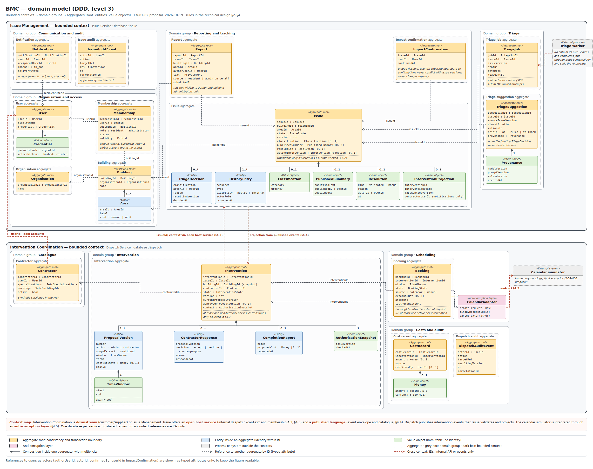
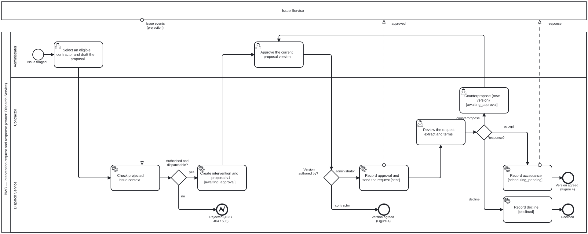
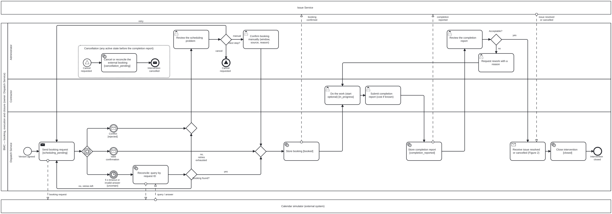

# Technical Design

**Status:** proposed conceptual design · Sprint 1, deliverable 7 · domain model, state rules and contract outlines reviewed in EN-01-02 · units, messaging, identity and deployment revised on 2026-10-27 to the EN-01-01 proposal ([ADR-001–010](adr/README.md), team review pending) · executable contracts pending

## 1. Context and boundaries

Residents, administrators, contractors and platform staff use a proposed responsive web client. Requests enter through one edge (Traefik); the backend coordinates issues and interventions, sends notifications, asks a separate AI triage service for suggestions and integrates an external calendar simulator. Everything below is the EN-01-01 proposal of 2026-10-27 ([ADR-001](adr/ADR-001-backend-boundaries.md)); nothing is built.

| Proposed unit | Responsibility / data it controls | Communication |
|---|---|---|
| Client | Forms, queues, states and corrections; no authority over permissions. React + Vite static files served by nginx ([ADR-002](adr/ADR-002-technology-stack.md)) | REST through Traefik (`/api/issue/*`, `/api/dispatch/*`, `/api/notifications/*`) with the edge session cookie |
| Issue service | Organisations, buildings, areas, user profiles keyed by Keycloak `sub` (no credentials), memberships, invitations, reports, attachment metadata, issues, triage suggestions and decisions, summaries, impact confirmations, history and audit; decides notification recipients for issue-side events and for the Dispatch events it projects | REST; publishes and consumes events through RabbitMQ (`issue.inbox`); object storage for attachments |
| Dispatch service | Contractors and contractor registrations, interventions, proposal versions, responses, bookings, completion reports, costs, audit, calendar adapter and contractor matching rules (rules, not AI); read projections of building administrators and issue dispatchability (4.3) | REST; events through RabbitMQ (`dispatch.inbox`); HTTP to the calendar simulator |
| Notification service | In-app inbox, per-user preferences (event type × channel) and delivery log; `NotificationFacade` with in-app and email channel adapters ([ADR-007](adr/ADR-007-notification-service.md)) | Consumes `NotificationRequested` (`notification.inbox`); serves `GET /notifications`; SMTP (Mailpit in dev/demo); Keycloak Admin API for addresses at send time |
| AI triage service | Stateless; consumes `TriageRequested`, calls the AI provider through a triage facade with a rules fallback and publishes `TriageSuggested` ([ADR-008](adr/ADR-008-ai-triage-service.md)) | Queue `ai-triage.requests`; internal `POST /classify` for the AI-01 evaluation only, never routed by Traefik |
| RabbitMQ | Topic exchange `bmc.events`, one quorum queue per consuming service and a dead-letter queue for each ([ADR-003](adr/ADR-003-asynchronous-messaging-rabbitmq.md)); holds messages in transit, not business records | AMQP with one broker credential per service |
| Edge and identity: Traefik, oauth2-proxy, Keycloak | Traefik is the only exposed container; oauth2-proxy holds the browser session (Backend-for-Frontend) and passes the access token upstream; Keycloak owns accounts, credentials, login, email verification and coarse realm roles (`user`, `platform_staff`) ([ADR-005](adr/ADR-005-authentication-authorisation.md)) | ForwardAuth; OIDC |
| MySQL 8.4 | Databases `issue`, `dispatch`, `notification` and `keycloak`, one user each | Each service reaches only its own database |
| Object storage (Garage) | Report photos (US-14 proposal) and off-host database backups ([ADR-010](adr/ADR-010-object-storage.md)) | S3 subset through Issue's storage port; never routed by Traefik |
| Calendar simulator | Separate small Spring Boot app: simulated bookings in memory from a fixed seed, failure scenarios ([ADR-006](adr/ADR-006-calendar-simulator.md)) | External contract with reference and idempotency key (4.5); scenario control on the internal network only |

Issue and Dispatch are the **two proposed independently deployable backend components** required by §6.2. The Notification and AI triage services are further deployables, one per bounded context; the calendar simulator stands for the external system (§6.5) and is not counted as a business component. Inside each service, commands and queries are separate packages over the same database (no separate read store), in hexagonal layers ([ADR-009](adr/ADR-009-service-internal-architecture.md)).

Services communicate **only through RabbitMQ**: there are no synchronous calls between services (4.2). Calls from a service to a platform component (Keycloak, object storage, SMTP) or to the external calendar are not service-to-service calls.

One MySQL instance hosts separate databases with one user each in the academic environment; this does not authorise cross-writing. Make the shared operational dependency and compatible migrations explicit. Technology, messaging, deployment and identity are proposed in EN-01-01 (#15) and not yet accepted.

## 2. Domain model and data ownership

Reviewed on 2026-10-19 for EN-01-02 ([Issue: 14](https://github.com/Phenriquerafael/LABDSOF_G9A/issues/14)) against journeys J1–J3 and the distinct steps in [vision 3–4.3](04-product-vision.md#3-journeys-and-responsibilities). Ownership follows the boundaries proposed in ADR-001.

*Figure 1 — Domain model, DDD level 3 ([editable HTML source](diagrams/domain-model.html); open the image for full size).* Each bounded context is one service with its own database. Domain groups collect related aggregates. A dashed frame is an aggregate, the consistency and transaction boundary: one root (yellow) plus its entities (blue) and value objects (green). Other aggregates are referenced by typed IDs only (grey dashed arrows); red arrows are the cross-context relations: IDs, the internal API (§4.3) or published events (§4.4), never shared tables. Two choices are deliberate. `ImpactConfirmation` and `TriageSuggestion` are separate aggregates, so concurrent confirmations and late AI results never conflict with the `Issue` version. `Booking` is separate from `Intervention`, so calendar retries and reconciliation do not lock the intervention. The tables below list the same entities with their journeys. Three figure names have no row of their own: `InterventionProjection` is the issue's projection of the active intervention (2.1), `AuthorisationSnapshot` is the snapshot stored by Dispatch (4.3 step 4), and `CalendarAdapter` is the calendar adapter (4.5). The figure predates the 2026-10-27 revision of EN-01-01 and has not been redrawn; where they differ, the tables win. In the figure, `User` still holds credentials, Issue still has a triage job and the `Notification` entity, and the cross-context arrows include the removed internal API; it has no `Invitation`, `Attachment`, contractor registration or Dispatch projections, and no Notification service.

### 2.1 Issue Service

| Entity | Key fields and relationships | Journey / notes |
|---|---|---|
| Organisation | `id`, name; 1:N buildings | Can represent a property management company |
| Building | `id`, `organisationId`, name, areas; the authorisation scope | J1–J3 |
| Area | `id`, `buildingId`, label, kind (common area or unit reference) | J1 step 1; reports about private units remain an open question in [requirements](requirements.md#open-decisions) |
| User | `id` = Keycloak `sub`, display name; no credentials, password or email verification state ([ADR-005](adr/ADR-005-authentication-authorisation.md)) | A profile only: Keycloak owns the account. A global account grants no access by itself |
| Membership | `userId`, `buildingId`, role (`resident` or `administrator`), status, validity; unique per user, building and role | Users N:M buildings. Granting and revoking publish `MembershipGranted` / `MembershipRevoked` for Dispatch's projection (4.3). Contractors are not building members (see Dispatch). Whether the membership keeps the unit from the invitation is open (8) |
| Invitation | `id`, `buildingId`, unit (`areaId` of kind unit reference), role `resident`, invitee email address, hashed single-use token, `expiresAt` (7 days), status (`pending`, `accepted`, `expired`), creator, accepting `sub`, times | **Proposed addition** (EN-01-01, 2026-10-27) for the DISC-03-06 workflows 1–2; needs a DEC entry (EN01-U11). Only the hash is stored; the raw token exists only in the invitation link. Address retention is open in DEC-07 |
| Attachment | `id`, `reportId`, `issueId`, `buildingId`, random object key, verified content type, size, uploader, time | **Proposed addition** for US-14 (Should, pending a DEC entry). The file is in object storage with EXIF/GPS stripped; visibility equals the private report text ([ADR-010](adr/ADR-010-object-storage.md)) |
| Report | `id`, `issueId`, `buildingId`, `areaId`, `authorUserId`, private text, source (`resident` or `administrator_on_behalf`), `submittedAt` | J1 steps 1–2; raw text stays private ([access matrix](09-security-privacy.md#2-proposed-access-matrix)) |
| Issue | `id`, `buildingId`, `areaId`, state, `version`, category, urgency, triage source, optional published summary, resolution (kind, reason, actor, time), projection of the active intervention (`interventionId`, state, last applied `aggregateVersion`, `contractorUserId` used only to address notifications) | 1:N reports; J1 step 4, J2 |
| Triage suggestion | `issueId`, source issue version, category, urgency, rationale, origin (`ai`, `rules` or `fallback`), model/prompt/rules versions, time | Recorded from `TriageSuggested` (4.4). Labelled unverified until a triage decision has been made ([AI Responsibility Section: 2](06-responsible-ai-assessment.md#2-baseline-and-fallback)). The 2026-10-15 triage job entity is removed: RabbitMQ is the queue ([ADR-003](adr/ADR-003-asynchronous-messaging-rabbitmq.md)) |
| Triage decision | `issueId`, category, urgency, actor, reason, resulting version, time | The [DEC-10](planning/decisions-and-feedback.md#1-open-decisions) “triage decision”; distinct from the suggestion |
| Impact confirmation | Unique (`issueId`, `userId`), time; withdrawal deletes the row | J1 step 4; never changes urgency (RF-04) |
| Issue history entry | `issueId`, sequence, type, visibility (`public` or `internal`), actor role, time; includes projected Dispatch events | J1 step 4 and J2; residents see only public entries |
| Audit event | Actor, action, target, resulting version, time, `correlationId`; no free text | [T-10](09-security-privacy.md) |

Issue decides who is notified about issue-side events and about the Dispatch events it projects, and publishes `NotificationRequested`; the notifications themselves belong to the Notification service (2.3). Contractor recipients come from the `contractorUserId` in Dispatch events (4.4).

### 2.2 Dispatch Service

| Entity | Key fields and relationships | Journey / notes |
|---|---|---|
| Contractor registration | `id`, registrant `sub`, company/display name, specialisations, coverage, status (`pending` → `validated`), validating `platform_staff` `sub`, times | **Proposed addition** (EN-01-01, 2026-10-27) for DISC-03-06 workflow 9; needs a DEC entry (EN01-U11). Validation creates or activates the Contractor. Rejection and profile data for matching are open (8) |
| Contractor | `id`, `userId` (Keycloak `sub` of the contractor's account), specialisations, coverage (building IDs), active flag | Synthetic catalogue [US-06](05-product-backlog.md); the `userId` link is how a contractor's login maps to assignments |
| Intervention | `id`, `issueId`, `buildingId` (snapshot taken from the issue projection at creation, 4.3), `contractorId`, state, `version`, current and approved proposal versions | Issue 0:N interventions; at most one non-terminal intervention per issue |
| Proposal version | `interventionId`, version number, author (`administrator` or `contractor`), sanitised scope extract, proposed window, terms, optional cost estimate, status | A counterproposal is a new version [DEC-10](planning/decisions-and-feedback.md#1-open-decisions). The extract is written by the administrator; raw report text is never copied |
| Contractor response | `interventionId`, proposal version, decision (`accept`, `decline`, `counterpropose`), reason, time | The [DEC-10](planning/decisions-and-feedback.md#1-open-decisions) “acceptance” |
| Booking | `id` (also the external request ID), `interventionId`, window, state, source (`calendar` or `manual`), external reference, attempts, last reconciliation time | Intervention 0:N bookings, at most one active; the [DEC-10](planning/decisions-and-feedback.md#1-open-decisions) “booking confirmation” |
| Completion report | `interventionId`, notes, optional proposed cost, time | The DEC-10 “completion report”; does not close the issue |
| Cost record | `interventionId`, amount ≥ 0 or empty, currency, source, confirming actor; corrections audited | US-11 [Should](requirements.md) |
| Audit event | As in Issue, for Dispatch actions | [T-10](09-security-privacy.md) |

Dispatch also keeps two **read projections**, written only by its event consumers and never by requests ([Section: 4.3](#43-how-dispatch-obtains-trustworthy-authorisation-context)):

| Projection | Fields | Fed by |
|---|---|---|
| Building administrators | `userId`, `buildingId`, role, active flag, last applied event and time | `MembershipGranted`, `MembershipRevoked` |
| Issue dispatchability | `issueId`, `buildingId`, state, version, `dispatchable`, category, urgency, area label, published-summary reference (never raw text), last applied time | `IssueStateChanged` |

Issue remains the authority for both; a projection is a copy that may lag.

### 2.3 Notification Service

| Entity | Key fields and relationships | Journey / notes |
|---|---|---|
| Notification | `id`, recipient `userId`, `templateKey`, params, priority, `sourceEventId`, time | The in-app inbox, read through `GET /notifications` ([US-10](05-product-backlog.md)). Params carry identifiers and labels, never private text |
| Preference | `userId`, event type, channel, enabled | Residents can switch email off per event type; the in-app channel is always on ([ADR-007](adr/ADR-007-notification-service.md)). Which notifications cannot be switched off is open (EN01-U8) |
| Delivery log entry | Unique (`notificationId`, `recipientUserId`, channel), state (`pending`, `sent`, `failed`, `skipped_by_preference`), attempts | Idempotency for redelivered `NotificationRequested`. Invitation deliveries store neither the address nor the link |

The channel baseline is in-app and email (Mailpit in dev/demo), as proposed for [DEC-06](planning/decisions-and-feedback.md#1-open-decisions) on 2026-10-27. Email addresses are not stored: they are looked up in Keycloak by `sub` at send time, except for invitations (4.4).

Issue, Dispatch and Notification also hold technical tables for the asynchronous workflow (outbox, processed event IDs, idempotency keys); see [Section: 5](#5-asynchronous-workflow-and-consistency). The AI triage service holds no database.

### 2.4 Cardinalities and ownership rules

- Organisation 1:N buildings; building 1:N areas; users N:M buildings through memberships; issue 1:N reports, 0:N interventions (at most one non-terminal); report 0:N attachments (at most 5, US-14 proposal); building 0:N invitations; intervention 1:N proposal versions and 0:N bookings (at most one active).

- References across services are IDs only. No service reads or writes another's database; Issue's state reflects Dispatch only through events that Issue validates and applies to its own data ([Section: 3.3](#33-invalid-and-concurrent-transitions), [Section: 4.4](#44-event-contracts)).

- `buildingId` never changes for an issue, so Dispatch may keep it as a snapshot for filtering and audit. Administrator memberships and issue dispatchability are copied into Dispatch's read projections from Issue's events; Dispatch never changes them, and Issue stays the single writer of memberships and issues ([Section: 4.3](#43-how-dispatch-obtains-trustworthy-authorisation-context)).

- Accounts and credentials belong to Keycloak; services keep only `sub` and profile data. Attachment files belong to object storage, written only by Issue.

Changes from the previous draft, found in the journey review: areas made explicit (J1 step 1); a contractor-to-account link added so J3 assignment can be checked; proposal versions separated from the intervention (J3 step 2); triage decision separated from triage suggestion and completion report from cost record [DEC-10](planning/decisions-and-feedback.md#1-open-decisions); issue history made a projection that includes Dispatch events. Changes in the EN-01-01 revision of 2026-10-27: credentials moved out of `User`; the triage job removed; notifications moved to their own service; invitations, attachments and contractor registrations proposed; memberships projected into Dispatch.

## 3. States and business rules

The rules below implement the step definitions in [Product Vision Section 4.3](04-product-vision.md#43-distinct-steps-dec-10). They are proposals for DEC-10 and still need validation with administrators and contractors.

### 3.1 Issue states (owner: Issue)

The figures in this section are BPMN 2.0 collaboration diagrams. Lanes show who acts. A state in brackets, such as `[triaged]`, is the state the issue or intervention enters at that step. Services that are not the owner are drawn as collapsed pools; dashed message flows are the events and calls in [§4](#4-api-and-contract-outline-no-executable-contract-yet). Link events (arrow circles) join paths that would otherwise cross the whole figure. The transition tables are the normative rules; the figures illustrate them. The `.bpmn` sources open in [bpmn.io](https://demo.bpmn.io/) (accessed 2026-10-25) or Camunda Modeler; re-export the SVG after editing.

*Figure 2 — Issue lifecycle ([BPMN source](diagrams/issue-lifecycle.bpmn)).* The event-based gateway waits for the next Dispatch event: booking confirmed or work started loops back, a decline or cancellation returns the issue to coordination, and a completion report goes to validation. The event sub-process covers manual closure or cancellation from any open state. The figure predates the 2026-10-27 revision: its triage worker pool is now the AI triage service, reached through `TriageRequested` and `TriageSuggested` (4.4).

| From | Trigger | Actor | To | Rule |
|---|---|---|---|---|
| — | `POST /reports` | Resident member, or administrator on behalf | `received` | Report, issue and outbox rows (`ReportSubmitted`, `TriageRequested`) in one transaction; never waits for AI or the broker |
| `received` | `TriageSuggested` (origin `ai`, `rules` or `fallback`) | AI triage service, through the `issue.inbox` queue | `in_triage` | Ignored if the issue version has moved on |
| `received`, `in_triage`, `triaged` | Triage decision | Building administrator | `triaged` | Records actor, reason and new version; manual triage works without a suggestion |
| `triaged` | `InterventionApproved` event | Dispatch | `in_coordination` | Only when the event's `issueId` and `buildingId` match the issue |
| `in_coordination`, `scheduled`, `in_progress` | `InterventionDeclined` or `InterventionCancelled` | Dispatch | `triaged` | Visible “needs a contractor” status; manual coordination remains possible. While Dispatch reports `InterventionCancellationPending`, the state is kept and history shows the pending cancellation |
| `in_coordination` | `BookingConfirmed` (external or manual) | Dispatch | `scheduled` | Manual confirmation is shown as manual, never as synchronised |
| `scheduled` | `InterventionStarted` | Dispatch | `in_progress` | — |
| `scheduled`, `in_progress` | `CompletionReported` | Dispatch | `awaiting_validation` | Not a closure |
| `awaiting_validation` | `ReworkRequested` | Dispatch | `in_progress` | Reason required (in Dispatch) |
| `awaiting_validation` | `POST /issues/{id}/closure` with kind `validated` | Building administrator | `resolved` | Unknown cost does not block closure |
| Any open state | `POST /issues/{id}/closure` with kind `manual` | Building administrator | `resolved` | Justification required; an active intervention is cancelled through `IssueResolved` |
| Any open state | `POST /issues/{id}/cancellation` | Building administrator | `cancelled` | Reason required (for example duplicate or not actionable); same propagation |
| `resolved` | `POST /issues/{id}/reopening` | Building administrator | `in_triage` | Reason required; earlier interventions stay closed in history; a new intervention is needed |

Rows triggered by Dispatch events describe the normal order. When an event is late, duplicated or missing, Issue derives the state from the event's `interventionState` instead (3.3, “Applying Dispatch events”).

“Open” means every state except `resolved` and `cancelled`. `cancelled` is terminal in this proposal: reopening it is rejected and a new report is created instead (to validate in DEC-10). The impact counter and notifications never change state.

### 3.2 Intervention states (owner: Dispatch)

*Figure 3 — Request, approval and response ([BPMN source](diagrams/intervention-request.bpmn)).* Dispatch checks its projection of the Issue context before creating anything (§4.3). A counterproposal returns to approval, and approving a contractor-authored version leads straight to booking. A change of terms by the administrator before the response (`POST …/proposals`) is not drawn.

*Figure 4 — Booking, execution and closure ([BPMN source](diagrams/intervention-booking.bpmn)).* The booking outcomes and reconciliation follow §4.5: a timeout or invalid answer is reconciled before any re-send, and a conflict or exhausted retries go to the administrator. The cancellation event sub-process applies in any active state before the completion report. The `discrepancy` case from §4.5 is not drawn.

| From | Command or event | Actor | To | Rule |
|---|---|---|---|---|
| — | `POST /interventions` | Building administrator | `awaiting_approval` | Dispatch's issue projection says the issue is dispatchable (`triaged` or `in_coordination`) and has no other non-terminal intervention; contractor eligible (US-06); creates proposal version 1. Selection sends nothing |
| `awaiting_approval` | `POST …/approval` for the current version | Building administrator | `sent`, or `scheduling_pending` if the version was authored by the contractor | Approves exactly one version. Approving a contractor's counterproposal records that version as the agreed terms, so the counterproposal counts as the contractor's acceptance; the booking request starts |
| `awaiting_approval`, `sent` | `POST …/proposals` (changed terms) | Building administrator | `awaiting_approval` | New version; any earlier approval is invalidated (US-07) |
| `sent` | `POST …/response` `accept` for the approved version | Assigned contractor | `scheduling_pending` | Records acceptance; Dispatch creates the booking request asynchronously (4.5) |
| `sent` | `POST …/response` `counterpropose` | Assigned contractor | `awaiting_approval` | New version authored by the contractor; needs new approval |
| `sent` | `POST …/response` `decline` | Assigned contractor | `declined` | Terminal; the administrator may create another intervention |
| `scheduling_pending` | Calendar outcome `confirmed`, or `POST …/manual-confirmation` | Calendar adapter, or building administrator | `booked` | Manual confirmation needs window, source and reason, and suspends automatic creation until reconciliation (4.5) |
| `scheduling_pending` | Calendar conflict, invalid data or exhausted retries | Calendar adapter | `scheduling_pending` | Booking marked `rejected`, `failed` or `uncertain` with the reason visible; the administrator retries, confirms manually or cancels |
| `booked` | `POST …/start` | Assigned contractor | `in_progress` | Optional step; completion may follow `booked` directly |
| `booked`, `in_progress` | `POST …/completion` | Assigned contractor, or administrator with a reason | `completion_reported` | Optional proposed cost |
| `completion_reported` | `POST …/rework` | Building administrator | `in_progress` | Reason required |
| `completion_reported` | `IssueResolved` or `IssueCancelled` event | Issue | `closed` | Terminal |
| `awaiting_approval`, `sent` | `POST …/cancellation`, or `IssueResolved` / `IssueCancelled` events | Building administrator, or Issue | `cancelled` | Reason recorded; the contractor is notified if the request was sent |
| `scheduling_pending`, `booked`, `in_progress` | Same | Same | `cancellation_pending` → `cancelled` | If a booking exists or may exist (request in flight or uncertain), Dispatch cancels or reconciles it first; the pending state stays visible until then |

Rescheduling after a booking confirmation is outside this baseline. Manual booking confirmation applies only to a pending booking (`scheduling_pending`); to move a confirmed booking, the administrator cancels the intervention and creates a new one. There is no “change booking” operation. A dedicated rescheduling flow remains open in DEC-10. A contractor cannot cancel through the platform after acceptance; they contact the administrator (to validate, Q9).

### 3.3 Invalid and concurrent transitions

The tables in 3.1 and 3.2 are allow-lists. Anything not listed is rejected without side effects.

| Rule | Behaviour |
|---|---|
| Transition not allowed from the current state | `409` with code `INVALID_TRANSITION` and the current state |
| Stale version | Every state-changing command sends the version it was based on (`If-Match`); a mismatch returns `409` `VERSION_CONFLICT` with the current version and changes nothing |
| Wrong actor | `403`, or `404` when the resource is outside the actor's scope (no enumeration) |
| Repeated command | Same `Idempotency-Key` and same body returns the original result with no new effect; same key with a different body returns `422` `IDEMPOTENCY_KEY_REUSED` (4.1) |
| Duplicate event | Receiver records `eventId` in the same transaction as the effect; a duplicate is acknowledged with no effect |
| Older or missing event | Issue applies a Dispatch event only if its `aggregateVersion` is greater than the last one applied for that intervention; an older one goes into history only. Events carry the full new intervention state, and the issue state is derived from it (table below), so a late or missing intermediate event cannot leave the issue behind |
| Late AI result | A suggestion based on an older issue version, or arriving after a triage decision, is stored but does not change category, urgency or state |

**Applying Dispatch events.** The broker does not guarantee order across retries and redeliveries, so Issue does not depend on receiving every event in sequence. For an open issue whose `issueId` and `buildingId` match, an event with a newer `aggregateVersion` sets the issue state from the event's `interventionState`:

| `interventionState` in the event | Issue state |
|---|---|
| `awaiting_approval`, `sent`, `scheduling_pending` | `in_coordination` |
| `booked` | `scheduled` |
| `in_progress` | `in_progress` |
| `completion_reported` | `awaiting_validation` |
| `declined`, `cancelled` | `triaged` |
| `cancellation_pending`, `closed` | Unchanged; history shows the pending cancellation or the closure |

The event must belong to the active intervention in Issue's projection, or the issue must be `triaged` with no active intervention, in which case the event's intervention becomes the active one. `declined` and `cancelled` clear the active intervention, so the issue is `triaged` with none and the next intervention can become active; events for an earlier, terminal intervention go into history only. Events for a `resolved` or `cancelled` issue go into history only, because Dispatch is already cancelling or closing the intervention (`IssueResolved`, `IssueCancelled`). Anything else (for example an event for a second non-terminal intervention, or for an issue still in `received` or `in_triage`) becomes a `failed` row for inspection. For example, if `BookingConfirmed` (version 4) arrives before `InterventionApproved` (version 2), the issue moves from `triaged` to `scheduled`, and the late version 2 is stored in history only.

Representative races and their outcomes:

| Race | Outcome |
|---|---|
| Two administrators approve the same version at the same time | One transaction wins; the other receives `409` `VERSION_CONFLICT` (or the original result if it reused the same idempotency key). One request is sent |
| Administrator changes the terms (new version) while the contractor accepts the previous version | If the acceptance commits first, the change of terms fails with `409` `INVALID_TRANSITION` (already `scheduling_pending`); if the new version commits first, the acceptance fails with `409` `VERSION_CONFLICT` |
| Contractor accepts while the administrator cancels | Whichever commits first wins; the other gets `409` `INVALID_TRANSITION`. If cancellation wins, no booking request is created |
| Completion report arrives while cancellation is pending | Rejected with `409`; the cancellation completes first |
| Administrator closes the issue manually while Dispatch is booking | Issue commits `resolved` and emits `IssueResolved`; Dispatch moves the intervention to `cancellation_pending` and cancels or reconciles the booking. Issue history shows the cancellation as pending until Dispatch reports it |
| Validated closure attempted before `CompletionReported` reaches Issue | Rejected with `409` (issue not yet `awaiting_validation`); the UI shows the last update time (eventual consistency) |
| Manual booking confirmation while an automatic request is uncertain | Manual confirmation is stored; automatic re-sending stops; reconciliation runs, and if it finds an external booking the discrepancy is shown to the administrator. It is never shown as a second booking |

## 4. API and contract outline (no executable contract yet)

The [access matrix](09-security-privacy.md#2-proposed-access-matrix) defines policy; the tables below apply it to operations. Functional criteria remain in the [backlog](05-product-backlog.md#4-stories-and-criteria). Request, response, event and error examples for the principal journey and a walkthrough of failure and denied-access scenarios are in the [contract examples annex](07a-contract-examples.md). The executable OpenAPI is produced with the implementation; this outline is not production-complete (excluded by EN-01-02).

### 4.1 Conventions

| Topic | Proposal |
|---|---|
| Identifiers | UUIDv7 strings generated by the owning service ([RFC 9562](https://www.rfc-editor.org/rfc/rfc9562), §5.7, accessed 2026-10-25); opaque to clients, never sequential integers |
| Time | RFC 3339 timestamps in UTC |
| Versions | Integer `version` per aggregate (issue, intervention), returned as `ETag` and sent back as `If-Match` |
| Idempotency | `Idempotency-Key` header on every effectful `POST`, scoped per actor and operation, kept for 24 h. The header name follows the IETF draft [draft-ietf-httpapi-idempotency-key-header](https://datatracker.ietf.org/doc/draft-ietf-httpapi-idempotency-key-header/) (version 08 of 2026-10-22, an active Internet-Draft and not an RFC; accessed 2026-10-25); the replay and reuse rules in 3.3 are this project's own |
| Errors | `application/problem+json` ([RFC 9457](https://www.rfc-editor.org/rfc/rfc9457), accessed 2026-10-25) with extension members `code`, `correlationId` and, where relevant, `currentState` and `currentVersion`. Error bodies never include private text |
| Status codes | `400` validation; `401` unauthenticated; `403` forbidden; `404` unknown or outside scope; `409` `VERSION_CONFLICT` or `INVALID_TRANSITION`; `422` `IDEMPOTENCY_KEY_REUSED` or semantic rule; `503` `DEPENDENCY_UNAVAILABLE` (the service's own database, or object storage for attachments). The broker being down never causes an error: events wait in the outbox (5). No success is returned unless the change is persisted |
| Authentication | The browser holds only the oauth2-proxy session cookie (httpOnly, Secure, SameSite=Strict); oauth2-proxy passes `Authorization: Bearer <access token>` upstream, and every service validates the token itself and authorises every operation ([ADR-005](adr/ADR-005-authentication-authorisation.md)). API routes answer `401` instead of redirecting; the client then navigates to `/oauth2/start`. State-changing requests also carry a required custom header against CSRF (name open, EN01-U6) |
| Routing | Paths below are relative to each service's base path; the edge routes `/api/issue/*`, `/api/dispatch/*` and `/api/notifications/*` ([ADR-004](adr/ADR-004-deployment-contract.md)). Internal endpoints (health, metrics, `POST /classify`) are never routed |
| Correlation | `X-Correlation-Id` accepted at the edge, or generated by the first service when absent (Traefik has no built-in request-ID generator, E36 in the [evidence register](adr/README.md#evidence-register-en-01-01)), returned in responses and copied into events with the W3C `traceparent` as the CloudEvents extensions `correlationid` and `traceparent` (4.4) |
| Messages | CloudEvents 1.0 structured JSON (E43) on RabbitMQ; `data` uses the proto3 JSON mapping of the `.proto` schemas in `contracts/proto/`, described for channels in an AsyncAPI 3 document ([ADR-003](adr/ADR-003-asynchronous-messaging-rabbitmq.md)) |

### 4.2 Operations

| Operation | Service | Actor | Result |
|---|---|---|---|
| `GET /me` | Issue | Any authenticated user | Own profile (keyed by `sub`) and memberships; the client loads its session from it and goes to `/oauth2/start` on `401` |
| `POST /condominium-registrations` | Issue | Any authenticated user | Organisation, first building and the caller's `administrator` membership in one transaction; publishes `MembershipGranted` (workflow 1; proposed addition, DEC entry pending) |
| `POST /buildings/{id}/invitations` | Issue | Building administrator | Unit and invitee email; stores the token hash with a 7-day expiry and publishes `NotificationRequested` with the link (invitation exception, 4.4) |
| `POST /invitations/{token}/acceptance` | Issue | Any authenticated user with the link | Valid, unused, unexpired token: `resident` membership for the caller's `sub`, invitation `accepted`, `MembershipGranted`. Unknown, used or expired: nothing changes and the user is told to ask for a new invitation (workflow 2) |
| `POST /reports` | Issue | Resident member; administrator on behalf (source recorded) | `201` with report and issue IDs and state `received` after persistence |
| `POST /reports/{id}/attachments` | Issue | Report author; administrator who submitted on behalf | Multipart; at most 5 photos of 5 MB; JPEG, PNG or WebP verified by content; EXIF/GPS stripped before storage; random object key. Storage down: `503`, the report is unaffected (US-14 proposal, Should) |
| `GET /attachments/{id}` | Issue | Report author; building administrators | Same visibility as the private report text; `404` otherwise. Not in the contractor extract (US-14 proposal) |
| `GET /issues`, `GET /issues/{id}`, `GET /issues/{id}/history` | Issue | Building members per matrix | Filtered by membership; role-specific projection (residents: public history only). Contractors are not members and read their assignments only through Dispatch (`GET /interventions?assigned=me`) |
| `POST /issues/{id}/triage` | Issue | Building administrator | Category, urgency and reason; `If-Match` |
| `POST /issues/{id}/publication` | Issue | Building administrator | Sanitised summary visible to the same building |
| `PUT` / `DELETE /issues/{id}/impact` | Issue | Resident of the building | One contribution per user; count only, no identities |
| `POST /issues/{id}/associations` | Issue | Building administrator | Audited link or reversal (US-05, Should) |
| `POST /issues/{id}/closure` | Issue | Building administrator | Kind `validated` or `manual` (with justification); `If-Match` |
| `POST /issues/{id}/cancellation` | Issue | Building administrator | Reason; `If-Match` |
| `POST /issues/{id}/reopening` | Issue | Building administrator | Reason; `If-Match` |
| `POST /contractor-registrations` | Dispatch | Any authenticated user | Company/display name, specialisations, coverage; state `pending` (workflow 9; proposed addition, DEC entry pending) |
| `GET /contractor-registrations?status=pending`, `POST /contractor-registrations/{id}/validation` | Dispatch | `platform_staff` (Keycloak realm role) | Validation creates or activates the contractor linked to the registrant's `sub` |
| `GET /contractors?issueId=` | Dispatch | Building administrator | Eligible contractors with the criteria used; unknown data not invented |
| `POST /interventions` | Dispatch | Building administrator | Contractor, scope extract, window, terms; state `awaiting_approval` |
| `GET /interventions?issueId=`, `GET /interventions?assigned=me`, `GET /interventions/{id}` | Dispatch | Building administrator; assigned contractor | Contractors see only their assignments and the extract |
| `POST /interventions/{id}/proposals` | Dispatch | Building administrator | New version with changed terms |
| `POST /interventions/{id}/approval` | Dispatch | Building administrator | Approves a named `proposalVersion`; `If-Match`; idempotent |
| `POST /interventions/{id}/response` | Dispatch | Assigned contractor | `accept`, `decline` or `counterpropose` for a named version |
| `POST /interventions/{id}/manual-confirmation` | Dispatch | Building administrator | Window, source and reason; booking source `manual` |
| `POST /interventions/{id}/start` | Dispatch | Assigned contractor | Work started |
| `POST /interventions/{id}/completion` | Dispatch | Assigned contractor; administrator with a reason | Completion report, optional proposed cost |
| `POST /interventions/{id}/rework` | Dispatch | Building administrator | Reason |
| `POST /interventions/{id}/cancellation` | Dispatch | Building administrator | Reason; may answer with `cancellation_pending` |
| `PUT /interventions/{id}/cost` | Dispatch | Building administrator confirms; contractor proposes | Audited correction (US-11, Should) |
| `GET /notifications` | Notification | Any authenticated user | Own notifications only |
| `GET` / `PUT /preferences` | Notification | Any authenticated user | Own preferences per event type and channel; email can be switched off ([ADR-007](adr/ADR-007-notification-service.md)) |

There are **no internal HTTP endpoints between services**. The 2026-10-15/EN-01-02 operations `POST /internal/triage-jobs/claim`, `POST /internal/triage-jobs/{id}/complete`, `GET /internal/issues/{id}/dispatch-context`, `GET /internal/users/{id}/memberships` and `POST /internal/events` are removed ([ADR-003](adr/ADR-003-asynchronous-messaging-rabbitmq.md)). Services exchange messages on the topic exchange `bmc.events` with routing key `<producer>.<eventType>`:

| Queue (quorum) | Consumer | Bound routing keys | Purpose |
|---|---|---|---|
| `issue.inbox` | Issue | `dispatch.*` intervention and booking events (4.4); `ai-triage.TriageSuggested` | Apply Dispatch events by version (3.3); record suggestions |
| `dispatch.inbox` | Dispatch | `issue.IssueStateChanged`, `issue.MembershipGranted`, `issue.MembershipRevoked`, `issue.IssueResolved`, `issue.IssueCancelled` | Update projections (4.3); cancel or close interventions |
| `notification.inbox` | Notification | `issue.NotificationRequested`, `dispatch.NotificationRequested` | Deliver through the enabled channels |
| `ai-triage.requests` | AI triage | `issue.TriageRequested` only | Classify; reply with `TriageSuggested` |

Each queue has `x-delivery-limit` 5 and dead-letters through `bmc.dlx` to `<queue>.dlq` (4.6). Each service connects with its own broker credential, allowed to publish to `bmc.events` and to read only its own queue (EN01-U6). Exact binding patterns are fixed in the AsyncAPI document.

### 4.3 How Dispatch obtains trustworthy authorisation context

Dispatch must know that the caller administers the issue's building and that the issue can be dispatched, without reading or writing Issue's data and without calling Issue. The 2026-10-27 revision replaces the per-command call of EN-01-02 with read projections fed by Issue's events ([ADR-001](adr/ADR-001-backend-boundaries.md)).

1. **Identity.** Dispatch validates the access token as an OAuth2 resource server (issuer, audience, expiry, Keycloak's signing keys; [ADR-005](adr/ADR-005-authentication-authorisation.md)) and takes only `sub` from it. Roles, building IDs or issue states sent by the client are never used as authority; tokens carry no building roles.
2. **Contractor commands** are authorised from Dispatch's own data: the intervention's `contractorId` must map to a contractor whose `userId` equals `sub` and who is active. Contractor registration validation needs the realm role `platform_staff` from the token.
3. **Administrator commands** are authorised against Dispatch's projections (2.2): the administrator projection must hold an active `administrator` membership of `sub` for the issue's building, and the issue projection must hold the issue with its `buildingId`, state and version; creation also needs `dispatchable`. The projections are fed only by `MembershipGranted`, `MembershipRevoked` and `IssueStateChanged`, applied by version; no request writes them and no call to Issue is made.
4. **Snapshot.** Dispatch stores `buildingId`, the projected issue version and the time of the projection entry used for the check on the intervention, in its own database, for audit and filtering. Every administrator write checks the projection again, so a revoked membership takes effect as soon as `MembershipRevoked` has been applied.
5. **Reads.** Administrator lists are filtered by the building IDs in the administrator projection. There is no separate cache.
6. **Missing data and freshness.** A missing projection row is a denial: no membership, or an issue unknown to the projection, answers `404` (no enumeration); a known issue that is not dispatchable answers `409` `INVALID_TRANSITION` with the projected state. Client data never fills a gap. If Dispatch's own database is unavailable, commands return `503` `DEPENDENCY_UNAVAILABLE`. The projection's age is exposed as a freshness metric and the UI shows “membership data as of …”. No maximum age after which administrator commands are refused is proposed; whether to add one is an EN-01-04 item (EN01-U6).
7. **Back-propagation.** Dispatch changes Issue only by emitting events. Issue checks that each event's `issueId` and `buildingId` match its own records before applying it; a mismatch becomes failed handling for inspection (the message ends in `issue.inbox.dlq`, 4.6). `IssueResolved` and `IssueCancelled` cancel or close the intervention whatever the projection says.

**Trade-off.** Revocation delay equals event propagation: normally seconds, but unbounded while Dispatch's consumer or the broker is down, and in that window a revoked administrator could still act on Dispatch. This is recorded as an EN-01-04 risk ([security T-12](09-security-privacy.md#3-threats-and-checks)); mitigations are the freshness metric, the “as of” notice, Issue's checks in step 7 and the cancelling effect of `IssueResolved` / `IssueCancelled`. In return, Dispatch keeps working, for contractors and administrators, while Issue is down, which the §6.8 degraded-mode demonstration needs (6).

Alternatives considered: a per-command call to Issue (`GET /internal/issues/{id}/dispatch-context`, with `GET /internal/users/{id}/memberships` for lists), failing closed when Issue does not answer — the EN-01-02 proposal by Afonso, now the rejected alternative: it gives immediate revocation but needs a synchronous call between services (against [ADR-001](adr/ADR-001-backend-boundaries.md)) and stops administrator commands whenever Issue is down. This revision changes his proposal and is recorded in the [decision register](planning/decisions-and-feedback.md#stack-revision--en-01-01-2026-10-27) pending his review; it does not imply that he agreed. Memberships as token claims (rejected: memberships are resolved on the server in ADR-005, and the token lifetime would delay revocation); read-only access by Dispatch to Issue's database (rejected: breaks ownership in ADR-001 and couples schemas). Open details: the revocation-delay target and any staleness limit (EN-01-04, EN01-U6); whether contractor accounts are scoped to an organisation (DEC-07).

### 4.4 Event contracts

Envelope as in [5](#5-asynchronous-workflow-and-consistency). On the wire, each event is a CloudEvents 1.0 structured JSON message (E43) published to `bmc.events` with routing key `<producer>.<eventType>`; the EN-01-02 envelope maps one-to-one ([ADR-003](adr/ADR-003-asynchronous-messaging-rabbitmq.md)):

| Envelope field | CloudEvents attribute |
|---|---|
| `eventId` | `id` |
| `eventType` | `type` |
| Producer service | `source` |
| `aggregateId` | `subject` |
| `occurredAt` | `time` |
| `schemaVersion`, `aggregateVersion`, `buildingId`, `correlationId` | Extensions `schemaversion`, `aggregateversion`, `buildingid`, `correlationid` |
| W3C trace context | Extension `traceparent` |
| Payload | `data`, in the proto3 JSON mapping of the `.proto` message |

`schemaVersion` is an integer; a receiver that does not support a major version rejects the message to its DLQ without retry instead of guessing. The rules on versions, out-of-order events and duplicates in 3.3 are unchanged. Payloads carry IDs and states, not private text; `TriageRequested` is the only exception, and `NotificationRequested` for invitations the only one with an address.

| Event | Producer | Consumers | Payload (beyond the envelope) |
|---|---|---|---|
| `ReportSubmitted` | Issue | Notification service through `NotificationRequested` | `reportId`, `issueId`, `areaId` |
| `TriageRequested` | Issue | AI triage service only (point-to-point: `issue.TriageRequested` is bound only to `ai-triage.requests`) | `issueId`, `issueVersion`, `buildingId`, `areaKind`, the report text needed for classification. Never fanned out; DLQ messages expire after 7 days; payloads never logged (DEC-07 note) |
| `TriageSuggested` | AI triage | Issue | `issueId`, `issueVersion`, category, urgency, rationale, origin (`ai`, `rules` or `fallback`), `modelVersion`, `promptVersion`, `rulesVersion`. Applied by `issueVersion`; late results as in 3.3 |
| `IssueTriaged` | Issue | Notification service through `NotificationRequested` | Category, urgency, `decisionSource` (`human`) |
| `IssueSummaryPublished` | Issue | Notification service through `NotificationRequested` | Summary ID (the text is fetched under authorisation) |
| `IssueStateChanged` | Issue | Dispatch (issue projection) | `issueId`, `buildingId`, state, version, `dispatchable`, category, urgency, area label, published-summary reference; never raw text |
| `MembershipGranted`, `MembershipRevoked` | Issue | Dispatch (administrator projection) | `userId`, `buildingId`, role |
| `IssueResolved` | Issue | Dispatch; Notification service through `NotificationRequested` | Resolution kind (`validated` or `manual`), `activeInterventionId` |
| `IssueCancelled` | Issue | Dispatch; Notification service through `NotificationRequested` | `activeInterventionId` |
| `IssueReopened` | Issue | Notification service through `NotificationRequested` | Reason code |
| `InterventionApproved` | Dispatch | Issue (projection and notification recipients) | `issueId`, `contractorUserId`, `contractorDisplayName`, approved version, `interventionState` |
| `ContractorResponded` | Dispatch | Issue | Decision, proposal version, `interventionState` |
| `InterventionDeclined`, `InterventionCancellationPending`, `InterventionCancelled` | Dispatch | Issue | Reason code, `interventionState` |
| `BookingConfirmed` | Dispatch | Issue | Window, source (`calendar` or `manual`), `interventionState` |
| `BookingStateChanged` | Dispatch | Issue | Non-confirmed booking state (`requested`, `uncertain`, `rejected`, `failed`, `discrepancy`), `interventionState` |
| `InterventionStarted`, `CompletionReported`, `ReworkRequested` | Dispatch | Issue | `interventionState`; no cost to residents |
| `NotificationRequested` | Issue or Dispatch | Notification service | `notificationId` (idempotency), `sourceEventId`, `recipientUserIds`, `templateKey`, params without private text, priority. Invitation exception: `recipientAddress` and the invite link instead of user IDs, because the invitee has no account; the DLQ TTL applies |

Every Dispatch event carries `issueId`, `buildingId` and the full new `interventionState`, with the intervention as `aggregateId`, so Issue can apply it by version (3.3). Issue decides the recipients for the Dispatch events it projects and publishes `NotificationRequested` in the same transaction. `contractorUserId` lets it address the contractor (for example when a request is sent or cancelled); it grants no read access in Issue, where contractors have no membership. Which Dispatch-driven notifications Dispatch requests directly (for example a validated contractor registration), and whether Issue events with no consumer outside Issue (`ReportSubmitted`, `IssueTriaged`, `IssueSummaryPublished`) are still published to the broker, are open for EN-01-03 ([ADR-001](adr/ADR-001-backend-boundaries.md)).

### 4.5 Calendar/simulator contract outline

The adapter in Dispatch talks to the calendar simulator, a separate Spring Boot process ([ADR-006](adr/ADR-006-calendar-simulator.md)), over HTTP through a provider-neutral port. A real calendar (US-13) must meet the same contract.

| Operation | Request | Possible outcomes |
|---|---|---|
| `POST /bookings` | `Idempotency-Key` = booking ID (stable across retries); `requestId`, `contractorRef`, window, building code, sanitised summary; no names, addresses or report text | `201` confirmed with `externalRef`; `200` replay of the same booking; `409` slot conflict; `422` invalid request; `503` unavailable; timeout |
| `GET /bookings?requestId=` | Booking ID | The booking if it exists, or an empty result; used for reconciliation |
| `POST /bookings/{externalRef}/cancellation` | `Idempotency-Key` | `200` cancelled, `404` unknown, `503`, timeout |

Dispatch treats a `2xx` answer as valid only if it echoes `requestId`, has a non-empty `externalRef` and returns the requested window. Otherwise the answer counts as invalid.

| Outcome | Booking state | Next action |
|---|---|---|
| Valid confirmation | `confirmed` (source `calendar`) | Emit `BookingConfirmed` |
| Slot conflict | `rejected` | Visible reason; administrator retries, confirms manually or cancels |
| `422` | `failed` | Contract defect: alert operators; no automatic retry |
| `503` or connection refused | `requested` | Retry with backoff (4.6) |
| Timeout, late answer or invalid `2xx` | `uncertain` | Reconcile with `GET /bookings?requestId=` before any re-send: found → `confirmed`; not found → re-send with the same key; unavailable → stay `uncertain` and retry later |
| Retries exhausted | `failed` | Intervention stays `scheduling_pending` with “needs manual action” |
| Confirmed booking missing at the provider (for example after a simulator restart) | `discrepancy` | Found by reconciliation on demand and before the booked window; shown to the administrator; never silently recreated or downgraded |

The same idempotency key makes a delayed or repeated request create at most one booking (NFR-11, T-04). A calendar slot alone does not prove contractor availability; acceptance comes first (3.2).

### 4.6 Retry, timeout and lease values (proposal)

These values answer EN-01-01's open detail EN01-U7 (#15) as a starting proposal, revised on 2026-10-27 for the broker ([ADR-003](adr/ADR-003-asynchronous-messaging-rabbitmq.md)). They will be calibrated in the spike (EN01-U2) and the first asynchronous slice, and are not measured results. The heading keeps “lease” so that existing links still work; with the triage job removed, no lease remains.

| Mechanism | Proposed value |
|---|---|
| Outbox publisher | Poll every 1 s; publisher confirms; a row is marked sent only when confirmed. While the broker is down: backoff 2 s doubling up to 5 min, without an attempt limit; rows stay `pending`, with an outbox-lag metric and alert |
| Consumer delivery | `x-delivery-limit` 5 per quorum queue, then `<queue>.dlq` (dead-letter strategy at-least-once); an unsupported `schemaversion` goes to the DLQ without retry; replay is a runbook step owned by DevOps (Martim) |
| AI call (AI triage service) | 10 s timeout per attempt (NFR-03); 2 attempts; then the rules fallback |
| Triage pending notice | No `TriageSuggested` within 2 min: Issue shows “triage pending — classify manually”; no state change |
| Calendar call | 5 s timeout; 5 attempts with backoff 5 s doubling up to 2 min, reconciling before each re-send; then booking `failed` |
| Retention | Idempotency keys 24 h; processed event IDs at least 7 days (longer than any retry window); DLQ messages expire after 7 days (`x-message-ttl`), so a replay must happen within that time |

The 2026-10-15/EN-01-02 rows for the HTTP outbox relay (10 attempts, then `failed`), the triage job lease (45 s, 3 claims) and the Dispatch → Issue context call (2 s) no longer apply.

## 5. Asynchronous workflow and consistency

1. Issue persists the report, the issue and outbox rows (`ReportSubmitted`, `TriageRequested`) in one transaction and answers `201`; the request waits neither for AI nor for the broker.
2. The outbox publisher sends pending rows to `bmc.events` with publisher confirms and marks a row sent only after the confirm. If the broker is down, rows stay `pending` and are retried (4.6); nothing is lost and the user request has already succeeded.
3. RabbitMQ routes `issue.TriageRequested` only to `ai-triage.requests`. The AI triage service validates schema version, ID and version and applies the [AI/baseline/fallback workflow](06-responsible-ai-assessment.md#2-baseline-and-fallback) with the NFR-03 timeout ([ADR-008](adr/ADR-008-ai-triage-service.md)).
4. It publishes `TriageSuggested` and only then acknowledges `TriageRequested`. It keeps no state, so a redelivered request is classified again and yields an equivalent suggestion for the same `issueVersion`.
5. Issue consumes `TriageSuggested` from `issue.inbox`, records the `eventId` in the same transaction as the effect and applies the suggestion by `issueVersion`; an old result does not replace a human correction (3.3). If nothing arrives within 2 min, the administrator sees “triage pending — classify manually”.
6. State changes produce further events in the same way: `IssueStateChanged` and membership events feed Dispatch's projections (4.3); `NotificationRequested` feeds the Notification service; Dispatch's events feed Issue's history and state (3.3). Every consumer acknowledges only after its transaction commits and deduplicates by `eventId`.
7. Dispatch manages approval/acceptance and issues a calendar request only when eligible (4.5).

Proposed envelope: eventId, eventType, schemaVersion, aggregateId, aggregateVersion, buildingId, occurredAt, correlationId and minimal payload, carried as CloudEvents attributes (4.4). Received building identifiers are also validated; they do not suffice as authorisation.

A consumer that fails is redelivered up to the delivery limit; the message then goes to its DLQ, with a DLQ-depth metric and alert, and is replayed by a documented runbook step, which is safe because consumers are idempotent. The outbox code, idempotent consumer, CloudEvents mapping and queue declarations live in an infrastructure-only starter shared by the Spring services, with a small Python counterpart in the AI service; no domain types are shared ([ADR-003](adr/ADR-003-asynchronous-messaging-rabbitmq.md)). Test crashes after persistence and before publication, kills between commit and publish, repeated delivery, out-of-order events and stale projections. Do not promise “exactly once” delivery; build idempotent effects.

## 6. External integration and degraded mode

The calendar/simulator must support requests with stable IDs, query/reconciliation and scenarios: success, timeout, unavailability, delay, incomplete/invalid response and scheduling conflict.

Timeout may occur after the external event is created; query/reconcile before retrying. Manual confirmation remains distinct from external synchronisation and suspends duplicate automatic creation until reconciliation. A calendar slot alone does not prove contractor availability.

Degraded modes (§6.8 needs one in the demonstration; the calendar, broker and Issue-down cases are the candidates):

| Failure | Behaviour |
|---|---|
| Calendar simulator unavailable, slow or invalid | Booking `requested` or `uncertain`, reconciled before any re-send; manual booking confirmation possible and shown as manual (4.5) |
| RabbitMQ down | User requests still succeed in each service; events wait as `pending` outbox rows and are published when the broker returns (outbox-lag metric and alert). Other services see the change late; Dispatch's projections age (“membership data as of …”) |
| A consumer down or failing | Messages wait in its queue; after 5 deliveries a failing message goes to the DLQ (DLQ-depth alert) and is replayed by the runbook |
| Issue down | Reports and issue views are unavailable with an explicit error; Dispatch keeps working for contractors and administrators from its projections (4.3); Dispatch's events wait in its outbox or in `issue.inbox` and are applied by version when Issue returns |
| Dispatch down | Issue keeps working; interventions cannot be created or answered; Issue's events wait in `dispatch.inbox` |
| AI provider down | The AI triage service publishes the rules result with origin `fallback`; reporting unaffected (NFR-03) |
| AI triage service down | `TriageRequested` waits in `ai-triage.requests`; after 2 min Issue shows “triage pending — classify manually”; manual triage always possible |
| Keycloak down | No new sign-in, registration or token refresh. Requests with a still-valid token are expected to keep working until it expires, because services validate tokens locally (to confirm in the spike; token lifetimes open, EN01-U6). Email deliveries that need an address lookup stay `pending` and are retried |
| Notification provider (SMTP) down | The in-app notification is still created; the email delivery is retried and then `failed`, visible in metrics; the UI can show “notification provider unavailable”. Status queries are unaffected |
| Object storage down | Report submission without photos still works; photo upload and download answer `503` (US-14 proposal) |
| Database unavailable | Explicit error without false acknowledgement. One MySQL instance hosts every database, so its failure stops all services and Keycloak; this single point of failure is a stated limit of the academic release ([ADR-001](adr/ADR-001-backend-boundaries.md)) |

## 7. Proposed deployment and operations

The deployment contract is proposed in [ADR-004](adr/ADR-004-deployment-contract.md); this is a summary.

- Containers: Traefik, oauth2-proxy, Keycloak, client (nginx), Issue, Dispatch, Notification, AI triage (web and consumer processes from one image), calendar simulator, RabbitMQ, MySQL 8.4, Garage, Mailpit, Prometheus and Grafana; one `compose.yaml` with profiles and a `.env.example`. No Kubernetes commitment.
- Only Traefik is exposed (80/443); everything else sits on internal networks (separate `edge` and `internal` networks). Internal endpoints, the broker, the databases, object storage and the simulator's scenario control are never routed.
- Multi-arch images (amd64/arm64) in GHCR, built once and promoted, aligned with the DEVOPS-01 proposal in PR #40 (not merged). Secrets only in the host or CI environment, never in Git; one database user and one broker credential per service.
- Migrations owned by each database's service; health and readiness (Spring Actuator, Flask `/health`); compatible versions for independent deployment.
- Structured logs with correlation ID and `traceparent`; Prometheus scrapes the services, Traefik, RabbitMQ and oauth2-proxy; a Grafana dashboard shows outbox lag, DLQ depth, consumer retries, AI fallback rate, pending bookings, error rate and notification failures. Loki/Tempo are left to DEVOPS-02 (EN01-U12).
- Runbook: start/stop, logs, migrations, backup/restore exercise (MySQL dumps copied to object storage), DLQ replay and rollback to the previous image tag; documented and exercised before release.
- Demonstration host: college servers expected; the memory of the full stack must be measured in the spike on the real host, not assumed (EN01-U3).

## 8. Gaps and validation

Proposed in EN-01-01 on 2026-10-27, not accepted until the team review (EN01-U1): units and boundaries (ADR-001), stack (ADR-002), messaging through RabbitMQ with outbox and DLQs (ADR-003), deployment (ADR-004), Keycloak with a Backend-for-Frontend session (ADR-005), the calendar simulator as a separate process (ADR-006), the Notification service (ADR-007), the AI triage service (ADR-008), hexagonal layers with enforced boundaries (ADR-009) and object storage (ADR-010). A two-day spike (EN01-U2) checks the riskiest assumptions; a failed item reopens the ADR that depends on it. Record alternatives and consequences in [ADRs](adr/README.md); open details are in the [register §5](planning/decisions-and-feedback.md#5-en-01-01-unresolved-details).

Still open: final schemas and the physical data model; executable OpenAPI and `.proto`/AsyncAPI contracts; a dedicated rescheduling flow after a booking confirmation (3.2, DEC-10); the revocation-delay target and staleness policy of Dispatch's projection (4.3, EN-01-04); which service requests each notification (4.4, EN-01-03); the AI provider and model (DEC-05); the demonstration host and measured memory (EN01-U3).

Differences from the DISC-03-06 [workflow proposals](workflows/bmc-workflows.md) ([#41](https://github.com/Phenriquerafael/LABDSOF_G9A/pull/41)) are listed as open DEC-10 items in the [decision register](planning/decisions-and-feedback.md#domain-and-contract-proposals--en-01-02). The workflows also introduce features that EN-01-02 did not cover. The 2026-10-27 revision proposes designs for three of them; all still need DEC entries and stories (EN01-U11) and must not be assumed accepted:

- Invitations — **proposed design**: `Invitation` with a hashed single-use token, valid for 7 days and bound to a unit (2.1), sent by email through `NotificationRequested` and accepted with `POST /invitations/{token}/acceptance` (4.2). Still open: whether `Membership` keeps the unit reference, revoking invitations, and address retention (DEC-07).
- Contractor self-registration — **proposed design**: the contractor registers in Keycloak, submits a `pending` contractor registration to Dispatch, and `platform_staff` validates it (2.2, 4.2). Still open: rejection, re-validation and the access-matrix wording for the platform team.
- Notifications by email and resident opt-out — **proposed design**: in-app and email channels in the Notification service, preferences per event type and channel, addresses looked up at send time (2.3, [ADR-007](adr/ADR-007-notification-service.md)). Still open: templates, which notifications cannot be switched off (EN01-U8) and DEC-06/07 review.
- Still open, no design: contractor profile data for matching (company, base address, price per visit or per hour, weekly schedule and blocked days). Availability would then have two sources (the profile and the calendar), which needs one owner.
- Still open: automatic contractor matching and the “proposal ready” notification. Contractor data belongs to Dispatch, so matching and its ranked candidates belong there, not to the AI triage service; it is rules-based, not AI ([AI assessment](06-responsible-ai-assessment.md)).
- Still open: a “temporary booking” when the administrator accepts. Here no slot is held before the contractor accepts, so two requests may target the same slot until the calendar answers.
- Still open: a resident-facing reference number. Issue IDs are opaque UUIDv7; a short display code would be a separate field.

Report photos are a further proposed scope addition (US-14, Should; [ADR-010](adr/ADR-010-object-storage.md)), against the 2026-10-07 post-MVP classification, and need a DEC entry.

See [requirements](requirements.md), [security](09-security-privacy.md) and [walking skeleton](10-walking-skeleton.md).
