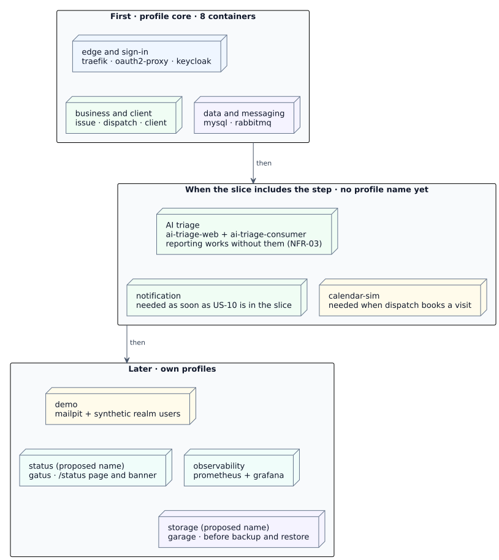

# Physical Views

**Status:** proposed physical (deployment) view · Sprint 1, deliverable 7 "Deployment view" · EN-01-03 ([#13](https://github.com/Phenriquerafael/LABDSOF_G9A/issues/13)) · drawn on 2026-10-29 from the EN-01-01 proposal ([ADR-001–012](adr/README.md), team review pending), redrawn on 2026-10-30 as UML deployment diagrams in the Visual Paradigm style · nothing is built, deployed or measured

These views show where the proposed BMC software runs: the nodes, the containers on each node, the networks that connect them, the only published port, the persistent state and the systems outside the host. They are the physical view of the [technical design](07-technical-design.md) (its §7 is the summary) and follow [ADR-004](adr/ADR-004-deployment-contract.md) for containers, networks, profiles and pipeline, [ADR-005](adr/ADR-005-authentication-authorisation.md) for identity and [ADR-012](adr/ADR-012-health-and-status-page.md) for health checks. Where this document adds a detail that no ADR states, the text says so and the detail is listed in [§10 Open items](#10-open-items-found-while-drawing-the-views). If this document and an ADR differ, the ADR wins until the team review decides otherwise.

The figures are UML deployment diagrams drawn as SVG in the style Visual Paradigm gives them: blue three-dimensional nodes with the name at the top, nested «container» components, provided interfaces as lollipops, communication paths labelled with the protocol, and notes for the open items. They are generated by a small Python script, one function per view, in [`diagrams/physical-views/`](diagrams/physical-views/); the script is plain text that a diff can review, and every shape is placed by hand. To change a view, edit its function in `views.py` and re-render it — the commands are in the [diagram README](diagrams/physical-views/README.md). The figures are not Visual Paradigm projects: no `.vpp` file exists. Open an image for full size.

Notation used in every figure:

| Element | Meaning |
|---|---|
| Three-dimensional box, name at the top | A UML node: «device» for the user device and the Docker host, «network» for a Compose network grouping, «executionEnvironment» for the browser, the CI runners or Docker Compose, «profile set» in P7, «external system» outside the host |
| Rectangle with the component icon | A «container» (one image, one Compose service), or a part of one: «entrypoint» and «middleware» in Traefik, «exchange» and «queue» in RabbitMQ, «bucket» in Garage, «job» in CI. A container drawn open shows its parts and has its name at the bottom left |
| Rectangle with the cylinder or page icon | A «database», or an «artifact» such as the working copy or the `.env` file |
| Ball on a stick (lollipop) | An interface the component provides: HTTPS 443 on Traefik, AMQP, S3 API, SMTP, Admin API, HTTP API, the oauth2-proxy session check |
| Stick figure | An actor: the operator |
| Dashed rectangle | A boundary: a trust boundary, or a set of routes or checks (not a UML element) |
| Note with a folded corner | An open item of §10, a limit or a source, anchored by a dashed line |
| Solid line | A communication path, labelled with the route or protocol; no arrow, as UML draws it |
| Dashed arrow | A dependency or information flow, from the user to what it uses; in P3 it follows the message, in P6 the code and images, in P7 the rollout order |
| Dashed outline | Optional or not yet placed: the off-host backup copy, the backup job, Grafana access in demo |

## 1. Nodes

| Node | What runs there | Source |
|---|---|---|
| User device | A browser or the installed PWA; online only, nothing is queued | [ADR-011](adr/ADR-011-installable-pwa-client.md) |
| Demonstration host | One Docker host with Docker Engine and Compose, linux/amd64 or linux/arm64. College servers are expected, not confirmed; the contract does not depend on the choice | ADR-004, EN01-U3 (Martim) |
| GitHub | Repository, GitHub Actions (no pipeline exists yet) and GitHub Container Registry (GHCR) for the multi-arch images | ADR-004, PR [#40](https://github.com/Phenriquerafael/LABDSOF_G9A/pull/40) (open) |
| AI provider | External model API; Gemini Flash is the candidate adapter, the choice stays DEC-05 | [ADR-008](adr/ADR-008-ai-triage-service.md) |
| Off-host backup target | Optional Cloudflare R2 bucket for a copy of the backups, because single-node Garage has no redundancy | [ADR-010](adr/ADR-010-object-storage.md) |
| Developer laptop | The same `compose.yaml` with a smaller profile set | ADR-004 |

## 2. View P1 — Deployment overview

All seventeen containers of ADR-004 run on one Docker host. A container can join more than one Compose network (Docker documents a service attached to both a `front-tier` and a `back-tier` network, [Compose networks reference](https://docs.docker.com/reference/compose-file/networks/), accessed 2026-10-29), so Figure P1 groups containers by the networks they join, not by two boxes only.

*Figure P1. Containers grouped by the networks they join.* ADR-004 puts Traefik "and the services it routes to" on `edge`, puts the data stores, broker, mail capture, metrics, Gatus and the simulator on `internal`, and attaches every service to `internal` "as needed". Two placements are this document's reading, not ADR text: Keycloak joins `internal` because its database is in MySQL, and the AI triage containers sit on `internal` only because Traefik never routes to them. Both are listed in §10 (P-01, P-02). The figure draws each Traefik route by path, without its middlewares (those are in P2); the connections from the services to the broker, databases, storage, mail and calendar are left to P3 and P4 so that P1 stays readable at this size.

### Container catalogue

Container names are proposed Compose service names. Versions are those in ADR-002/004, as of 2026-10-27; they are pinned at the spike.

| Container | Runtime | Networks | Persistent state | Compose profile (ADR-004) | Health check ([ADR-012](adr/ADR-012-health-and-status-page.md)) |
|---|---|---|---|---|---|
| `traefik` | Traefik 3.7 | edge | none (TLS certificate source open) | `core` | `ping` |
| `oauth2-proxy` | oauth2-proxy 7.15 | edge | none: encrypted cookie session, Redis optional | `core` | `/ready` |
| `client` | nginx serving the React + Vite build | edge | none | `core` | not stated (P-04) |
| `issue` | Spring Boot 4.1.2, Java 25 | edge, internal | database `issue` in MySQL; objects in Garage | `core` | Actuator readiness, path per DEVOPS-02 |
| `dispatch` | Spring Boot 4.1.2, Java 25 | edge, internal | database `dispatch` in MySQL | `core` | Actuator readiness |
| `notification` | Spring Boot 4.1.2, Java 25 | edge, internal | database `notification` in MySQL | added when US-10 is in the slice; profile name not proposed | Actuator readiness |
| `keycloak` | Keycloak 26.8 | edge, internal | database `keycloak` in MySQL; realm imported from `infra/keycloak/bmc-realm.json` | `core` | `/health/ready` on management port 9000 |
| `gatus` | Gatus 5.37 | edge, internal | volume with 30 days of results (storage type is spike item 12) | `status` (proposed name) | none in the container (`FROM scratch`); Prometheus alert instead |
| `ai-triage-web` | Python 3.14, Flask 3.1.3, Gunicorn | internal | none (stateless) | added when triage is in the slice | Flask health route |
| `ai-triage-consumer` | same image, `python -m triage.consumer` | internal | none (stateless) | with `ai-triage-web` | not stated (P-04) |
| `calendar-sim` | Spring Boot, Java 25 | internal | none: in memory from a fixed seed; a restart is the "external system lost data" scenario ([ADR-006](adr/ADR-006-calendar-simulator.md)) | added when Dispatch books a visit | not stated in the container table (P-04); Gatus checks it |
| `rabbitmq` | RabbitMQ 4.x | internal | quorum queues and DLQs on a volume (P-06) | `core` | `rabbitmq-diagnostics -q ping`, at most every 30 s |
| `mysql` | MySQL 8.4 LTS | internal | databases `issue`, `dispatch`, `notification`, `keycloak` on a volume (P-06) | `core` | `mysqladmin ping`, plus a query-level Gatus check |
| `garage` | Garage 2.5, single node | internal | buckets `bmc-attachments` and `bmc-backups` on a volume (P-06) | `storage` (proposed name) | admin `GET /health` |
| `mailpit` | Mailpit 1.32 | internal | captured mail only, disposable in demo | `demo` | `readyz` |
| `prometheus` | Prometheus 3.x | internal | time series on a volume (P-06) | `observability` | `/-/ready` |
| `grafana` | Grafana 13 | internal | dashboards on a volume or provisioned from files (P-06) | `observability` | `/api/health` |

The backup job that writes MySQL dumps to `bmc-backups` is named in ADR-004 and ADR-010 but has no container, schedule owner or host placement yet (P-03; DEVOPS-02 owns schedule, rotation and restore).

## 3. View P2 — Edge routing and trust boundaries

Traefik is the only container with a published port. Every public route, its upstream and its middlewares come from the ADR-004 route table.

*Figure P2. The path of one request through the edge; arrows follow the request.* Traefik Proxy has no JWT middleware, so the gateway is not the security control: each Spring service is an OAuth2 resource server and authorises against its own data, answering `404` outside the caller's scope (ADR-005). The figure draws that second boundary around the three API services and lists the endpoints that are never routed in a note instead of drawing refused arrows. `/status/api` must win over the `/status` page route; the rule priority is a spike item, and the route exists only if spike item 11 shows that Gatus strips hosts, URLs and errors from its JSON (ADR-012).

| Boundary | What crosses it | Control (proposed, not verified) |
|---|---|---|
| Internet → `traefik` | Browser requests on 443 | TLS at Traefik (certificate source open, ADR-004); `HttpOnly`, `Secure`, `SameSite=Strict` session cookie; custom header on state-changing requests (ADR-005) |
| `traefik` → services | Requests with `Authorization: Bearer` from oauth2-proxy | Signature, issuer, audience and expiry checked in each service; membership or assignment check in the owning service |
| Services → `mysql`, `rabbitmq`, `garage` | SQL, AMQP, S3 | One database user, one broker user and one storage key per service; no shared superuser (ADR-003, ADR-005, ADR-010) |
| Host → outside | AI provider calls; later a real SMTP server | Only the AI service needs egress in the design; whether the others can be denied egress is open (ADR-004, P-02) |
| `TriageRequested` messages | The only message with private report text | Point-to-point queue, never logged, DLQ TTL 7 days (ADR-003, ADR-008) |

## 4. View P3 — Messaging through RabbitMQ

Messages flow from the publishers through the `bmc.events` topic exchange to one quorum queue per consumer ([ADR-003](adr/ADR-003-asynchronous-messaging-rabbitmq.md)). Unlike the other views, arrows here follow the message, not the connection: physically, every publisher and consumer opens its own AMQP connection to `rabbitmq` with its own user.

*Figure P3. Publishers, exchange, queues and consumers.* Every consumer acknowledges only after its transaction commits and deduplicates by `eventId`; outbox rows wait as `pending` while the broker is down ([design §5](07-technical-design.md#5-asynchronous-workflow-and-consistency)). `TriageRequested` is the only message with private report text: it is bound only to `ai-triage.requests`, never logged, and its dead-letter copy expires after 7 days. Whether Issue events with no consumer outside Issue (`ReportSubmitted` and others) are published at all is open (ADR-001), so they are not drawn.

## 5. View P4 — Data stores and platform connections

Inside the host, services reach only their own database and talk to each other only through RabbitMQ (ADR-001). Calls to a platform component (Keycloak, object storage, SMTP) or to the external calendar are not service-to-service calls.

*Figure P4. Who connects to which store and platform component; arrows point from client to server.* Every Spring service also needs Keycloak's signing keys to validate tokens; that connection is omitted from the figure and its route is open (P-05). Whether the Notification service publishes events of its own is not stated in ADR-007, so no publish arrow is drawn.

Worker ownership, as far as the ADRs state it:

| Background work | Runs in | Source |
|---|---|---|
| Outbox publisher (poll every 1 s, backoff to 5 min) | Inside each Spring service that publishes (`issue`, `dispatch`), through the shared messaging starter | ADR-003 |
| Triage consumer | `ai-triage-consumer`, separate process from `ai-triage-web` | ADR-008 |
| Email sending and retries | Inside `notification`, after the delivery rows commit | ADR-007 |
| Calendar retries and reconciliation | Inside `dispatch` | ADR-006, design §4.5 |
| Projection snapshot and rebuild | `issue` republishes memberships and issue states for `dispatch` (runbook step) | ADR-004, design §4.3 |
| Health polling | `gatus` | ADR-012 |
| Database backups | Not placed (P-03) | ADR-004, ADR-010 |

## 6. View P5 — Health, metrics and logs

*Figure P5. Health and metrics paths.* Gatus maps checks to the capabilities shown publicly (Report a fault, Schedule interventions, Notifications, Suggestions, Calendar sync, Sign-in, Photo upload) and never lists infrastructure by name (ADR-012). The Grafana dashboard shows outbox lag, DLQ depth, consumer retries, AI fallback rate, pending bookings, error rate, notification failures and projection freshness (ADR-004). Logs are structured with `correlationId` and `traceparent`; where they are collected (Loki or another tool) is left to DEVOPS-02 (EN01-U12), so no log collector is drawn. Prometheus sits on `internal` and Traefik on `edge` only, so the "scrape Traefik" line needs one of them to join the other network (P-01).

## 7. View P6 — Environments and delivery path

No pipeline, image or host exists yet. This view shows the proposed path from a commit to a running host, as in ADR-004 and the DEVOPS-01 proposal (PR [#40](https://github.com/Phenriquerafael/LABDSOF_G9A/pull/40), open, not merged).

*Figure P6. Proposed environments and delivery path; arrows follow code and images.* How arm64 images are built (emulation or native runners) is open (EN01-U9). Multi-arch availability is recorded for Traefik, RabbitMQ, MySQL, Mailpit, Temurin and python images, not yet for Keycloak, oauth2-proxy, Garage, Prometheus, Grafana or nginx (spike item 8, ADR-004).

### Configuration and secrets per container

Values come from the host or CI environment through `.env` (a `.env.example` with placeholders is committed); nothing secret is in Git (ADR-004, NFR-08). The list collects the credentials named across ADR-003, 004, 005, 007, 008 and 010; rotation is EN01-U6.

| Container | Secrets it needs |
|---|---|
| `traefik` | TLS certificate or its issuing account (source open) |
| `oauth2-proxy` | `bmc-edge` client secret, cookie secret |
| `keycloak` | admin password, `keycloak` database user, SMTP settings |
| `issue` | `issue` database user, broker user, `bmc-attachments` storage key |
| `dispatch` | `dispatch` database user, broker user |
| `notification` | `notification` database user, broker user, `notification-service` client secret, SMTP settings |
| `ai-triage-web`, `ai-triage-consumer` | broker user, AI provider key (when AI is enabled) |
| `mysql`, `rabbitmq`, `garage`, `grafana` | their own admin credentials |
| backup job | MySQL read access, `bmc-backups` storage key, optional R2 key |

## 8. View P7 — Compose profiles and rollout

ADR-004 proposes starting the first vertical slice with eight containers and adding the rest as stories need them. This is a proposal for the team review (EN01-U1); the memory of each set is not measured (EN01-U3, spike item 8).

*Figure P7. Profile sets in the proposed order.* `storage` and `status` are profile names proposed in ADR-004; the AI, Notification and simulator containers have no profile name yet.

## 9. Failure domains

One host, one MySQL instance and one RabbitMQ node are single points of failure, stated as limits of the academic release (ADR-001, ADR-004). The behaviour of each failure is in [design §6](07-technical-design.md#6-external-integration-and-degraded-mode); this table only maps it onto the physical units.

| Physical unit fails | What stops | What keeps working |
|---|---|---|
| Demonstration host | Everything | Nothing; recovery is a restore on a host from the GHCR images and the off-host backup copy |
| `mysql` | All services and Keycloak | Nothing that needs data; explicit errors, no false acknowledgement |
| `rabbitmq` | Event delivery between services | User requests in each service; events wait in the outbox |
| `keycloak` | New sign-in, registration and token refresh | Requests with a still-valid token (to confirm in the spike) |
| `ai-triage-*` or the provider | Suggestions | Reporting and manual triage; rules fallback when only the provider is down |
| `calendar-sim` | Calendar sync | Bookings stay `requested` or `uncertain`; manual confirmation |
| `garage` | Photo upload and backups | Reports without photos |
| `gatus` | The public status page and banner | All business capabilities; Prometheus alerts on the missing series |

## 10. Open items found while drawing the views

These do not change any ADR. They are inputs for the team review (EN01-U1) and the spike (EN01-U2). Proposed owners follow the ADR owners.

| ID | Item | Why it matters | Proposed owner |
|---|---|---|---|
| P-01 | Prometheus is on `internal`, while Traefik and oauth2-proxy are on `edge` only, yet ADR-004 has Prometheus scrape both | Either Prometheus also joins `edge`, or Traefik and oauth2-proxy also join `internal` | Martim (DEVOPS-02) with Ricardo |
| P-02 | If `internal` is declared with `internal: true` ("an externally isolated network", [Compose networks reference](https://docs.docker.com/reference/compose-file/networks/), accessed 2026-10-29), the AI containers cannot reach the provider, and a later real SMTP server would be unreachable for Notification and Keycloak | ADR-004 says only the AI service needs egress but does not say how that is given; one option is a third `egress` network joined only by the containers that need it | Ricardo (ADR-004), Martim |
| P-03 | The backup job has no container, schedule owner or credentials placement | It needs MySQL read access and a storage key, so where it runs changes the secret list | Martim (DEVOPS-02) |
| P-04 | No health check is stated for `client`, `ai-triage-consumer` and `calendar-sim` containers | `depends_on: condition: service_healthy` cannot wait on a container without a health check | Martim (DEVOPS-02, EN01-U13) |
| P-05 | Tokens carry Keycloak's public issuer URL, but the services validate them from the internal network | How services fetch the signing keys (through Traefik or directly from `keycloak` on an internal URL) has to work with the issuer check | Ricardo (ADR-005 spike item) |
| P-06 | Volumes for `mysql`, `rabbitmq`, `garage`, `prometheus` and `grafana` are implied by their persistent state but not listed in ADR-004 | Backups, restore and a host move depend on which volumes exist | Martim (DEVOPS-02) |
| P-07 | The DEVOPS-02 proposal (PR [#48](https://github.com/Phenriquerafael/LABDSOF_G9A/pull/48), open) assumes nginx or an API gateway, PostgreSQL and an EC2 container or Amazon RDS, while ADR-004 proposes Traefik, MySQL 8.4 and any Docker host | The two proposals cannot both describe the same deployment | Martim and Ricardo, at the team review |

## 11. Limits of these views

- They describe a proposed design. No container, network, image, pipeline or host exists, and nothing was run or measured.
- The memory of the full stack and of the minimal profile is unknown until spike item 8; it may change which profiles run together on the demonstration host.
- Container names, the grouping by networks in Figure P1, the volume list and items P-01 to P-07 are this document's proposals; the ADRs stay the source for decisions.
- The SVG and PNG files were generated on 2026-10-30 by `views.py` (Python 3.13; PNG through a headless Chromium); the reviewer should check them in the GitHub preview of the PR, because GitHub renders SVG through its own sanitiser. Labels use Arial with Liberation Sans and Helvetica as fallbacks, so text widths can shift slightly on a system that has none of them.
- The figures follow UML deployment notation in the Visual Paradigm style; they are not Visual Paradigm projects, no `.vpp` file exists, and they were not opened in Visual Paradigm.
