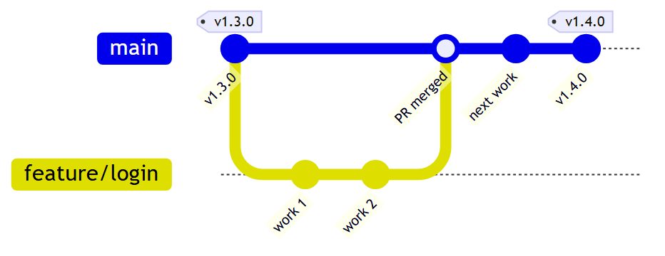
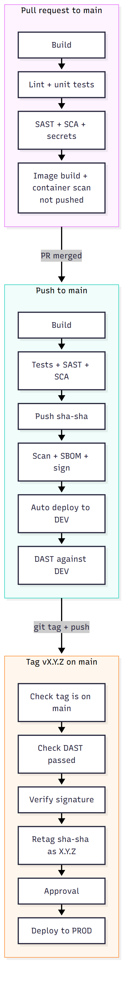
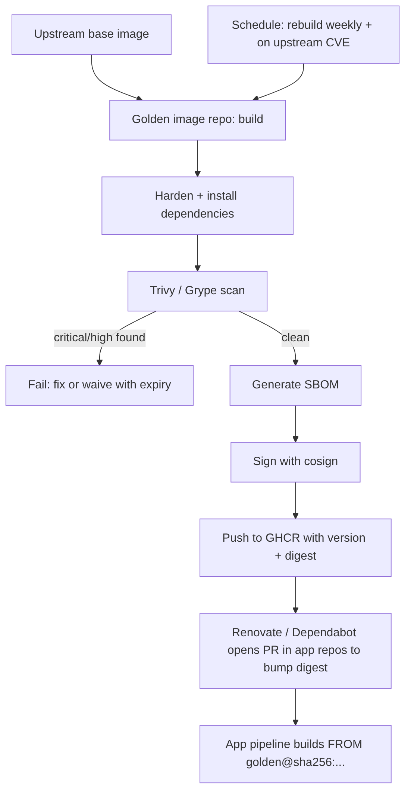
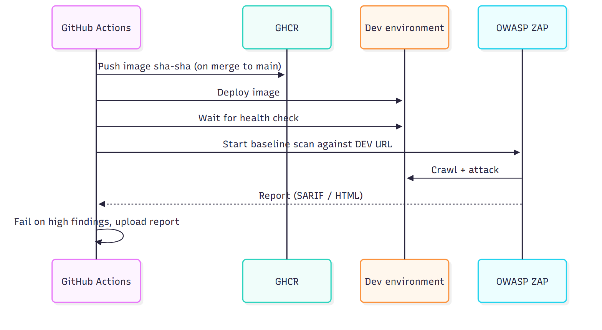
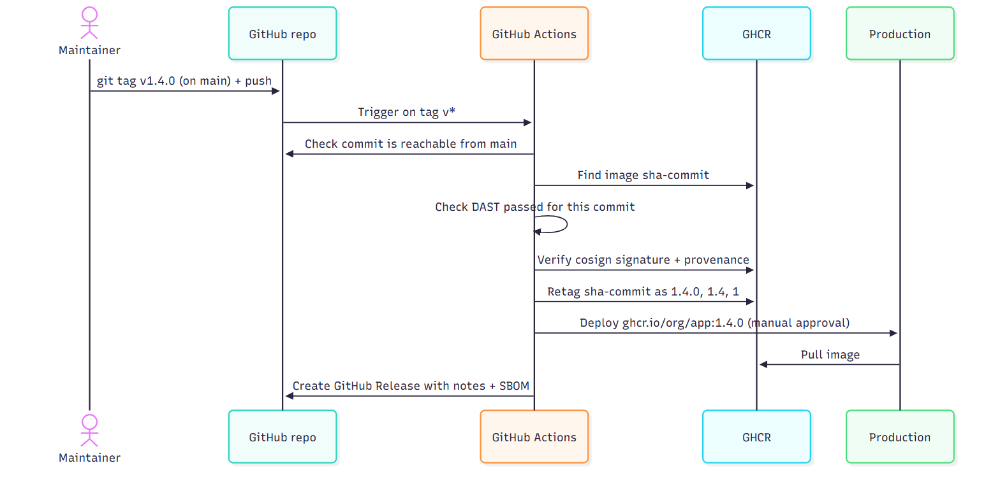
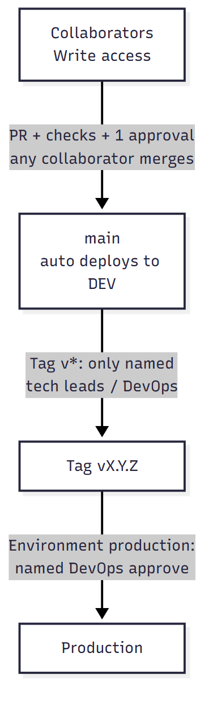

# CI/CD Strategy

This document describes our branching model, pipelines, golden images, security testing and release process.

**Status:** proposal. Nothing in this document is applied to the repository or to GitHub settings yet.

## Rollout phases

- **Phase 1 (now, before the app runs anywhere):** the `main-quality` ruleset (PR with 1 approval, no force push, no deletion). No required status checks until there is a build and tests.
- **Phase 2 (once there is a build and tests):** `ci.yml` as required checks, the tag-gated release (`release.yml`), the tag ruleset, the `production` environment, automatic dev deploy from `main` (`main.yml`), DAST and the `dev` environment.
- **Phase 3 (when the team or registry outgrows the basics):** golden-image repository, GHCR cleanup and the organization transfer. These sections are marked "Phase 3".

---

## 1. Principles

1. **Build once, promote the same image.** A release tag retags the image that was already deployed to dev, by digest. Prod never triggers a rebuild.
2. **Dev is automatic, prod is deliberate.** Every merge to `main` deploys to dev by itself. Production is only released by a protected version tag, with approval.
3. **One path to prod.** Code reaches prod only from a `main` commit that already ran on dev, through a version tag and approval.
4. **Everything is built on golden images.** Hardened, scanned, signed base images that we own and version.
5. **Security is part of the pipeline**, not a separate phase (SAST, SCA, secrets, container scan, DAST).
6. **Everything is traceable.** Every running version maps to a tag, a commit, an SBOM and a signature.

---

## 2. Branching model

There is one long-lived branch: `main`. It is the integration branch, it is what dev runs, and it is the release candidate. There is no `dev` branch.

| Branch or ref | Purpose | Who can merge or create it | Protection | Deploys to |
|---|---|---|---|---|
| `main` | Integration and release candidate | Any collaborator, through a PR with 1 approval and passing checks | Protected: PR, approval, checks, no force push, no deletion | **Dev** (automatic on every merge) |
| `feature/*`, `fix/*`, any other | Short-lived work branches, merged into `main` by PR | n/a (anyone can push) | None | Nothing (PR checks run on the PR) |
| Tag `v*` on `main` | A release | **Named tech leads and DevOps only** | Tag ruleset | **Prod** (after approval) |

See [section 11](#11-access-control-and-roles) for how this is enforced.



Flow of code: `feature/*` → PR → `main` (auto-deploys to dev) → tag `vX.Y.Z` on `main` → production.

### Development flow

1. **Open a draft PR** for the work, from a branch made off `main` (`git switch -c feature/<name>`).
2. **Develop locally:** run the app and tests on your machine, ideally with the same Dockerfile. Pre-commit hooks run the secrets scan and linters before each commit.
3. **Mark the PR ready and merge it into `main`** after one approval. PR checks run on every push (`ci.yml`).
4. **The merge deploys to dev.** `main.yml` builds, scans, signs and pushes `sha-<sha>`, deploys it to dev and runs DAST against it.
5. **Release:** when `main` is ready, tag `vX.Y.Z` on that commit. `release.yml` retags the tested image and deploys it to prod after approval.

To fix a bad release, merge the fix into `main` and tag a new patch version.

### Why one branch

- A `dev` branch would be a second long-lived copy of `main`. It needs constant merging and drifts from `main`.
- Prod would run an image rebuilt from a new merge commit, not the image that was tested on dev.
- Rolling back a bad merge would need a revert on `main` plus a merge-back into `dev`, which is the revert-of-revert trap.

With one branch, the commit that runs on dev is the commit you tag, and a bad release is fixed forward on `main`.

---

## 3. Pipeline overview

| Trigger | Build | Tests + SAST + SCA + secrets | Push image to GHCR | Container scan + SBOM + sign | Deploy | DAST |
|---|---|---|---|---|---|---|
| Pull request to `main` | yes | yes | no | scan only (image not pushed) | no | no |
| Push to `main` | yes | yes | yes (`sha-<sha>`) | yes | **auto to dev** | yes |
| Tag `v*` on `main` | no (promote) | verify + check DAST | retag (`vX.Y.Z`) | verify signature | **prod** (after approval) | no (uses the DAST result of the `main` run) |



---

## 4. Golden images

> Phase 3. Not needed until the app runs and we have more than one base image. Until then, use official images pinned by digest.

**Rollout, in two steps:**

1. **Now (Phases 1 and 2):** every base image the services use is an official image pinned by digest, and every tool that scans or signs (such as Trivy) is pinned to a fixed release. Each version is a reviewed change to the workflow files.
2. **Later (Phase 3):** the same base images and tool pins move into the golden-image repository. Each service's Dockerfile then builds `FROM` a golden image pinned by digest, one service at a time. Each switch is a PR.

Golden images are our own hardened base images (runtime, language, tooling). Application Dockerfiles **only** build `FROM` a golden image, never directly from Docker Hub.

### What makes an image "golden"

- Built from a minimal upstream (distroless, Alpine, or a slim Debian/Ubuntu)
- Non-root user by default, no shell or package manager in runtime variants
- Only the required packages and dependencies
- Scanned with **zero unwaived critical/high CVEs**
- SBOM generated and attached
- **Signed** with cosign
- Published to GHCR and **pinned by digest** by consumers

### Lifecycle



### Rules

- **Rebuild on a schedule** (e.g. weekly) and whenever the upstream image or a critical CVE changes.
- **Pin by digest** in app Dockerfiles: `FROM ghcr.io/<org>/golden-node@sha256:<digest>`.
- Let **Renovate/Dependabot** open PRs to bump the digest, so updates go through the normal pipeline.
- Keep golden images in their **own repository** with their own pipeline and release cadence.

Example app Dockerfile:

```dockerfile
# Build stage
FROM ghcr.io/<org>/golden-node-build@sha256:<digest> AS build
WORKDIR /app
COPY package*.json ./
RUN npm ci
COPY . .
RUN npm run build

# Runtime stage
FROM ghcr.io/<org>/golden-node-runtime@sha256:<digest>
WORKDIR /app
COPY --from=build /app/dist ./dist
USER nonroot
CMD ["dist/main.js"]
```

---

## 5. Security testing

One tool per category keeps the pipeline easy to maintain. Replace a tool only with a reason written in the PR.

| Check | Tool | What it finds | When it runs |
|---|---|---|---|
| **Secrets scan** | gitleaks | Leaked credentials | Every PR and push to `main` |
| **SAST** | CodeQL | Vulnerabilities in our source code | Every PR and push to `main` |
| **SCA** | Dependabot alerts | Vulnerable dependencies | Continuously, on the default branch (advisory: does not gate PRs) |
| **Dockerfile scan** | hadolint | Dockerfile misconfigurations | Every PR and push to `main` |
| **Container scan + SBOM** | Trivy | CVEs and component inventory in the final image | Every image build |
| **Image signing** | cosign (keyless via GitHub OIDC) | Integrity / provenance | Every pushed image |
| **DAST** | OWASP ZAP (baseline scan) | Runtime issues (XSS, injection, headers, auth) | After every deploy to **dev** |

### About DAST

DAST needs a **running application**. It runs against the **dev environment** right after each automatic deployment, which means after every merge to `main`:



Suggested policy:
- **Block** the PR/merge on SAST, secrets, and critical/high container or dependency findings.
- **Block the release** (`release.yml`) if the `main` run for that commit did not pass its DAST job.
- Waivers must have an owner and an expiry date.

---

## 6. Registry and image tagging (GHCR)

All images live in GitHub Container Registry: `ghcr.io/<org>/<app>`.

One image per service (`<repo>-issue`, `<repo>-dispatch`, …). A tag promotes every service image built from that commit.

| Event | Tags pushed | Notes |
|---|---|---|
| Merge to `main` | `sha-<sha>` | Deployed to dev, and the release candidate |
| Tag `v1.4.0` | `1.4.0` | **Retag** of the `sha-<sha>` image, never a rebuild. Short tags (`1.4`, `1`) are not pushed, because they move between releases |

Avoid deploying `latest`. Deploy by **version tag or digest**. Image cleanup is covered in [section 10](#10-ghcr-cleanup-retention).

GHCR image paths must be **lowercase**. This repository's name has uppercase letters, so lowercase the repository name in scripts (for example `${REPO,,}` in bash) before building image references.

Every image is:
- **Signed** with cosign (keyless, GitHub OIDC)
- Published with an **SBOM** and build **provenance** attestation
- Deployed only after its **signature is verified**

---

## 7. Releasing to production by tag

Production is triggered only by pushing a `v*` tag. The pipeline **does not rebuild**. It finds the image that was built on `main` and deployed to dev, checks that the `main` run passed (including DAST), verifies its signature, and retags it. Prod then runs the same image that ran on dev.



### How to release

```bash
git checkout main && git pull
git tag -a v1.4.0 -m "Release 1.4.0"
git push origin v1.4.0
```

### Safeguards

- **Tag ruleset** (Settings → Rules → Rulesets): only named tech leads and DevOps can create `v*` tags.
- Pipeline **fails if the tagged commit is not on `main`**.
- Pipeline **fails if no signed image exists** for that commit (meaning `main.yml` never built it).
- Pipeline **fails if the `main` run for that commit did not pass**, DAST included.
- **Environment `production`** with required reviewers: a DevOps reviewer (Martim) or the tech lead (Ricardo) must approve before the deploy job runs.
- **Test the gate before the first real release.** Push a throwaway tag such as `v0.0.1-gate-test` on a commit whose `main` run failed, and confirm `release.yml` stops before the deploy. Delete the tag afterwards.

### Fixing a bad release

- Fix forward: merge the fix to `main`, then tag a new patch version (`v1.4.1`).
- Stopgap: redeploy the previous version tag while the fix is prepared.

### Rollback

Redeploy a previous version tag: `ghcr.io/<org>/<app>:1.3.2`. No rebuild needed, since the image still exists in GHCR. Keep a retention policy that never deletes released version tags.

---

## 8. GitHub Actions skeleton

Suggested workflow files. Before using them:

- They assume a `Makefile` with `build` and `test` targets and a `Dockerfile` per service (`issue`, `dispatch`, `notification`, `ai`, `client`). Create those first.
- Actions are shown with version tags for readability. **Pin every third-party action to a full commit SHA** (section 11.3, item 6) and keep the version in a comment.
- The Mermaid sources for the diagrams are in `documents/devops/diagrams/`. Regenerate the PNGs from them after any change. `golden-image-lifecycle.png` has no source yet and is a manual image until one is added.

```
.github/workflows/
├── ci.yml             # pull requests to main: build, test, SAST, SCA, scan (no push)
├── main.yml           # push to main: build, push sha-<sha>, sign, deploy dev, DAST
├── release.yml        # tag v*: verify, check DAST, retag, deploy prod, GitHub Release
└── ghcr-cleanup.yml   # weekly: prune old images (dry run first, see section 10)
```

### `ci.yml` (pull requests to `main`)

```yaml
name: CI
on:
  pull_request:
    branches: [main]

permissions:
  contents: read
  security-events: write

jobs:
  test:
    runs-on: ubuntu-latest
    steps:
      - uses: actions/checkout@v4
      - name: Secrets scan
        uses: gitleaks/gitleaks-action@v2
      - name: Build and test
        run: |
          make build
          make test
      - name: SAST (CodeQL)
        uses: github/codeql-action/init@v3
        with:
          languages: <your-language>      # for example javascript-typescript or java-kotlin
      - uses: github/codeql-action/analyze@v3
      - name: Build image (not pushed)
        run: docker build -t app:ci -f <service>/Dockerfile <service>
      - name: Container scan
        uses: aquasecurity/trivy-action@ed142fd0673e97e23eac54620cfb913e5ce36c25   # v0.36.0 (released 2026-04-22); tags on this action were force-pushed in 2026, so pin the commit
        with:
          image-ref: app:ci
          severity: CRITICAL,HIGH
          exit-code: "1"
```

### `main.yml` (push to `main`)

Steps, in order:

1. Build and test (same commands as `ci.yml`).
2. Build the image and push it as `ghcr.io/<org>/<app>:sha-<sha>`.
3. Run the container scan, generate the SBOM, and sign the image with cosign.
4. Deploy `sha-<sha>` to the `dev` environment (`environment: dev`).
5. Run DAST against the dev URL. This is a job in the same workflow, so a failed scan fails the run.

A successful `main.yml` run for a commit is what `release.yml` checks before it promotes that commit.

### `release.yml` (tag)

```yaml
name: Release
on:
  push:
    tags: ["v*"]

permissions:
  contents: write
  packages: write
  id-token: write
  actions: read

jobs:
  verify:
    runs-on: ubuntu-latest
    steps:
      - uses: actions/checkout@v4
        with: { fetch-depth: 0 }

      - name: Ensure tag is on main
        run: |
          git merge-base --is-ancestor "$GITHUB_SHA" origin/main \
            || { echo "Tag is not on main"; exit 1; }

      - name: Check main run passed (including DAST)
        env:
          GH_TOKEN: ${{ github.token }}
        run: |
          PASSED=$(gh run list --workflow main.yml --commit "$GITHUB_SHA" \
            --status success --json databaseId --jq 'length')
          [ "$PASSED" -gt 0 ] || { echo "No passing main.yml run for this commit"; exit 1; }

      - uses: sigstore/cosign-installer@v3
      - uses: docker/login-action@v3
        with:
          registry: ghcr.io
          username: ${{ github.actor }}
          password: ${{ secrets.GITHUB_TOKEN }}

      - name: Verify signature of the tested image
        run: |
          cosign verify ghcr.io/${{ github.repository }}:sha-${{ github.sha }} \
            --certificate-identity "https://github.com/${{ github.repository }}/.github/workflows/main.yml@refs/heads/main" \
            --certificate-oidc-issuer https://token.actions.githubusercontent.com

  deploy:
    needs: verify
    runs-on: ubuntu-latest
    environment: production        # required reviewers approve before this job starts
    steps:
      - uses: actions/checkout@v4
      - uses: sigstore/cosign-installer@v3
      - uses: docker/login-action@v3
        with:
          registry: ghcr.io
          username: ${{ github.actor }}
          password: ${{ secrets.GITHUB_TOKEN }}

      - name: Promote (retag, no rebuild)
        run: |
          VERSION=${GITHUB_REF_NAME#v}
          docker buildx imagetools create --prefer-index=false \
            -t ghcr.io/${{ github.repository }}:${VERSION} \
            ghcr.io/${{ github.repository }}:sha-${{ github.sha }}

      - name: Deploy to prod
        run: ./scripts/deploy.sh prod ${GITHUB_REF_NAME#v}

      - name: GitHub Release
        uses: softprops/action-gh-release@v2
        with:
          generate_release_notes: true
```

> These are starting points. Adjust build commands, deploy scripts and tool versions to the real stack. The `${{ github.repository }}` image paths need the lowercase fix from section 6.

---

## 9. Secrets and variables

GitHub's equivalent of GitLab CI/CD variables are **secrets** (encrypted, masked in logs, write-only) and **variables** (plain configuration, visible). Both are set under Settings → Secrets and variables → Actions, and used as `${{ secrets.NAME }}` and `${{ vars.NAME }}`.

### 9.1 Rules

- **Never commit secrets, and never bake them into images.** `ARG` and `ENV` values end up in image layers.
- **Narrowest scope wins:** environment secret over repository secret.
- **Production secrets live only in the `production` environment**, which is limited to `v*` tags (and approval, if enabled). See section 11.
- **Separate credentials for dev and prod.** A leaked dev credential must never work in prod.
- **Prefer OIDC** (short-lived cloud credentials, nothing stored) over long-lived keys wherever the provider supports it.
- **Pass a secret only to the step that needs it,** through `env:`, and never print it.
- **Every long-lived credential has an owner, an expiry date and a rotation reminder.**

### 9.2 What lives where

| Item | Type | Scope | Used by |
|---|---|---|---|
| `GITHUB_TOKEN` | Automatic, per run | The workflow run | GHCR push, retag, GitHub Release, reading `main` run results (permissions set per job) |
| `SONAR_TOKEN` (if SonarQube is used) | Secret | Repository | `ci.yml` |
| Dev deploy credentials | Secret | Environment `dev` | `main.yml` deploy job |
| Prod deploy credentials | Secret | Environment `production` | `release.yml` only |
| `GHCR_CLEANUP_PAT` | Secret (classic PAT) | Repository | `ghcr-cleanup.yml` only, see section 10 |
| App URLs, registry name, feature toggles | Variable | Repository or environment | Any workflow |
| Tokens that Dependabot PRs need (for example the Sonar token) | Dependabot secret | Repository | Dependabot-triggered runs |

### 9.3 Usage

```yaml
jobs:
  deploy-prod:
    runs-on: ubuntu-latest
    environment: production          # unlocks the production secrets
    steps:
      - name: Deploy
        run: ./scripts/deploy.sh "${GITHUB_REF_NAME#v}"
        env:
          DEPLOY_TOKEN: ${{ secrets.DEPLOY_TOKEN }}
          APP_URL: ${{ vars.APP_URL }}
```

### 9.4 GitLab to GitHub

| GitLab | GitHub |
|---|---|
| CI/CD variable (masked) | Secret (always masked) |
| Plain variable | Variable (`vars.*`) |
| Environment scope | Environment secrets |
| Protected variable (protected branches and tags only) | Environment with deployment branches and tags limited to `v*` |
| Group-level variable | Organization secret (needs an organization) |
| File-type variable | No equivalent: write the value to a file inside a step |

### 9.5 Gotchas

- **Fork PRs do not receive secrets.** That protects you on a public repo, but it means checks that need a secret (for example a Sonar scan) must be skipped or run only for same-repo PRs.
- **Dependabot has its own secret store.** Dependabot PRs cannot read normal Actions secrets.
- **Anyone who can edit a workflow can read the secrets it uses,** for example by pushing a workflow that sends the value somewhere. That is why prod secrets sit in a restricted environment and why section 11 limits who can create release tags.
- **Masking only hides the exact value.** A transformed value (base64, a substring, a URL-encoded copy) is not masked, so avoid printing derived forms.
- **A single secret is limited to about 48 KB.** Larger files need another approach.

---

## 10. GHCR cleanup (retention)

> Phase 3. Not needed until the registry grows. Until then, delete old unreleased images by hand after checking they carry no version tag.

Without cleanup, every merge to `main` adds an image. The goal is to keep the registry small without deleting anything you need for rollback, audit or signature verification.

### 10.1 Retention policy

| What | Policy | Why |
|---|---|---|
| Release tags (`1.4.0`, `1.4`, `1`) and the image they point to | **Keep forever** | Rollback and audit |
| `sha-<sha>` images built on `main` | **Keep for now** | A released image is the same image as its `sha-<sha>` tag, so they share one package version. A tag-based prune could delete a release. Revisit once the retention action can skip versions that carry a version tag. |
| Cosign signatures and attestations (tags such as `sha256-<digest>.sig`) | **Never touch** | Needed to verify released images |
| Untagged versions | **Never delete by hand** | Often the per-platform children or attestations of a tagged image |

Nothing is pruned automatically yet, so the cleanup cannot touch a released image. Before automating it, confirm the retention tool can skip any version that carries a version tag.

### 10.2 Do you need a PAT?

- **To publish and promote images: no.** `GITHUB_TOKEN` with `packages: write` is enough.
- **To delete image versions: it depends.** GitHub documents that a workflow's `GITHUB_TOKEN` can delete versions of packages that belong to the workflow's repository, as long as the repository has the **Admin** role on the package (Package settings → Manage Actions access). GitHub labels this capability a public preview, so it may change.
- **The catch:** the retention action recommended below cannot use its wildcard and tag filters with `GITHUB_TOKEN`. To prune by tag you need a **personal access token (classic)** or a GitHub App token.
- **PAT type:** GitHub Packages only supports **classic** PATs, not fine-grained ones. Scopes: `read:packages` and `delete:packages`.
- **Treat it as sensitive.** A classic PAT is tied to a person, is long-lived, and can delete **any** package that person can access. Store it as the repository secret `GHCR_CLEANUP_PAT`, use it only in the cleanup workflow, give it an expiry date (for example 90 days) and set a reminder to rotate it. After a move to an organization, a GitHub App token with `packages: write` is the cleaner option.

### 10.3 Workflow (`ghcr-cleanup.yml`)

```yaml
name: GHCR cleanup
on:
  workflow_dispatch:
    inputs:
      dry_run:
        description: "Only log what would be deleted"
        type: boolean
        default: true

permissions:
  contents: read

jobs:
  cleanup:
    runs-on: ubuntu-latest
    steps:
      - uses: snok/container-retention-policy@<commit-sha>   # v3.x, pin by SHA and confirm the latest release
        with:
          account: user                          # personal account; use the org name after a transfer
          token: ${{ secrets.GHCR_CLEANUP_PAT }}
          image-names: "<app>"                   # the package name, without the ghcr.io/<owner>/ prefix
          image-tags: "sha-*"                    # WARNING: also matches released versions; keep dry-run until section 10.1 is resolved
          tag-selection: tagged
          cut-off: 30d
          keep-n-most-recent: 10
          dry-run: ${{ github.event_name == 'workflow_dispatch' && inputs.dry_run }}
```

This is a starting point that has not been run against your registry. Check the input names against the README of the version you pin.

### 10.4 Rollout and traps

1. **Manual deletion only.** The workflow runs only when triggered by hand, with `dry_run` on first. Read the log and confirm that no released version is listed before any real run.
2. **No automatic cleanup yet.** A scheduled lifecycle rule that removes old images must be defined, after section 10.1 is resolved, before it is enabled.
3. **Multi-platform and attested images:** an image can consist of several untagged child manifests. Deleting those breaks the tagged image that points to them. The action protects the children of the tagged versions it keeps, but a tag filter that matches released versions is unsafe (see 10.1).
3. **Signatures:** the action's documentation does not cover cosign signatures. Make sure release signatures are never candidates. Signatures of deleted images will remain as small orphaned versions, which is harmless.
4. **Public packages:** GitHub does not allow deleting a version of a public package if any version of it has more than 5,000 downloads.
5. **Mistakes can be undone for 30 days:** a deleted package or version can be restored within 30 days, as long as the name has not been reused.

---

## 11. Access control and roles

> This section assumes a **public repository owned by a personal GitHub account** on the Free plan. Everything below is available at no cost in that setup. If the project outgrows it, see [11.5](#115-when-to-move-to-an-organization).

### 11.1 Who can do what

| Action | Who | Enforced by |
|---|---|---|
| Push to `feature/*`, `fix/*` | Any collaborator | No restriction |
| Merge a PR into `main` (deploys to dev) | **Any collaborator** | Ruleset `main-quality`: PR + checks + 1 approval |
| Create a `v*` tag (release to prod) | **Named tech leads and DevOps** | Tag ruleset |
| Approve the prod deployment | **DevOps (Martim) or tech lead (Ricardo)** | Environment `production` required reviewers |
| Change pipelines (`.github/`, Dockerfiles, infra) | DevOps reviewers | CODEOWNERS |
| Change repo settings, rulesets, secrets | **Repo owner only** | Owner role |



### 11.2 Roles on a personal repository

A personal repository has only two permission levels, so "tech lead" and "DevOps" do not exist as GitHub roles. They become **lists of usernames** in rulesets, environments and CODEOWNERS.

| Level | What it can do |
|---|---|
| **Owner** (exactly one) | Everything: settings, rulesets, environments, secrets, collaborators |
| **Collaborator** | Read and write: push to unprotected branches, open and merge PRs (subject to the rulesets) |
| Anyone else | Read the public repo, fork it, open PRs from their fork. No write access. |

There are no teams, and no Triage, Maintain or Admin roles. Mapping for this project:

| Project role | In GitHub |
|---|---|
| Developers | Collaborators |
| Tech leads | Collaborators, listed in the tag ruleset and CODEOWNERS |
| DevOps | Martim: tag ruleset bypass list and `production` reviewer |
| External contributors | Fork + PR only |

The owner (Pedro) is the only admin: settings, rulesets, secrets. DevOps (Martim) approves and releases, but cannot change settings.

### 11.3 How to set it up

**1. Add collaborators:** Settings → Collaborators → Add people (these get Write access).

**2. Ruleset for `main`** (anyone can merge, because a merge only deploys to dev). Settings → Rules → Rulesets → New branch ruleset:
- Name `main-quality`, enforcement **Active**, target branch `main`, **no bypass list**
- Require a pull request before merging (1 approval)
- Require Code Owner review (applies only to the paths in CODEOWNERS)
- Require status checks to pass (build, test, SAST, container scan) (from Phase 2)
- Block force pushes, restrict deletions

Production is protected by the tag ruleset and the `production` environment instead, not by a merge gate.

**3. Tag ruleset** (Settings → Rules → Rulesets → New tag ruleset)
- Target: tags matching `v*`
- Rules: restrict creations, restrict updates, restrict deletions
- Bypass list: named tech leads and DevOps users (the only ones who can create release tags)

**4. CODEOWNERS** (`.github/CODEOWNERS`) protects the pipeline itself:

```
# Pipelines, images and infrastructure need DevOps approval
/.github/        @<owner-username>
**/Dockerfile    @<owner-username>
/infra/          @<owner-username>
```

Keep this limited to sensitive paths. A `*` entry would force an approval from those owners on every PR into `main`, which is every PR.

**5. Environments** (Settings → Environments)

| Environment | Settings |
|---|---|
| `dev` | No reviewers. Deployment branches: `main` only. Deploy credentials for dev only. |
| `production` | Required reviewers: DevOps (Martim) and the tech lead (Ricardo). Prevent self-review. Deployment branches and tags: `v*` only. **Do not** allow administrators to bypass. Prod secrets live here, never at repo level. |

If there is only one DevOps person, "prevent self-review" would block them from approving their own release. Turn it off in that case, or add a second reviewer.

**6. Hardening for a public repo** (Settings → Actions → General)
- Require approval to run workflows from first-time contributors
- Default `GITHUB_TOKEN` permissions: read-only, elevate per job
- Pin third-party actions by commit SHA
- Never expose secrets to fork PRs, and avoid `pull_request_target` unless you fully understand it
- Check the GHCR package visibility after the first push, since a public repo's package may be publicly pullable

### 11.4 Limits of a personal account

- **One owner, no co-admins.** If that person is unavailable, nobody else can change settings.
- **Everything is a list of usernames.** Adding or removing a tech lead means editing the tag ruleset, the environment reviewers and CODEOWNERS.
- **Bypass is powerful.** Keep the bypass lists as short as possible.
- **Open merges mean open dev deploys.** Any collaborator's merged change reaches dev. That is intended, but it means dev must never hold prod credentials, and a bad merge breaks dev until it is fixed.

### 11.5 When to move to an organization

> Phase 3. Decide earlier if the single-owner limits (11.4) start blocking the team.

Creating a **free organization** and transferring the repository (Settings → Danger Zone → Transfer) removes those limits. Rulesets are available for public repositories on the Free plan for organizations too. You get:

- **Teams** (`developers`, `tech-leads`, `devops`), so rulesets, CODEOWNERS and environments point to a team instead of individual usernames
- **Repository roles:** Read, Triage, Write, Maintain and Admin (custom roles are Enterprise only)
- **Several admins**, and organization roles (Owner, Member, Billing manager, Security manager, and others)
- **Branch restrictions** ("restrict who can push") on organization-owned repos

After a transfer, the GHCR image path changes from `ghcr.io/<user>/<app>` to `ghcr.io/<org>/<app>`, so update the workflows and any deployment manifests.

---

## 12. Repository settings checklist

- [ ] Ruleset `main-quality` on `main` (PR with 1 approval, status checks, no force push, no deletion), see section 11.3
- [ ] Tag ruleset for `v*`, limited to named tech leads and DevOps
- [ ] No `dev` branch exists, and no ruleset or environment refers to one
- [ ] GitHub Environments: `dev` (deployment branch `main`, no approval), `production` (required reviewers, `v*` only)
- [ ] Secret scanning and push protection enabled
- [ ] Dependabot / Renovate enabled (dependencies, Docker digests, Actions)
- [ ] GHCR package visibility and access configured, retention policy excludes version tags and `sha-*` (section 10)
- [ ] Golden image repo with scheduled rebuild workflow
- [ ] Workflow permissions default to read-only, elevated per job
- [ ] Cosign verification enforced before any deploy
- [ ] DAST job in `main.yml` is required, because `release.yml` checks its result
- [ ] Collaborators added with Write access; Pedro (owner) applies the settings
- [ ] CODEOWNERS covers `.github/`, Dockerfiles and infra
- [ ] Environment `production` has required reviewers and is limited to `v*` tags
- [ ] Bypass lists and environment reviewers kept to the minimum number of people
- [ ] Secrets: prod credentials only in the `production` environment, dev and prod credentials separate (section 9)
- [ ] `GHCR_CLEANUP_PAT` created (classic, `read:packages` + `delete:packages`), has an expiry date and a rotation reminder
- [ ] GHCR cleanup workflow run once as a dry run and the log reviewed before any real run; a lifecycle rule is defined before any automatic cleanup

---

## 13. Quick reference

| I want to... | Do this |
|---|---|
| Work on a change | Branch from `main` as `feature/<name>`, open a PR to `main` |
| See my change on dev | Merge the PR; it deploys to dev automatically |
| Get feedback before merging | Open a draft PR; the PR checks run on it |
| Ship to production | Tag `vX.Y.Z` on `main` and push the tag (tech lead or DevOps), then approve the prod deployment |
| Fix a bad release | Merge the fix to `main` and tag a new patch version |
| Roll back | Redeploy the previous version tag |
| Update base images | Merge the Renovate/Dependabot digest bump PR |
| Clean old images | Run `ghcr-cleanup.yml` manually with dry run on, review, then run it for real by hand; automatic cleanup waits for a defined lifecycle rule |

---

## 14. Open decisions

These are not decided yet. The workflows contain placeholders until they are.

- **Deploy target for dev and prod.** The cloud provider, host or cluster is not chosen. `scripts/deploy.sh` is a placeholder.
- **Named tech leads and DevOps users.** The tag ruleset, environment reviewers and CODEOWNERS need usernames.
- **Single owner or organization.** Decide whether one owner account is acceptable, or move to an organization early (11.5).
- **Dev on every merge or on demand.** Automatic deploys show integration problems early, but they also break the shared environment on every bad merge.
- **Base images until phase 3.** Use official images pinned by digest, or wait for the golden images.

---

## 15. Sources

- Docker, `docker buildx imagetools create`: https://docs.docker.com/reference/cli/docker/buildx/imagetools/create/, accessed 2026-10-25.
- Trivy action v0.36.0, commit `ed142fd0673e97e23eac54620cfb913e5ce36c25`: from `gh api` on [aquasecurity/trivy-action releases](https://github.com/aquasecurity/trivy-action/releases), accessed 2026-10-29. The release was published 2026-04-22. Source of the tag-force-push warning: [trivy-action releases](https://github.com/aquasecurity/trivy-action/releases), accessed 2026-10-29, and a search summary that reports the March 2026 incident; confirm it on the advisory before relying on it.
- Repository roles on a personal account (sections 11.2 and 11.4): [permission levels for a personal account repository](https://docs.github.com/en/enterprise-cloud@latest/repositories/managing-your-repositorys-settings-and-features/repository-access-and-collaboration/permission-levels-for-a-personal-account-repository), accessed 2026-10-29. It describes one owner and collaborators, with no read-only collaborators on private personal repositories.
- Deleting package versions (section 10.2): [deleting and restoring a package](https://docs.github.com/en/packages/learn-github-packages/deleting-and-restoring-a-package), accessed 2026-10-29. It says GitHub Packages supports only classic personal access tokens. The GraphQL `deletePackageVersion` route needs a classic token with `read:packages`, `delete:packages` and `repo`. A `GITHUB_TOKEN` can delete through the REST API only on registries with granular permissions. Earlier versions of the same page list fewer scopes, so check the live page.
- Rulesets and environment reviewers on public repositories (sections 11.3 and 12): [about rulesets](https://docs.github.com/en/repositories/configuring-branches-and-merges-in-your-repository/managing-rulesets/about-rulesets), accessed 2026-10-29, and [managing environments for deployment](https://docs.github.com/en/actions/how-tos/deploy/configure-and-manage-deployments/manage-environments), accessed 2026-10-29. Rulesets are available in public repositories under GitHub Free. Environment protection rules such as required reviewers are available on public repositories across plans. The page does not address free-plan organizations specifically.

The entries above come from search results and summaries, not full reads of the pages. Confirm each statement on the linked page before the document is approved.
