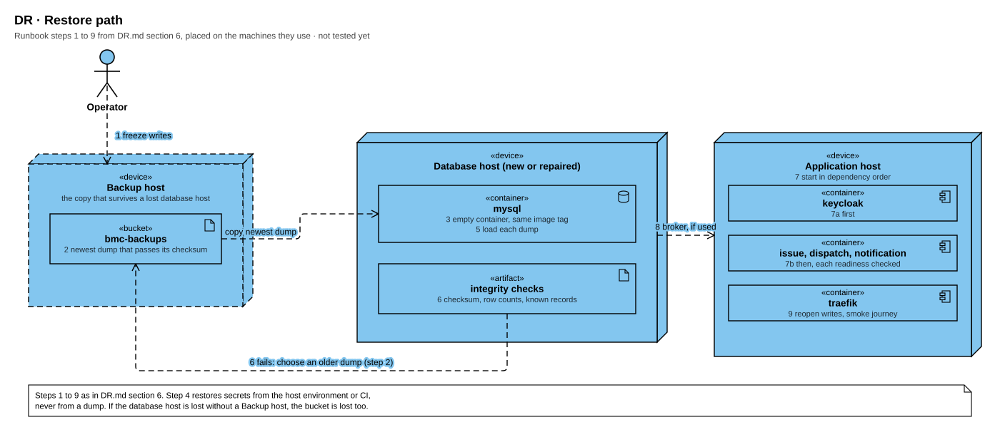

# Backup and disaster recovery

**Issue:** [#42 — DEVOPS-02: Observability and DR](https://github.com/Phenriquerafael/LABDSOF_G9A/issues/42)
**Status:** proposal, revised on 2026-11-01 to follow the physical views and ADR-004. **No backup has been created and no restore has been performed.**

Related: [observability plan](OBSERVABILITY.md), [CI/CD strategy](CICD.md), [configuration sketches](OBSERVABILITY-configs.md), [physical views](../07b-physical-views.md) (P1, P4, P5), [ADR-004](../adr/ADR-004-deployment-contract.md), [ADR-010](../adr/ADR-010-object-storage.md).

---

## 1. Focus and scope

**Focus: the database.** It holds the data users depend on, so it gets the most protection and the most restore testing. Everything else is rebuilt from Git and the secrets store, or accepted as lost.

The system runs on three machines, following ADR-004 and the physical views:

| Machine | Runs | Provider |
|---|---|---|
| Application host | Docker Compose: Traefik, client, services, RabbitMQ, Prometheus, Grafana and the other application containers | Not chosen (college server, VPS or VM; EN01-U3) |
| Database host | MySQL 8.4 (one database per service: `issue`, `dispatch`, `notification`, `keycloak`), Garage with `bmc-attachments` (report photos), and the nightly backup job | Not chosen; separate from the application host |
| Backup host | Garage with the `bmc-backups` bucket (proposal, see section 2) | Not chosen |

The database is **not** in Amazon RDS. ADR-004 runs MySQL as a container on a Docker host, and this document follows it. Section 2 records what changed from the earlier AWS plan.

Out of scope: multi-region recovery, log and metric history, and production compliance claims.

---

## 2. Database location (decided by ADR-004; host not chosen)

| Item | Earlier plan (AWS EC2, RDS recommended) | Current plan (ADR-004, physical views) |
|---|---|---|
| Engine | PostgreSQL (assumed) | MySQL 8.4 LTS, one instance, one database per service |
| Location | Amazon RDS or a container on the EC2 server | A container on the Database host, separate from the application host |
| Backups | RDS automated backups and snapshots | Nightly `mysqldump` run by a cron job on the Database host (ADR-004 runbook, decision D2) |
| Backup storage | Encrypted object storage off the server | Garage bucket `bmc-backups` on the Backup host (proposal); single-node Garage has no redundancy (E46) |
| Off-host copy | Off-AWS copy | Cloudflare R2 is **optional and not part of the academic release** (ADR-004, ADR-010) |

**Open points, not settled here:**

- The Backup host is a proposal. ADR-004 says backups go to the Garage on the Database host, so a third machine changes the decision and needs an ADR update.
- The private link between the hosts, and the copy of the database metrics (P-08 in [07b](../07b-physical-views.md#10-open-items-found-while-drawing-the-views)), are not in ADR-004.
- The provider of each host is not chosen (P-07 and EN01-U3). The AWS choice in PR #48 conflicts with ADR-004 and must be settled at the team review.

---

## 3. What is backed up

1. **The four service databases:** `issue`, `dispatch`, `notification` and `keycloak`. They include the outbox tables for events not yet sent, and Keycloak's realm data, including its signing keys. A separate export of the token signing key is therefore not needed, but the spike must confirm that the keys are in the database dump.
2. **Report photos:** `bmc-attachments` on Garage on the Database host. The team has adopted report photos (ADR-010), so the bucket is backed up nightly with the databases (section 4.1, step 5). Photos are personal data (DEC-07): their copies follow the same retention rule, which is still open.
3. **RabbitMQ definitions** (exchanges, queues, bindings, users), if RabbitMQ is adopted (ADR-003). Messages in flight are covered by the outbox.
4. **Backup metadata** for each run: checksum, size, time and row counts.

**Not backed up:** secrets (restored by hand), container images (pulled by version), logs and metrics, and dashboards (provisioned from Git).

---

## 4. Backup flow

Scope of this section: ADR-004 decision D2 (review decisions register). The steps are a proposal to test in the spike and are **not run yet**.

| Copy | Frequency | Retention (proposal) | Where it lands |
|---|---|---|---|
| `mysqldump` of each service database, read-only backup user | Nightly (ADR-004) | Set when the restore is tested; the register records no retention yet | Garage `bmc-backups` (Backup host, proposal) |
| `bmc-attachments` copy (report photos) | Nightly, changed files only | Open with DEC-07 | Garage `bmc-backups`, under `attachments/` |
| Volume snapshot of the MySQL data | Not in ADR-004; open | Open | Open |
| Off-host copy to Cloudflare R2 | Optional, outside the academic release | Open | Not in release |
| RabbitMQ definitions | With the nightly job, if RabbitMQ is used | Open | `bmc-backups` |

**Recovery targets (proposal):** RPO of 24 hours, the interval of the nightly dump; the team can ask for more frequent dumps, but that is a change to ADR-004. RTO of 4 hours. Both must be checked against the real data size and restore time (NFR-09).

### 4.1 How the nightly backup runs (proposal, not tested)

Commands are examples with placeholders. They must be checked against the MySQL and Garage documentation before the first run.

1. A cron job on the Database host (ADR-004: "a cron job on the Docker host, not a container") starts once a night.
2. For each database, dump it with a read-only backup user, so the job cannot write:
   `mysqldump --single-transaction --user=<backup-user> <db-name> > /var/backups/bmc-<db>-<UTC timestamp>.sql` (the `--single-transaction` flag is for InnoDB and needs checking against the MySQL 8.4 manual).
3. Compress each dump, and write a SHA-256 checksum next to it.
4. Copy the dump and checksum to the Garage bucket `bmc-backups` through its S3 API, with the bucket key kept in the host environment.
5. Copy each new or changed object from `bmc-attachments` to `bmc-backups` under `attachments/`, and write a manifest that lists the SHA-256 checksum of every photo. The copy tool is not chosen; the S3 API is the interface.
6. Delete local copies older than a day; the retention of the bucket is set separately.
7. Every night, restore the newest dump into a scratch MySQL container and compare row counts for the main tables, and compare the photo manifest with the copied objects. A failure raises an alert.

**Credentials:** the backup user and the bucket key are in the host environment, never in Git (ADR-004, P-03).

**Encryption before the copy:** not in ADR-004. The idea of encrypting each dump with a public key, so a compromised host cannot read old copies, is still a proposal for the team.

**Alerting (proposal):** a failed or missing nightly backup must raise an alert, because the RPO is then no longer true. Two parts, neither needing Prometheus or the private link:

- **Failure:** the job checks the exit status of each step. On any error it posts a message to the chat channel webhook and stops.
- **Missing run:** after each successful backup, the job makes one outbound HTTPS request to an external heartbeat service. The service expects that request every day and alerts through the chat channel when it does not arrive. This also covers the job never starting and the Database host being down.

The heartbeat service is not chosen. Both parts need outbound HTTPS from the Database host, which ADR-004 does not provide yet. See [observability alerts](OBSERVABILITY.md#7-alerts).

---

## 5. Integrity checks

Each run records a checksum, size, time and row counts for the main tables. A restore is accepted only if the checksum matches, the row counts match the recorded values (allowing for writes after the dump), and a known record is found in each main table.

Photos: the restored `attachments/` objects must match the manifest for each checksum, and every photo referenced by a restored report must exist. A missing photo is reported as a data gap, not silently accepted.

A failed or missing backup raises an alert, because the RPO is then no longer true.

---

## 6. Restore runbook

Based on the ADR-004 runbook (backup and restore kept simple for the academic release, exercised once).

1. Freeze writes: put the gateway in maintenance mode.
2. Pick the newest dump that passes its checksum.
3. Start a MySQL container on the Database host (or a replacement host) from the same image tag as production.
4. Restore secrets from the host environment or CI secrets, never from a dump.
5. Load each service's dump into its database. Keycloak's dump is restored with its own database. Copy the `attachments/` objects back into `bmc-attachments` and check them against the manifest.
6. Run the integrity checks. If they fail, go back to step 2 and choose an older copy.
7. Start the services in dependency order: Keycloak, then Issue and Dispatch, then Notification, then the gateway. Each must pass its readiness check (ADR-012 names the endpoints).
8. Restore RabbitMQ, if used: import the definitions; each service's outbox republishes unsent events.
9. Reopen writes and run the smoke journey (sign in, report an issue, view it). Record the data gap and the total time against the RTO.

If the Database host is lost, the Garage bucket on the Backup host (if adopted) is the only copy, and the restore starts from step 3 on a new Database host. Without the Backup host, the bucket is on the same machine and is lost with it (ADR-004).

---

## 7. Failure scenarios

| Scenario | Response | Recovery |
|---|---|---|
| Rows deleted by a user or operator | Find the deletion time; freeze the affected writes if needed | Restore to a scratch database and copy missing rows back, or restore fully within the RPO |
| Bad migration | Roll back the application image; stop further migrations | Restore the dump taken before the migration, if the schema changed |
| Database failure | Readiness fails for the affected services; return explicit errors, never a false acknowledgement | Restore the dump (section 6) |
| Photos lost or unreadable | Report the affected reports; keep the manifest for evidence | Restore from `bmc-backups/attachments/`; a photo not in any copy is recorded as lost |
| Corruption found by checks | Freeze writes; keep the damaged copy for analysis | Restore the last copy that passes |
| Database host lost | Prometheus cannot scrape the database host (P-08 gap) and the uptime check must cover it | Runbook steps 3 to 9 |
| Application host lost | The external uptime check reports it | Rebuild from the image tag and Compose file; the database host is unaffected |
| Token signing key lost | Users are signed out and old tokens stop working | Keycloak's signing keys come from its database dump; if unavailable, issue a new key and ask users to sign in again |
| Broker data lost | Check the outbox tables | Restore definitions; republish from the outbox; consumers ignore duplicates |
| Backup fails or does not run | Chat message on failure; heartbeat alert when the daily request is missing | Fix the job, run a manual dump, record the gap |
| Backup credential leaked | Revoke it; review access records | Rotate keys, re-check newer copies, assess the personal-data impact |
| Region or provider outage | Out of scope for the MVP | Documented as a limitation |

---

## 8. Restore tests

Planned, not yet executed.

- **When:** once before the academic release, as NFR-09 requires, and before each release that changes the schema.
- **How:** restore the newest dump into a scratch environment, run the integrity checks, start the services, and run the smoke journey.
- **Pass:** the restore finishes within the RTO, the checks pass, the readiness checks pass on every service, and the smoke journey works.
- **Evidence:** date, copy name, duration, row counts, result and the person who ran it. Counts and identifiers only, never personal data.
- **On failure:** record an issue, fix it, and repeat the test before the next release.

---

## 9. Limitations and open decisions

- No backup or restore exists yet. The RPO and RTO are proposals.
- **Backup host:** a separate machine for `bmc-backups` contradicts ADR-004's current wording and needs an ADR update if adopted.
- **Garage has a single node** and no redundancy (E46). A failure of the Database host can take the backups with it unless the Backup host exists.
- **Off-host copy:** Cloudflare R2 is optional and outside the academic release (ADR-004, ADR-010).
- **Volume snapshots and retention** are not set in ADR-004.
- **Photo retention:** how long photo copies are kept, and when they are deleted, is open under DEC-07. The register needs a DEC entry for the adoption (ADR-010 points to a DEC entry opened by Afonso).
- **Provider choice** for each host is open (P-07, EN01-U3), and the PR #48 AWS proposal conflicts with ADR-004.
- The runbook has not been tested.
- No external sources are cited yet. MySQL and Garage behaviour must be checked against their current documentation before the team relies on it.
