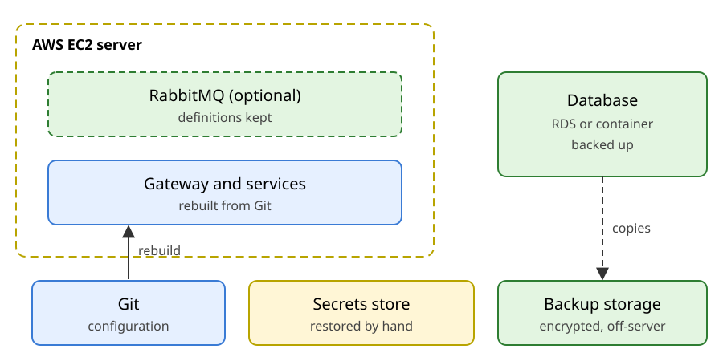
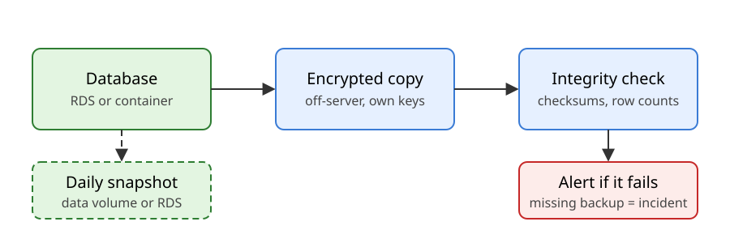
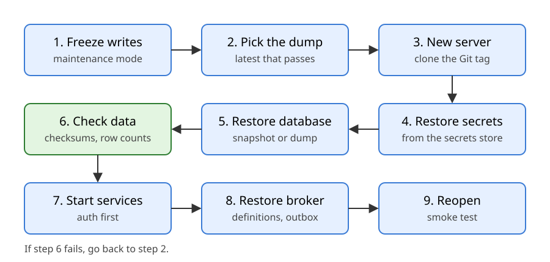

# Backup and disaster recovery

**Issue:** [#42 — DEVOPS-02: Observability and DR](https://github.com/Phenriquerafael/LABDSOF_G9A/issues/42)
**Status:** proposal. **No backup has been created and no restore has been performed.**

Related: [observability plan](OBSERVABILITY.md), [CI/CD strategy](CICD.md), [configuration sketches](OBSERVABILITY-configs.md).

---

## 1. Focus and scope

**Focus: the database.** It holds the data users depend on, so it gets the most protection and the most restore testing. Everything else is rebuilt from Git and the secrets store, or accepted as lost.

The system runs on one AWS EC2 server (gateway, Dispatch, Issue, auth, optional RabbitMQ and the observability containers). The database may live on that server or in Amazon RDS; section 2 covers the choice.

Out of scope: multi-region recovery, log and metric history, and production compliance claims.

*Figure A. Green is backed up. The services come back from Git, and the secrets are restored by hand.*

---

## 2. Database location (decision needed)

| | Option A: container on the EC2 server | Option B: Amazon RDS (recommended) |
|---|---|---|
| Backups | We schedule dumps and volume snapshots | The service takes automated backups and snapshots; point-in-time restore is available |
| Restore | We run every step ourselves | Restore a snapshot or point in time into a new instance, then reconnect the services |
| If the server is lost | Database is lost with it unless a copy was made | Database survives; only the application server is rebuilt |
| Our effort | Higher; we must prove every step | Lower; we still keep our own off-AWS copy (section 4) |
| Cost | Included in the server | Extra instance, storage and backup charges |
| Network | Same host | Must be reachable from the server inside the AWS network |

**Recommendation:** Option B. The focus is the database, and a managed backup service reduces the custom code we must prove works. The team must still confirm:

- the monthly cost against the course budget, using the AWS pricing page with an access date;
- the backup retention limits and restore behaviour in the AWS documentation for the chosen engine;
- the database engine, which the technical design has not yet fixed.

Either way, a separate copy of the data (section 4) stays outside the database service, so one mistake in the AWS account cannot remove every copy.

---

## 3. What is backed up

1. **The database:** every table, including issues, reports, assignments, users and roles, audit records, and the outbox tables for events not yet sent.
2. **The token signing key** from auth, as an encrypted export kept off the server.
3. **RabbitMQ definitions** (exchanges, queues, bindings, users), only if RabbitMQ is adopted.
4. **Backup metadata** for each run: checksum, size, time and row counts.

**Not backed up:** secrets (restored by hand), container images (rebuilt or pulled by version), logs and metrics, dashboards (provisioned from Git), and messages in flight (covered by the outbox).

Open question: if reports can include photos or documents, their storage must be added here. The design does not say yet whether they exist.

---

## 4. Backup flow

*Figure B. Both options end in the same off-server copy and the same integrity check.*

| Copy | Frequency (proposal) | Retention (proposal) | Applies to |
|---|---|---|---|
| Service backups and snapshots | Automatic (RDS) or daily snapshot (container) | 30 days | A and B |
| Logical dump copied off the server | Hourly, or daily if the team accepts a 24 h RPO | Hourly 7 days; daily 30 days; monthly 12 months | A and B |
| Token signing key export | Once, and after each rotation | Kept as long as the key may be needed | A and B |
| RabbitMQ definitions | Daily and after changes | 30 days | If RabbitMQ is used |

Each dump is encrypted before it leaves the server, with the team's **public** key. Only the public key is on the server, so a compromised server cannot read old copies. The private key is kept offline by two named holders, never in the backup storage. Backup storage needs versioning or a deletion lock, so a compromised account cannot erase the copies. Check the provider's current documentation before relying on either.

Migrations must work with the previous application version, so rolling back the application never needs a database rollback.

### 4.1 How the backups run (proposal)

The database engine is not decided. These steps assume **PostgreSQL**. The commands are examples with placeholders, **not tested**, and must be checked against the tool and AWS documentation before the first run.

**Option A: database container on the EC2 server**

1. A scheduled job on the host (cron) runs the dump hourly and the volume snapshot daily.
2. Dump the database from its container, compressed:
   `docker exec <db-container> pg_dump -U <db-user> -Fc <db-name> > /backups/bmc-$(date -u +%Y%m%dT%H%M%SZ).dump`
3. Encrypt the dump with the team's public key, for example with `gpg --encrypt --recipient <backup-key-id>`.
4. Write a SHA-256 checksum file next to the encrypted dump.
5. Copy both files to backup storage, using an account on the server that can write but not delete.
6. Once a day, take a snapshot of the EBS volume that holds the database data.
7. Every night, restore the latest dump into a scratch container and compare row counts for the main tables. A failure raises an alert.
8. Delete local copies older than one day. Retention in backup storage is set by lifecycle rules.

**Option B: Amazon RDS**

1. Turn on automated backups with a retention period of 14 days, which is inside the 35-day maximum, and a backup window outside office hours. Point-in-time restore then works for those 14 days without custom code.
2. Once a week, take a manual snapshot, for example `aws rds create-db-snapshot --db-instance-identifier <db-id> --db-snapshot-identifier bmc-$(date -u +%Y%m%d)`. Manual snapshots stay until someone deletes them, so they provide the monthly copies.
3. For a copy outside the AWS database service, the application server runs steps 2 to 5 of Option A against the RDS endpoint over the private network.
4. Every night, restore the latest dump into a scratch container and compare row counts, as in Option A step 7. Once a week, restore the latest snapshot as a test.
5. A failed job, or an RDS backup event that reports a failure, raises an alert. The newest backup must be younger than the RPO, and an alert fires if it is not.

**Both options**

- The backup account on the server has write-only access, and the database password comes from the secrets store.
- A failed job posts to the Discord webhook used by the [observability alerts](OBSERVABILITY.md#7-alerts).
- A second member reviews the newest backup each week and records the check.

**Sources (accessed 2026-10-29):**
- Automated backups with a retention period of up to 35 days, and manual snapshots kept until deleted: [Amazon RDS for PostgreSQL](https://aws.amazon.com/rds/postgresql/).
- Manual snapshots restore only to the moment they were taken, while automated backups allow point-in-time restore: [AWS Database Blog, RDS snapshot restore and recovery](https://aws.amazon.com/blogs/database/amazon-rds-snapshot-restore-and-recovery-demystified/).
- Not verified: the exact CLI syntax, the `pg_dump`, `gpg` and EBS commands, and the current backup window and retention limits. Check each before the first test.

**Recovery targets (proposal):** RPO of 1 hour with hourly dumps, or 24 hours with daily dumps. RTO of 4 hours. The team chooses the RPO; the values must be checked against the real data size and restore time (NFR-09).

---

## 5. Integrity checks

Each run records a checksum, size, time and row counts for the main tables. A restore is accepted only if the checksum matches, the row counts match the recorded values (allowing for writes after the dump), and a known record is found in each main table.

A failed or missing backup raises an alert, because the RPO is then no longer true (see [observability alerts](OBSERVABILITY.md#7-alerts)).

---

## 6. Restore runbook

*Figure C. The steps below match the figure.*

1. Freeze writes: put the gateway in maintenance mode.
2. Pick the latest dump or snapshot that passes its checks.
3. Provision a new server, or reuse the existing one if its disk is intact, and clone the Git tag being recovered.
4. Restore secrets from the secrets store, never from a dump.
5. Restore the database: a new RDS instance from the snapshot (Option B), or an empty database container loaded from the dump (Option A).
6. Run the integrity checks. If they fail, go back to step 2 and choose an older copy.
7. Start the services in dependency order: auth, Issue, Dispatch, then the gateway. Each must pass `/readyz`.
8. Restore the broker, if used: import the definitions; each service's outbox republishes unsent events.
9. Reopen writes and run the smoke journey (sign in, report an issue, view it). Record the data gap and the total time against the RTO.

---

## 7. Failure scenarios

| Scenario | Response | Recovery |
|---|---|---|
| Rows deleted by a user or operator | Find the deletion time; freeze the affected writes if needed | Restore to a scratch database and copy missing rows back, or restore fully within the RPO |
| Bad migration | Roll back the application image; stop further migrations | Restore the snapshot taken before the migration |
| Database failure | Show `down` in `/status`; return explicit errors, never a false acknowledgement | Restore a snapshot (B) or a dump onto a new volume (A) |
| Corruption found by checks | Freeze writes; keep the damaged copy for analysis | Restore the last copy that passes |
| Server lost | The external uptime check reports it | Runbook steps 3 to 9 |
| Token signing key lost | Users are signed out and old tokens stop working | Restore the key from its encrypted export; if unavailable, issue a new key and ask users to sign in again |
| Broker data lost | Check the outbox tables | Restore definitions; republish from the outbox; consumers ignore duplicates |
| Backup fails silently | Alert fires | Fix the job, run a manual backup, record the gap |
| Backup credential leaked | Revoke it; review access records | Rotate keys, re-encrypt newer copies, assess the personal-data impact |
| Region or provider outage | Out of scope for the MVP | Documented as a limitation |

---

## 8. Restore tests

Planned, not yet executed.

- **When:** once per sprint, and before each release that changes the schema.
- **How:** restore the latest copy into a scratch environment, run the integrity checks, start the services, and run the smoke journey.
- **Pass:** the restore finishes within the RTO, the checks pass, `/readyz` passes on every service, and the smoke journey works.
- **Evidence:** date, copy name, duration, row counts, result and the person who ran it. Counts and identifiers only, never personal data.
- **On failure:** record an issue, fix it, and repeat the test before the next release.

---

## 9. Limitations and open decisions

- No backup or restore exists yet. The RPO and RTO are proposals.
- **Database location and engine are not decided** (section 2). The recommendation is RDS, pending the cost and engine checks.
- Backup storage location and provider, snapshot tooling and costs are not chosen. Check prices on the provider's pricing page, with a date, before deciding.
- Retention, especially for audit records, is open.
- The outbox design (NFR-04) and token lifetime are open in the technical design; the recovery steps depend on them.
- Attachments: not yet covered (section 3).
- The runbook has not been tested.
- No external sources are cited yet. Provider behaviour must be checked against current documentation before the team relies on it.
