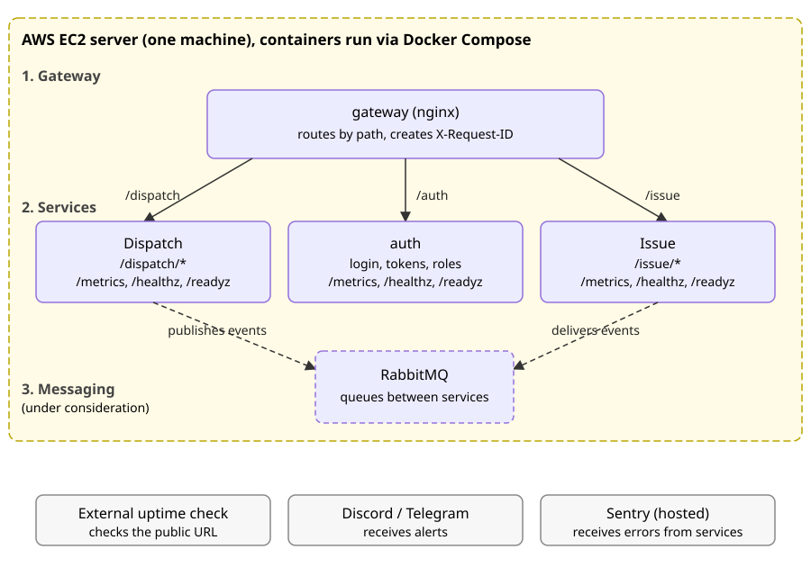
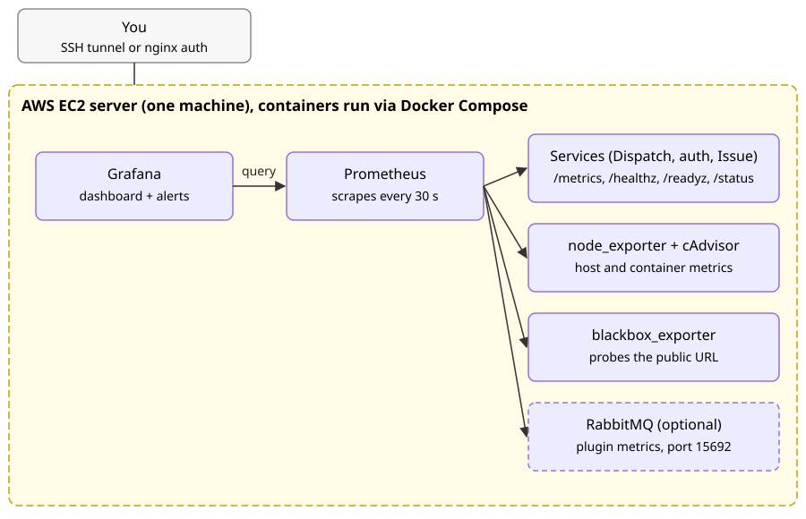
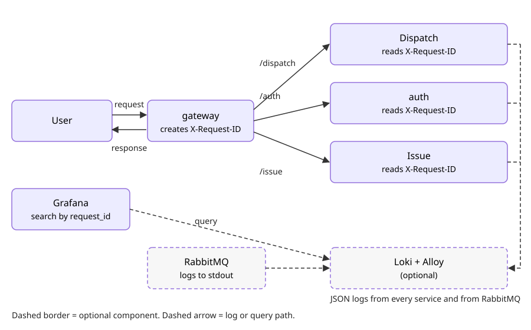
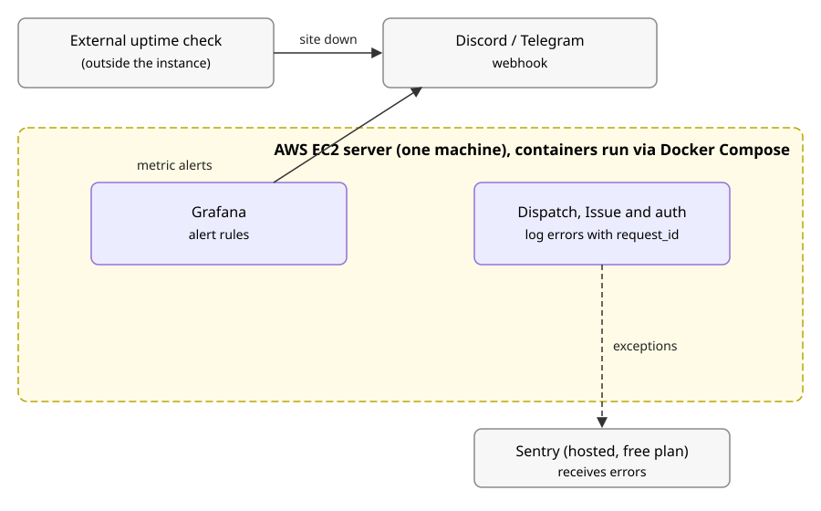

# Observability and Resilience Plan

Scope: a university project. One EC2 instance running Docker Compose with an nginx reverse proxy (or gateway) and one or two services. The goal is to meet the course requirements (sections 6.6 to 6.8), see problems quickly, and have a clear demo, not enterprise-grade monitoring.

Stack: **Prometheus + Grafana** (no CloudWatch).

## Decisions at a glance

| Decision | Status | Where |
|---|---|---|
| One AWS EC2 server running Docker Compose | Proposed for the MVP | section 2 |
| Observability stack on the same server | Proposed for the MVP; off-box is future work | sections 2, 16 |
| Prometheus and Grafana for metrics and dashboards | Proposed | sections 4.4, 6 |
| Gateway: nginx | Recommended, not yet agreed | section 2.1 |
| Error reporting: Sentry or log-based | Open | section 4.5 |
| Log stack (Loki and Alloy) | Optional | section 3 |
| Messaging with RabbitMQ | Under consideration | section 4.6 |
| Authentication | Mocked login allowed for the MVP; roles kept real | section 9 |
| Degraded mode demonstrated | Proposed: AI service; others listed | sections 8, 8.5 |
| RPO and RTO targets | Proposed; see [DR document](DR.md) | issue [#42](https://github.com/Phenriquerafael/LABDSOF_G9A/issues/42) |

---

## 1. Requirements coverage

| Requirement | How this plan covers it | Section |
|---|---|---|
| **6.7** Structured application logs | JSON logs with a fixed set of fields, nginx access log in JSON | 4.1 |
| **6.7** Health checks | `/healthz` (alive), `/readyz` (can serve), `/status` (dependency detail) | 4.3 |
| **6.7** Relevant metrics | Request rate, errors, latency, dependency calls, degraded-mode gauge | 4.4 |
| **6.7** Correlation or trace identifiers | `X-Request-ID` created by nginx, logged and forwarded by every service | 4.2 |
| **6.7** Error reporting | Sentry (free plan) or log-based fallback | 4.5 |
| **6.7** Small operational dashboard | One "Operations overview" dashboard | 6 |
| **6.7** Service-level indicators | Availability, latency and dependency success, with example SLO targets | 5 |
| **6.8** At least one degraded-mode scenario | Template, example and demo script | 8 |
| **6.6** Audit records | Separate structured audit log events | 9 |
| **6.6** Authentication and authorization | Mocked auth is acceptable for the MVP; keep the roles and the audit trail real | 9 |

---

## 2. Architecture

Everything runs in one Docker Compose network on the EC2 instance.

**Why the observability stack is on the same instance:** one host adds no monitoring cost, and Prometheus reaches every container by its Compose service name. The trade-off is that metrics and logs are lost if the host is lost, and the monitoring containers compete for memory (section 11). Moving the stack to a second host or a hosted Grafana is future work (section 16). The uptime check already runs outside the instance, so a full host failure is still reported.

The architecture is shown as separate figures, one per concern, instead of a single full view. The SVG files are the only source for these diagrams; edit them directly.

**Metrics and health.** Prometheus **pulls** metrics from each target every 30 seconds. Grafana queries Prometheus for the dashboard.



*Figure 1. Application layers from top to bottom: gateway, services (`Dispatch`, `auth`, `Issue`), messaging (under consideration). The gateway sends each request to one service by path. The observability containers (Prometheus, Grafana, exporters) run on the same server and are shown in Figure 2.*



*Figure 2. Prometheus pulls from every target inside the instance boundary. Only you reach Grafana from outside.*

**Requests and logs.** nginx creates the `X-Request-ID`, and each service forwards it. Logs go to stdout as JSON. Loki is optional; without it, logs are read with `docker logs`.



*Figure 3. The gateway routes each request to one service by path. The same `X-Request-ID` goes out in the response, so a user can quote it. Every service, the auth service and RabbitMQ write JSON logs; Loki collects them if it is enabled.*

**Alerts and errors.** Grafana alert rules and the external uptime check both send to one chat webhook. The uptime check runs outside the instance, because Prometheus on the same machine cannot report that the whole machine is down. Exceptions go to Sentry, which is hosted, not on the instance.



*Figure 4. Alerts leave the instance through the chat webhook. The uptime check runs outside, so it still reports when the whole instance is down. Sentry is hosted.*

| Component | Job | Port (internal) |
|---|---|---|
| Prometheus | Scrapes and stores metrics | 9090 |
| Grafana | Dashboard and alerts | 3000 |
| node_exporter | Host CPU, memory, disk, network | 9100 |
| cAdvisor | Per-container CPU, memory, restarts | 8080 |
| blackbox_exporter | Probes URLs, checks TLS expiry | 9115 |
| Application services (`Dispatch`, `Issue`) | Expose `/metrics`, `/healthz`, `/readyz`, `/status` | their own |
| Auth service (third microservice) | Login, token issuing and role checks; mocked login is acceptable for the MVP (section 9) | its own `/metrics`, `/healthz`, `/readyz`, `/status` |
| Loki + Grafana Alloy (optional) | Searchable logs, queried by `request_id` | 3100 |
| RabbitMQ (under consideration) | Queues between services; metrics via its Prometheus plugin (section 4.6) | 15692 (metrics), 15672 (management UI, not public) |
| Sentry (hosted, free plan) | Error reporting with stack traces | external |

Skipped on purpose: Alertmanager (Grafana sends the alerts), tracing backends, and database and nginx exporters. They are listed as future work.

### 2.1 Gateway: nginx or an API gateway

The gateway is the only public entry point. It routes each request to one service by path, creates the `X-Request-ID`, and is where TLS and rate limits would go.

| Option | Fit for this project | Trade-offs |
|---|---|---|
| **nginx** (current choice) | One container; routing is a plain config file in the repo; the JSON log format and `X-Request-ID` in section 4.2 already use it | Routing and any auth are written by hand; no admin UI |
| **Traefik** (self-hosted) | Reads routes from Docker labels, so adding a service needs less config | One more component to learn; request-ID behaviour must be checked in its docs before relying on it |
| **Managed API gateway** (for example AWS API Gateway) | Runs outside the instance, so it adds an external dependency and per-request cost to a demo that should run on one host | Pricing and free-tier terms must be checked on the vendor page before any decision |

Recommendation (not yet agreed by the team): keep nginx for the MVP, since it is the smallest fit and this document already depends on it. Revisit only if routing or authentication outgrows the config file.

---

## 3. Phases

| Phase | What | Done when |
|---|---|---|
| **1. Must have** | Prometheus, Grafana, node_exporter, cAdvisor; JSON logs with `request_id`; `/healthz`, `/readyz`, `/status`; external uptime check | You can see host and container state, and you get a message if the site is down |
| **2. Requirements complete** | `/metrics` in services (rate, errors, latency, dependency calls, degraded gauge); the operational dashboard; SLIs; alerts; Sentry; one degraded-mode scenario | Everything in section 1 can be demonstrated |
| **3. Future work** | Loki for logs, tracing, database and nginx exporters, off-box Prometheus copy | Mentioned in the report as next steps |

---

## 4. The application contract

### 4.1 Structured logs

Every service writes **one JSON object per line to stdout**. Required fields:

| Field | Example | Why |
|---|---|---|
| `time` | `2026-10-25T09:12:03.412Z` | Ordering |
| `level` | `info`, `warn`, `error` | Filtering |
| `service` | `orders-api` | Which service |
| `version` | `1.4.0` | Which release |
| `request_id` | `9f2c...` | Correlation across services |
| `route` | `/orders/:id` | What was called (use the template, not the raw URL) |
| `status` | `200` | Outcome |
| `duration_ms` | `34` | Latency |
| `degraded` | `true` | Whether a fallback was used |
| `error` | message and stack trace (only on errors) | Debugging |

Rules: never log passwords, tokens or personal data, and don't put raw query strings in logs.

Example line:

```json
{"time":"2026-10-25T09:12:03.412Z","level":"warn","service":"orders-api","version":"1.4.0","request_id":"9f2c7e1a4b8d4c2f9a1e0d3c5b6a7f80","route":"/recommendations","status":200,"duration_ms":2011,"degraded":true,"msg":"ai provider timeout, served cached result"}
```

### 4.2 Correlation IDs

nginx creates a unique ID for every request, passes it to the services, and returns it to the client so a user can quote it when reporting a problem.

```nginx
# in the http block
log_format json_combined escape=json
  '{"time":"$time_iso8601","request_id":"$request_id","remote_addr":"$remote_addr",'
  '"method":"$request_method","uri":"$uri","status":$status,"bytes":$body_bytes_sent,'
  '"request_time":$request_time,"upstream_time":"$upstream_response_time"}';
access_log /dev/stdout json_combined;

# in the server / location block
proxy_set_header X-Request-ID $request_id;
add_header X-Request-ID $request_id always;
```

`$uri` is used instead of `$request_uri` so query strings (which can contain tokens) stay out of the logs.

Each service must:
1. Read `X-Request-ID` from the incoming request (generate one if it is missing).
2. Put it in **every log line** and in error reports.
3. **Forward it** in the headers of calls to other services and to external providers.
4. Include it in error responses (for example in the JSON error body).

This is enough to follow one request across nginx and both services. OpenTelemetry (`traceparent` header) is the upgrade path if you later want real traces.

### 4.3 Health checks

| Endpoint | Meaning | Checks | Used by |
|---|---|---|---|
| `/healthz` | **Liveness**: the process is running | Nothing external | Docker healthcheck, uptime ping |
| `/readyz` | **Readiness**: the service can do its core job | Required dependencies, treating "degraded but working" as ready | Deploy smoke test, blackbox probe |
| `/status` | **Detail**: JSON for humans and the demo | Each dependency's state | Dashboard, presentation |

Example `/status` response:

```json
{"status":"degraded","version":"1.4.0",
 "dependencies":{"database":"up","ai_provider":"down"},
 "degraded_features":["recommendations"]}
```

**Important:** do not restart a container or remove it from nginx just because an *external* dependency is down. If the health check fails whenever the AI provider or the database is unreachable, the degraded mode never gets a chance to work, and a partial outage becomes a full one (or a restart loop). Liveness must not depend on external services.

### 4.4 Metrics

Use the Prometheus client library for your language (for example `prom-client` for Node, `prometheus_client` for Python, Micrometer for Spring Boot).

| Metric | Type | Labels | Purpose |
|---|---|---|---|
| `http_requests_total` | counter | `method`, `route`, `status` | Rate and errors |
| `http_request_duration_seconds` | histogram | `method`, `route` | Latency |
| `dependency_requests_total` | counter | `dependency`, `outcome` (`success`, `error`, `timeout`) | Health of providers and the database |
| `dependency_request_duration_seconds` | histogram | `dependency` | Slow dependencies |
| `degraded_mode` | gauge (0 or 1) | `feature` | Whether a fallback is active |
| `app_info` | gauge (always 1) | `version` | Which release is running |

**Label discipline:** use route **templates** (`/users/:id`), never raw URLs, and never user IDs or emails as label values. Every distinct label value creates a new time series.

### 4.5 Error reporting

| Option | Notes |
|---|---|
| **Sentry, Developer (free) plan** | One SDK per service. Tag events with `request_id` and `version`. Per [a June 2026 comparison](https://merginit.com/blog/14062026-free-error-monitoring-apm-comparison): 5,000 errors per month, one seat, email-only alerts. That article is third-party, so check the vendor's pricing page. **One seat** means only one team member logs in, which may matter for a group project. |
| **Log-based** (no extra tool) | Log errors as JSON with `level=error` and the stack trace, count them in an `errors_total` metric, and alert on the error rate. With Loki added, a Grafana panel can list recent errors and search by `request_id`. |
| Better Stack free plan | The same article lists 100,000 exceptions per month on its free plan. Unverified. |
| GlitchTip self-hosted | No event cap, but it needs its own Postgres and web and worker containers. Too much to run on the same small instance. |

Recommended: Sentry for the stack traces, plus the error-rate metric and alert, so error reporting does not depend on one tool.

### 4.6 Messaging (RabbitMQ, under consideration)

Only relevant if the team adopts RabbitMQ. Services publish events and the consumer processes them later; a queue that grows or stops draining is the main early warning sign.

- **Metrics:** the `rabbitmq_prometheus` plugin serves metrics on port 15692 at `/metrics`, enabled with `rabbitmq-plugins enable rabbitmq_prometheus`. It is included from RabbitMQ 3.8 onwards. Source: [rabbitmq-prometheus README](https://github.com/rabbitmq/rabbitmq-prometheus/blob/master/README.md), accessed 2026-10-29. Per-object metrics are off by default and should stay off in production, because they are costly with many queues.
- **Health:** a queue that is not draining (messages ready rising, no consumers) is the signal to watch. The Prometheus scrape of the plugin is the health check for the broker itself.
- **Queue metrics to chart:** messages ready and unacknowledged per queue, consumer count, and the dead-letter queue depth. Metric names must be checked against the pinned RabbitMQ version before use.
- **Alerts (proposal):** queue depth rising for an agreed period; zero consumers on a queue that should have them; a non-empty dead-letter queue.
- **Degraded mode:** if the broker is down, the service stores the event in its own database table for later publication, the same pattern as the outbox in NFR-04. The user is not told that a notification is delayed unless it is part of the scenario being demonstrated.
- **Logs:** RabbitMQ writes its own logs to stdout like any container, so Loki collects them with the services' logs. Each message carries the `request_id` in its headers, so a consumer log line can be matched to the original request.

---

## 5. Service-level indicators (SLIs)

An SLI is a number that tells you whether users are having a good experience. An SLO is the target you set for it. Pick targets that match your product and be ready to explain the choice. The numbers below are examples.

| SLI | Definition | Example SLO |
|---|---|---|
| **Availability** | Share of requests that did not fail on the server (not 5xx) | 99% over 7 days |
| **Latency** | 95th-percentile duration of the core user journey | p95 under 500 ms |
| **Dependency success** | Share of successful calls to each external provider or the database | 95% per dependency |
| **Degraded share** | Share of time or requests served in degraded mode | Under 5% over 7 days |

PromQL (adjust metric names to your client library):

```promql
# availability (5 minute window)
sum(rate(http_requests_total{status!~"5.."}[5m]))
  / sum(rate(http_requests_total[5m]))

# p95 latency of the core route
histogram_quantile(0.95,
  sum by (le) (rate(http_request_duration_seconds_bucket{route="/orders"}[5m])))

# dependency success per dependency
sum by (dependency) (rate(dependency_requests_total{outcome="success"}[5m]))
  / sum by (dependency) (rate(dependency_requests_total[5m]))

# is any fallback active right now
max(degraded_mode) == 1
```

Count 4xx responses as successful for availability, since they are the client's mistakes, but watch them separately.

---

## 6. The operational dashboard

One dashboard called **Operations overview**, with these rows:

| Row | Panels |
|---|---|
| **Status** | Probe up/down, running version, `degraded_mode` indicator |
| **SLIs** | Availability, p95 latency, dependency success per dependency, with the SLO target as a line |
| **Traffic** | Request rate, 5xx rate, requests by route |
| **Saturation** | CPU, memory available, disk used and predicted fill, container restarts |
| **Errors** | Error rate; with Loki, a table of recent errors; the Sentry link |

Store the dashboard as JSON in the repo and provision it into Grafana. For the host row, the community dashboard **Node Exporter Full** is a candidate source for panels. Its Grafana ID (1860) is unverified and must be checked on grafana.com before use.

---

## 7. Alerts

Alerts are defined in Grafana and sent to a **Discord or Telegram webhook**. These need no mail server, unlike Grafana's email contact point, which needs SMTP configured.

| Alert | Condition | Severity |
|---|---|---|
| Target down | `up == 0` for 2 minutes | Page |
| Site unreachable | `probe_success == 0` for 2 minutes | Page |
| High error rate | 5xx share of requests above 5% for 5 minutes | Page |
| **Degraded mode active** | `max(degraded_mode) == 1` for 1 minute | Warn |
| Dependency failing | Dependency success under 90% for 5 minutes | Warn |
| Latency SLO breach | p95 above target for 10 minutes | Warn |
| Disk filling | Predicted to fill within 24 hours | Warn |
| Memory low | Available memory under 10% for 10 minutes | Warn |
| Container restarting | More than 2 restarts in 15 minutes | Warn |
| Auth unavailable | Auth `/readyz` failing for 2 minutes | Page |
| Broker queue growing | Queue depth rising for an agreed period (only if RabbitMQ is used) | Warn |
| No consumers | A queue that should have consumers has none (only if RabbitMQ is used) | Page |
| Dead letters | Dead-letter queue not empty (only if RabbitMQ is used) | Warn |

Keep the list short. An alert that fires constantly gets ignored.

---

## 8. Degraded-mode scenario (6.8)

You must implement and **demonstrate** at least one scenario. The requirement lists: an external data provider, an AI service, a network connection, a database, a notification provider, or a backend component. Choose the one your product actually depends on. An external provider or AI service is the easiest to simulate and to degrade gracefully.

### 8.1 Scenario template

Fill in one of these per scenario:

| Item | To define |
|---|---|
| **Dependency** | Which one becomes unavailable |
| **Detection** | Timeout, error rate, or circuit breaker that opens |
| **Behaviour** | What the product does instead (cached last-known data, simplified result, queue for later, feature disabled) |
| **User message** | Clear text and a visible banner explaining the limitation |
| **Unaffected features** | What still works normally |
| **Recovery** | How it returns to normal without manual action |
| **Evidence** | Metric, log line, alert and screenshot |

### 8.2 Example (AI service unavailable)

| Item | Example |
|---|---|
| Dependency | The AI provider API |
| Detection | 2 second timeout, 1 retry, circuit breaker opens after 5 failures in 30 seconds |
| Behaviour | Serve the last cached result, or a rule-based answer, and mark the response `degraded` |
| User message | Banner: "Recommendations are temporarily simplified. Everything else works normally." |
| Unaffected | Login, browsing, saving data |
| Recovery | The breaker tries again after 30 seconds and closes on success |
| Evidence | `degraded_mode{feature="recommendations"} = 1`, log lines with `degraded:true`, a warning alert, a screenshot of the banner |

### 8.3 Implementation checklist

- **Short timeouts** on every external call, with a limited number of retries using backoff and a little randomness.
- **Circuit breaker** so a failing provider doesn't slow down every request.
- **Fallback** that is safe, never a made-up answer presented as real.
- **Tell the user** in the response (for example `X-Service-Mode: degraded` header and a field in the body) and in the interface.
- **Report it**: set `degraded_mode`, log `degraded:true`, and count `dependency_requests_total{outcome="error"}`.
- **Do not fail the liveness check** because of the dependency (see section 4.3).

### 8.4 Demo script

1. Show the normal state: dashboard green, a request works, note its `request_id`.
2. Break the dependency: `docker compose stop <mock-or-dependency>` (or point the provider URL at a closed port, or `docker compose stop postgres` for a database scenario).
3. Use the product: show the banner and that unaffected features still work.
4. Show the dashboard: `degraded_mode = 1`, dependency success dropping, the warning alert arriving.
5. Follow the request: find the `request_id` in the logs and the Sentry event.
6. Restore it: `docker compose start <dependency>`. Show automatic recovery and the banner disappearing.

### 8.5 Other scenarios to define

Use the same template as 8.1 for each. Proposed starting points:

| Item | Auth service unavailable | Broker (RabbitMQ) unavailable |
|---|---|---|
| Dependency | `auth` (login and token issue) | RabbitMQ |
| Detection | `/readyz` on auth fails; `/status` shows `down` | Connection errors; `dependency_requests_total{outcome="error"}` rises |
| Behaviour | Existing tokens keep working until they expire; new logins are refused with a clear error | Services keep events in their own table and publish them when the broker returns (outbox pattern, NFR-04) |
| User message | "Sign-in is temporarily unavailable" | Notifications may be delayed; no error shown unless this scenario is being demonstrated |
| Unaffected | Viewing and reporting for users already signed in | Reporting, viewing and triage |
| Recovery | Auth readiness returns and logins resume | Outbox drains; consumers ignore duplicate events |
| Evidence | `/status` before and after; refused logins as audit events; dashboard | Outbox backlog rising and falling; log lines |

Token lifetime and the outbox design are open decisions for the technical design.

---

## 9. Audit records and access (6.6)

The course allows mocked authentication for the MVP. The observability side of access control still applies:

- **Audit events are a separate, structured log type** (for example `"log_type":"audit"`), not mixed into normal debug logs:

```json
{"log_type":"audit","time":"2026-10-25T09:15:41Z","actor":"user-42","role":"admin","action":"order.delete","target":"order-9001","outcome":"success","request_id":"9f2c7e1a4b8d4c2f9a1e0d3c5b6a7f80","auth_mode":"mock"}
```

- Record who did what to which object, the outcome, the `request_id`, and `auth_mode` (so it is honest that the identity was mocked).
- Never put passwords, tokens or unnecessary personal data in audit events.
- Keep **roles real even if login is mocked**: for example a `user` and an `admin` role with the authorization checks enforced in the services.
- **Service-to-service calls** between the services: keep them on the private Docker network and require a shared secret or signed token, and keep that secret out of the repo.
- **Auth service:** login, token issue and role-denied events are audit records with `auth_mode`. Its tokens are checked by the other services, so authorization does not depend on the auth service being called on every request. That check is a design choice for the team to confirm.
- With Loki, audit events can be filtered by `log_type`. Without it, `docker logs <service> | jq 'select(.log_type=="audit")'` works for the demo.

---

## 10. Configuration sketches

The Prometheus, Compose and log-rotation sketches are in [OBSERVABILITY-configs.md](OBSERVABILITY-configs.md). They are starting points and have not been run.

---

## 11. Resources and cost

- **Everything runs on the existing EC2 instance, so there is no extra monitoring cost.** Sentry and the uptime check use free plans.
- **Memory is the limit.** Prometheus, Grafana and cAdvisor together typically use a few hundred MB, which is tight on a 1 GB instance that also runs nginx, the services and a database. Loki would add more. Check real usage with `docker stats` and consider a 2 GB instance.
- **Disk:** Prometheus retention is capped at 15 days and 2 GB in the config above. Alert on disk usage.
- **Set an AWS budget alert,** and stop instances you are not using.

## 12. Security

- **Bind Prometheus and Grafana to `127.0.0.1`** as in the Compose file, and reach them through nginx with TLS and authentication, or through an SSH tunnel.
- **Never open the exporter ports** (9100, 8080, 9115, 9090) in the EC2 security group.
- **Set a real Grafana admin password** from a secret, not the default.
- **No secrets or personal data** in logs, metrics, labels, dashboards or error reports. Configure Sentry to scrub request bodies and headers.
- The Discord or Telegram webhook URL and the Sentry DSN are secrets. Keep them out of the repo.

## 13. In the repo and in CI

```
observability/
├── prometheus.yml
├── dashboards/
│   └── operations-overview.json
└── provisioning/        # Grafana data source and dashboard provisioning
docker-compose.observability.yml
```

- Changes go through PRs like all other code.
- **CI check:** run `promtool check config observability/prometheus.yml` (for example with the `prom/prometheus` image) so a broken config fails the PR.
- **Release workflow:** call `/readyz` after each deploy as a smoke test.
- **Optional:** post a deploy annotation to Grafana so graphs show when each version went out.

---

## 14. Checklist

- [ ] Services write JSON logs with the required fields, including `request_id`
- [ ] nginx creates and returns `X-Request-ID`; services log and forward it
- [ ] `/healthz`, `/readyz` and `/status` implemented; liveness does not depend on external services
- [ ] `/metrics` exposes request, dependency, `degraded_mode` and `app_info` metrics
- [ ] Error reporting works (Sentry or log-based), with `request_id` attached
- [ ] SLIs and SLO targets chosen and justified
- [ ] "Operations overview" dashboard provisioned from the repo
- [ ] Alerts configured and sent to Discord or Telegram (test each by breaking something)
- [ ] At least one degraded-mode scenario implemented, with a user-visible message
- [ ] Degraded-mode demo rehearsed
- [ ] Audit events logged separately from normal logs
- [ ] Prometheus and Grafana bound to localhost; no exporter ports open in the security group
- [ ] Docker log rotation enabled
- [ ] `promtool check config` in CI
- [ ] AWS budget alert set

---

## 15. Report tips

- **Show an incident end to end** with the demo script in section 8.4, and include the screenshots in the report.
- **Show a load test:** a short run with a tool like `hey` or `k6` makes the request-rate and latency graphs move.
- **Justify the SLO numbers** with the product's needs, not just "99% sounds good".
- **Future work to mention:** logs in Loki, distributed tracing with OpenTelemetry, database and nginx exporters, an off-box Prometheus copy, and SLO burn-rate alerts.

## 16. Limits

- **Prometheus on the same host cannot report that the host is down.** The external uptime check covers this.
- **Short retention** (15 days) and one disk: if the disk is lost, the history is lost.
- **Without Loki,** logs are read with `docker logs` and `jq`, which is fine for a demo but doesn't scale.
- **Sentry's free plan has limits** (quota and seats), so confirm them on the vendor's page before relying on it.
