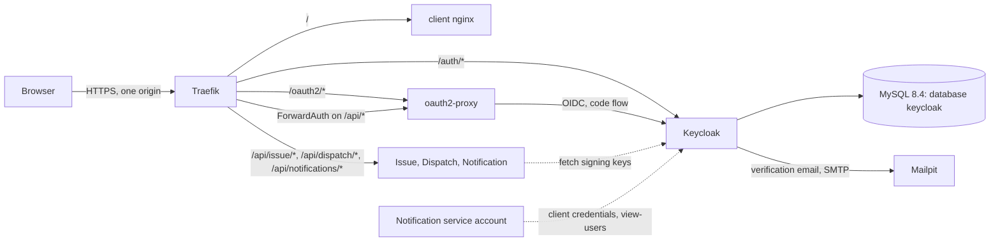

# Keycloak setup guide (design level)

**Status:** planned configuration, not executed — no Keycloak instance has been set up (EN-01-01, 2026-10-27)

**Audience:** the team members who will set up identity in the spike (Ricardo, Afonso, Martim for infrastructure). Decision and reasons: [ADR-005](../adr/ADR-005-authentication-authorisation.md). Evidence IDs (E27, E31 …) refer to the [evidence register](../adr/README.md#evidence-register-en-01-01). Anything marked **to confirm in the spike** is not in the register and must be checked against the Keycloak, oauth2-proxy or Traefik documentation before use. Placeholders such as `<KEYCLOAK_ADMIN_PASSWORD>` stand for values that come from the environment; no real secret, hostname or password belongs in this file or in Git.

## 1. Purpose and scope

The guide describes what to configure so that spike items 1 (Keycloak 26.8 on MySQL 8.4 with realm import) and 3 (Traefik ForwardAuth → oauth2-proxy returns `401` to API calls and passes the bearer token) can be run. It does not cover production hardening, token lifetimes, logout or cookie-secret rotation (EN01-U6, EN-01-04), and it does not describe how the services validate tokens beyond the points that affect Keycloak.

## 2. Components and how they connect

- Only Traefik is exposed. The browser sees one origin; `/auth/*` is Keycloak, `/oauth2/*` is oauth2-proxy.
- On `/api/*` Traefik asks oauth2-proxy (ForwardAuth). With a valid session oauth2-proxy answers with `Authorization: Bearer <access token>` and Traefik copies it to the service (E32). Without one it answers `401`.
- The services are resource servers: they fetch Keycloak's signing keys and validate issuer, audience and expiry themselves (E16). Traefik Proxy cannot validate JWTs (E35).
- The Notification service logs in to Keycloak as a service account to look up email addresses by `sub`.

## 3. MySQL 8.4 prerequisites

Keycloak is supported on MySQL 8.4 and 8.0 only; 8.0 is end of life (2026-04-30) and 9.x is unsupported (E27, E44). The platform runs `mysql:8.4`.

| Item | Setting | Evidence |
|---|---|---|
| Database | A dedicated database named `keycloak` | Brief; one database per service ([ADR-001](../adr/ADR-001-backend-boundaries.md)) |
| User | A dedicated user (`keycloak`) with all privileges on that database only; password `<KEYCLOAK_DB_PASSWORD>` from the environment | — |
| `sql_generate_invisible_primary_key` | `OFF`, set **before** the first install or any upgrade | E27 |
| `binlog_format` | Anything but `STATEMENT` | E27 |
| Character set and collation | Server defaults; any Keycloak-specific recommendation **to confirm in the spike** | — |

The MySQL instance is shared with `issue`, `dispatch` and `notification`; the two global settings above therefore apply to all databases, so set them in the MySQL configuration, not per session. Flyway behaviour of the services on the same server is spike item 2.

## 4. Container settings

| Topic | Planned setting | Status |
|---|---|---|
| Version | Keycloak 26.8 line (26.8.1 published 2026-10-13, E26); pin the exact image tag in Compose | Pin at the spike |
| Memory | Set a container memory limit. Base memory is about 1250 MB per instance and the heap defaults to 70% of the container limit, so do not also set a fixed heap (E28) | Limit value: measure in the spike |
| Database connection | Database type MySQL, URL, user and password from `<KEYCLOAK_DB_PASSWORD>` and related variables | Option names **to confirm in the spike** |
| Hostname and proxy | Public hostname `<PUBLIC_HOST>`; trust `X-Forwarded-*` headers from Traefik (`KC_PROXY_HEADERS=xforwarded`); plain HTTP on the internal network only (`KC_HTTP_ENABLED`); Keycloak served under `/auth` (`KC_HTTP_RELATIVE_PATH`) | All four option names and values **to confirm in the spike** |
| Start mode | Production-style `start --optimized` for demo and release; a development start mode only on a developer machine | **To confirm in the spike** |
| Realm import | Mount `infra/keycloak/bmc-realm.json` into `/opt/keycloak/data/import/` and start with `--import-realm` (E29) | Planned |
| Admin bootstrap | Initial admin user and password from `<KEYCLOAK_ADMIN_USER>` and `<KEYCLOAK_ADMIN_PASSWORD>`; change or remove after setup | Variable names **to confirm in the spike** |
| Health | A health endpoint for the Compose health check | **To confirm in the spike** |
| Networks | Keycloak on the `internal` network; reachable by Traefik only through `/auth/*`; the admin console is not published beyond what the spike needs | [ADR-004](../adr/ADR-004-deployment-contract.md) |

## 5. Realm `bmc` as code

- One realm named `bmc`, defined in `infra/keycloak/bmc-realm.json`, committed to Git.
- `--import-realm` skips a realm that already exists (E29): editing the file does not change a running database. In dev, change the file, drop the `keycloak` database or its volume and restart; in demo and release, make deliberate changes through a documented procedure (open, EN01-U9).
- The file contains **no secrets**. Client secrets, the admin password, SMTP settings and the database password come from the environment. Whether the import supports environment placeholders for client secrets is **to confirm in the spike**; the fallback is to set the secret after import with a script (never committed).
- Demo users are synthetic and exist only in the dev/demo profile. Because a second file for the same realm would be skipped, they cannot be a second import file of the realm `bmc`; options for the spike: a demo variant of the realm file mounted instead of the base file, or a script that creates the users after start. Decision open.
- Realm settings that matter: self-registration on, email verification on, a password reset available, login by email, SMTP to Mailpit (section 7). Exact switch names **to confirm in the spike**.

## 6. Clients and roles

| Client | Type | Grant | Redirect URIs | Purpose |
|---|---|---|---|---|
| `bmc-edge` | Confidential; secret `<BMC_EDGE_CLIENT_SECRET>` from the environment | Authorization code (PKCE with S256 **to confirm in the spike**); refresh token | `https://<PUBLIC_HOST>/oauth2/callback`; post-logout redirect `https://<PUBLIC_HOST>/` | Used by oauth2-proxy for the browser session. Needs an **audience mapper** so the access token's audience is valid for oauth2-proxy and the services (E31) |
| `notification-service` | Confidential; secret `<NOTIFICATION_CLIENT_SECRET>` from the environment | Client credentials only (service account enabled) | none | Notification looks up an email address by `sub`; the service account gets the realm-management role `view-users` and nothing else (E17) |
| Issue → Keycloak | Not planned | — | — | Created only if the invitation flow proves to need it, with minimal rights |
| Services (Issue, Dispatch, Notification) | No client | — | — | They only validate JWTs against the issuer and its signing keys (E16) |

Audience: which audience value(s) the services require (one shared API audience or one per service) is open; whichever is chosen, the `bmc-edge` audience mapper must put it into the access token, and the services must reject tokens without it.

| Realm role | Meaning | Assignment |
|---|---|---|
| `user` | Any registered person; default role. Grants no access by itself — building memberships live in Issue | Default for every new account |
| `platform_staff` | Project team members who validate contractor registrations | Assigned manually in the Keycloak admin console; how the first one is created and the audit of assignments are open (EN-01-04) |

Tokens carry `sub` (and the realm roles above); they never carry building roles. Whether the services read realm roles from the default claim or a mapper is **to confirm in the spike**.

## 7. Registration, email verification and SMTP

- Self-registration and email verification are enabled in realm `bmc`. An unverified account cannot be used for the flows below (whether Keycloak blocks login or the services check the claim is **to confirm in the spike**).
- SMTP in dev and demo goes to Mailpit (E52): host `mailpit`, port `<MAILPIT_SMTP_PORT>`, from address `<NO_REPLY_ADDRESS>`; the Mailpit web UI is where the team reads verification mail. A real SMTP account later needs credentials in the environment only; a Gmail App Password has the limits in E53.
- These Keycloak emails are separate from the platform's notifications ([ADR-007](../adr/ADR-007-notification-service.md)), which go through the Notification service.

## 8. Onboarding flows step by step

### Condominium registration (workflow 1)

| # | Where | Step |
|---|---|---|
| 1 | Browser | The visitor opens the app; the SPA loads (`/` is public) and calls `GET /api/issue/me` |
| 2 | Traefik / oauth2-proxy | No session: `401`; the SPA navigates to `/oauth2/start?rd=<path>` |
| 3 | **Keycloak** | The visitor chooses "Register", fills the form and verifies the email address (message in Mailpit in dev/demo), then logs in |
| 4 | oauth2-proxy | Callback `/oauth2/callback`, session cookie set, redirect to `<path>` |
| 5 | **Issue** | The SPA calls the registration endpoint (to define in the EN-01-01 views); Issue creates the organisation, the first building and an administrator membership for the authenticated `sub`, and a profile row keyed by `sub` |
| 6 | **Issue** | The administrator creates one invitation per fraction (workflow 2) |

### Resident invitation acceptance (workflow 2)

| # | Where | Step |
|---|---|---|
| 1 | **Issue** | The administrator creates an invitation: random single-use token, stored hashed, valid 7 days, bound to a fraction |
| 2 | Issue → Notification | `NotificationRequested` with the invitee's address and link; Notification sends the email (Mailpit in dev/demo). The link is `https://<PUBLIC_HOST>/invite#t=<token>`: the token is in the fragment, which the browser never sends to Traefik or oauth2-proxy |
| 3 | Browser | The resident opens the link; the SPA reads the token from the fragment, removes it from the address bar and keeps it in `sessionStorage` until step 6 |
| 4 | Traefik / oauth2-proxy | No session: `401`, then `/oauth2/start` with `rd=/invite`; the token is not in `rd` or in any logged path |
| 5 | **Keycloak** | The resident registers (and verifies the email) or logs in |
| 6 | **Issue** | `POST /api/issue/invitations/acceptance` with the session and the token in the JSON body; the SPA then deletes it from `sessionStorage` whatever the outcome: the token is checked (valid, unused, unexpired) and the token's `email` claim must equal the invitee address with `email_verified` true (otherwise `403`); then the membership is bound to the `sub` and the token is marked used |
| 7 | **Issue** | If the token is expired or used, the resident asks the administrator for a new one |

Proposed after review (2026-10-27): the verified email must match the invitation address, so a forwarded link cannot be accepted by another account; the administrator revokes and reissues an invitation sent to a wrong address. To confirm in the spike: the access token passed by oauth2-proxy carries `email` and `email_verified` (Keycloak's `email` client scope). EN-01-04 reviews the rule.

### Contractor registration (workflow 9)

| # | Where | Step |
|---|---|---|
| 1 | **Keycloak** | The contractor registers and verifies the email address, then logs in (same path as above) |
| 2 | **Dispatch** | `POST /api/dispatch/contractor-registrations` with company, specialties, coverage, base address, price and schedule; a `pending` registration linked to the `sub` is stored |
| 3 | **Dispatch** | A user with the realm role `platform_staff` validates the registration (endpoint to define); the contractor then enters the catalogue |
| 4 | **Dispatch** | While the registration is `pending`, the contractor is not in the catalogue and cannot be assigned a request |

**Not used:** Issue creating Keycloak users through the Admin API with an "execute actions" email. Reasons in [ADR-005](../adr/ADR-005-authentication-authorisation.md#onboarding-flows).

## 9. oauth2-proxy settings that matter

| Setting | Planned value | Status |
|---|---|---|
| Provider | `keycloak-oidc`, issuer URL of realm `bmc`, client `bmc-edge`, client secret from `<BMC_EDGE_CLIENT_SECRET>` | E31; flag names **to confirm in the spike** |
| Reverse proxy | `--reverse-proxy=true` | E32 |
| Session | Encrypted cookie session (default); Redis is the documented alternative if cookies grow too large | E31; size with Keycloak tokens **to confirm in the spike** |
| Cookie flags | `HttpOnly`, `Secure`, `SameSite=Strict`; cookie secret `<OAUTH2_PROXY_COOKIE_SECRET>` generated per environment, never committed | Planned; accepted secret length and flag names **to confirm in the spike** |
| Upstream header | `Authorization: Bearer <access token>` forwarded by Traefik through `authResponseHeaders` (`X-Auth-Request-Access-Token` is also available) | E32 |
| API routes | No-auto-redirect behaviour so unauthenticated API calls get `401`, not a redirect to the login page | E32 |
| Redirect URL | `https://<PUBLIC_HOST>/oauth2/callback`, same as the `bmc-edge` redirect URI | Planned |
| Token refresh | Whether oauth2-proxy refreshes the access token before expiry and with which lifetimes | Open (EN01-U6) |

Traefik side: a ForwardAuth middleware pointing at oauth2-proxy's auth endpoint on the `internal` network, used by the `/api/*` routers; no middleware on `/` and `/auth/*`; `/oauth2/*` routed to oauth2-proxy; RateLimit on `/auth/*` and `/oauth2/*` (E35). The CSRF request header is enforced by the services or an edge middleware (EN-01-04).

## 10. Troubleshooting and pitfalls

| Symptom | Likely cause | Check |
|---|---|---|
| Keycloak fails at start or upgrade with MySQL primary-key errors | `sql_generate_invisible_primary_key` is `ON` | Set `OFF` before install (E27) |
| Keycloak starts but refuses the database | MySQL 8.0 end of life or 9.x | Use 8.4 (E27, E44) |
| Container killed or restarts under load | No memory limit, or a limit below the base need | Set a limit; base is about 1250 MB; heap is 70% of the limit (E28) |
| Login redirects point to an internal hostname or `http://` | Hostname or proxy settings missing | Set the public hostname and proxy headers (names to confirm) |
| Services reject valid tokens with an issuer error | `iss` is the public URL, but the service was configured with the internal one | Configure the public issuer and an internal key URL; check `issuer-uri` and `jwk-set-uri` (E16) |
| oauth2-proxy rejects the token or the services reject the audience | Audience mapper missing on `bmc-edge` | Add it and decode the access token in the spike (E31) |
| API call returns a `302` to the login page | Wrong route: the no-redirect behaviour is not applied | Fix the Traefik router; expect `401` (E32) |
| Login loops or "CSRF cookie" errors after returning from Keycloak | `SameSite=Strict` or `Secure` conflicts with the redirect, or HTTP on a local host | Spike item; Keycloak is on the same origin, so the callback should be same-site (to confirm) |
| Cookie too large, session lost | Tokens exceed the cookie limit | Check cookie size; use Redis (E31) |
| Realm change in the JSON has no effect | The realm already exists, so the import is skipped (E29) | Reset the dev database or change the realm through a procedure |
| Demo users missing | A second import file for the same realm is skipped (E29) | See section 5 |
| Verification email does not arrive | SMTP host, port or from address wrong | Read Mailpit's UI and Keycloak's SMTP test |
| Notification cannot look up an address | Service account lacks `view-users` or the secret differs | Check the `notification-service` client and its role |

## 11. What the spike must confirm

1. Keycloak 26.8 starts on MySQL 8.4 with the two MySQL settings and imports `bmc-realm.json` (spike item 1); the option names marked "to confirm" above.
2. Traefik ForwardAuth → oauth2-proxy returns `401` to an API call without a session and forwards the bearer token with a session (spike item 3); the SPA can then navigate to `/oauth2/start` and return.
3. The access token's issuer, audience and roles as the services need them; a service validates it locally.
4. Cookie size and `SameSite=Strict` through the login redirects; if they fail, record option B in [ADR-005](../adr/ADR-005-authentication-authorisation.md) as adopted.
5. How secrets enter the realm without being in Git, and how demo users are created.
6. The Notification service account can read an email address by `sub` with `view-users` only.
7. The measured memory of Keycloak in the full Compose stack (spike item 8, EN01-U3).

Related: [ADR-005](../adr/ADR-005-authentication-authorisation.md), [ADR-007](../adr/ADR-007-notification-service.md), [ADR-004](../adr/ADR-004-deployment-contract.md), [technical design](../07-technical-design.md), [security](../09-security-privacy.md#2-proposed-access-matrix), [workflows](../workflows/bmc-workflows.md).
