# BMC — Proposed workflows (with diagrams)

Status: proposal · DISC-03-06 · validation pending
Language: English. The Portuguese version is not written yet.

## Ground rules

- The AI suggests a category and urgency for a report. The rules that filter and rank contractors are deterministic system rules, not AI. The system proposes a contractor and a date, but nothing is sent to a contractor without the administrator's approval.
- The resident only reports, follows progress, confirms "this affects me too" and requests a cancellation. Residents do not approve bookings.
- Issue status: **reported → triaged → approved → accepted → scheduling pending → booked → completed (awaiting validation) → closed**. Detours: booking cancelled (the issue goes back to "to be scheduled") and reopened.
- Each workflow starts with its trigger, actors, records and outcome. Items in "Proposed decisions" at the end are not validated yet.

## 1. Condominium registration

> **Trigger:** a new user registers a condominium. **Actors:** the user (becomes administrator), system. **Records:** organisation, first building, condominium space, one e-invite per fraction. **Outcome:** the administrator can invite every resident.

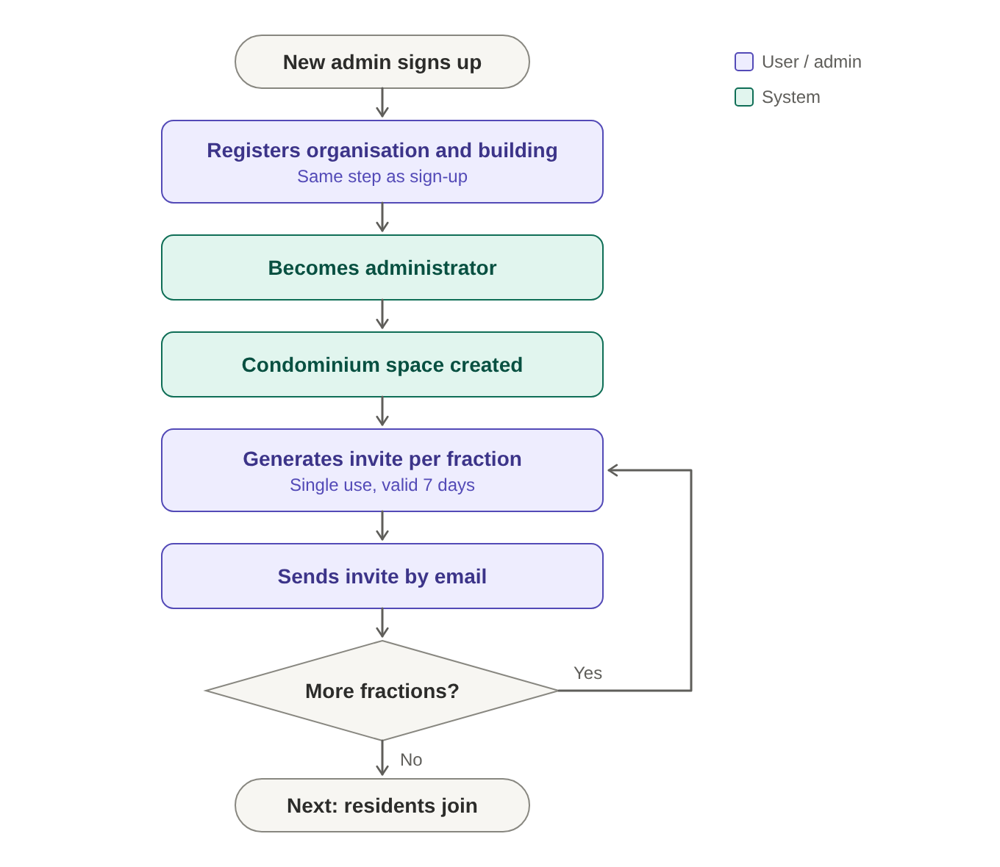

1. The user creates an account and registers the organisation and the first building in the same step.
2. They become the administrator of that organisation.
3. The system creates the condominium space.
4. For each fraction (apartment unit), the administrator generates an **e-invite** (single use, valid for 7 days) and emails it to the resident.

## 2. Resident joins by e-invite

> **Trigger:** a resident opens an e-invite link. **Actors:** resident, system. **Precondition:** the invite is valid and unused. **Records:** resident account, link to building and fraction, invite marked as used. **Outcome:** the resident is linked to their fraction.

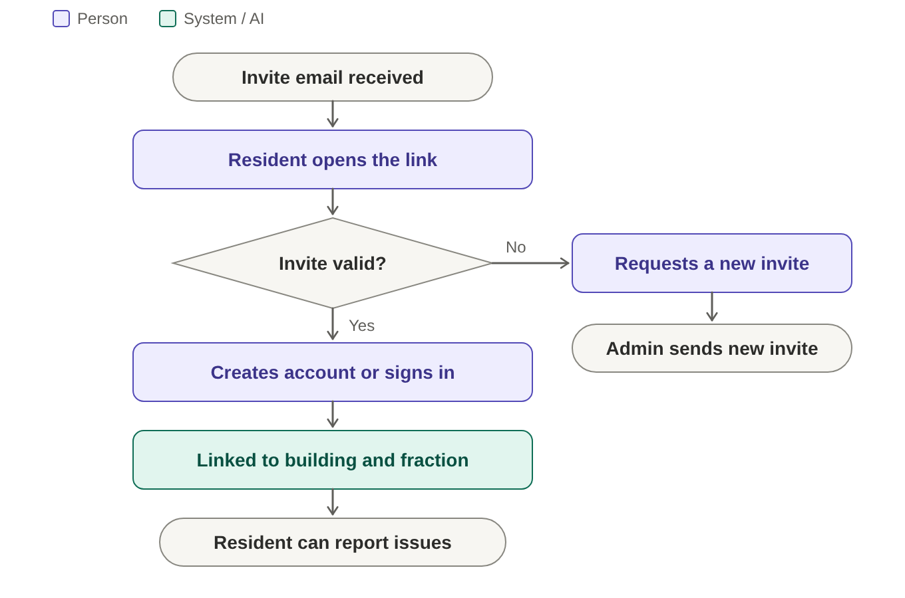

1. The resident opens the e-invite link and creates an account (or signs in, if they already have one).
2. They are linked automatically to the building and the fraction on the invite, with no approval step.
3. If the invite has expired or was already used, they ask the administrator for a new one.

## 3. Report an issue

> **Trigger:** a resident reports a problem. **Actors:** resident, system. **Records:** the report and its reference number. **Outcome:** the report is saved and the analysis starts.

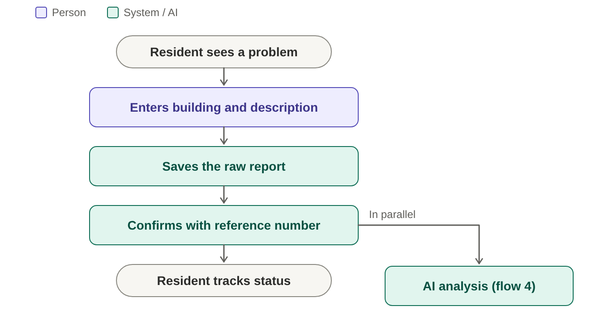

1. The resident enters the building and the zone and describes the problem in text.
2. The system saves the report and immediately returns a **confirmation with a reference number**.
3. The report goes on to the analysis (workflow 4), without the resident having to wait.

If the analysis fails, the report is still saved. The resident follows the status through the reference number.

## 4. Analysis and proposal (automatic)

> **Trigger:** a report is saved. **Actors:** system (AI for the suggestion; rules for filtering and ranking). **Records:** unverified suggestion and proposal. **Outcome:** the administrator has a proposal to review, or the issue waits for manual coordination.

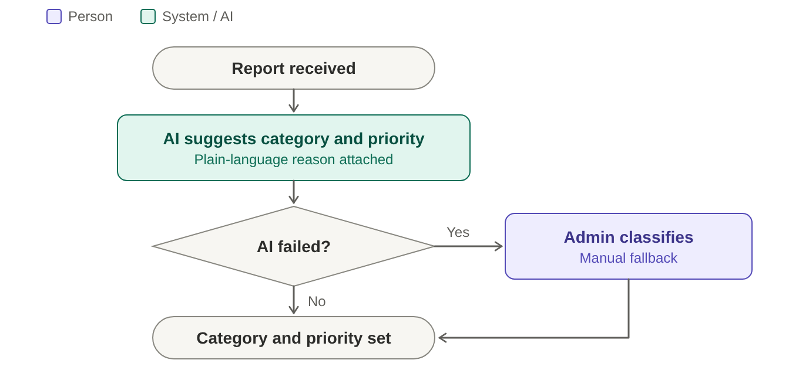

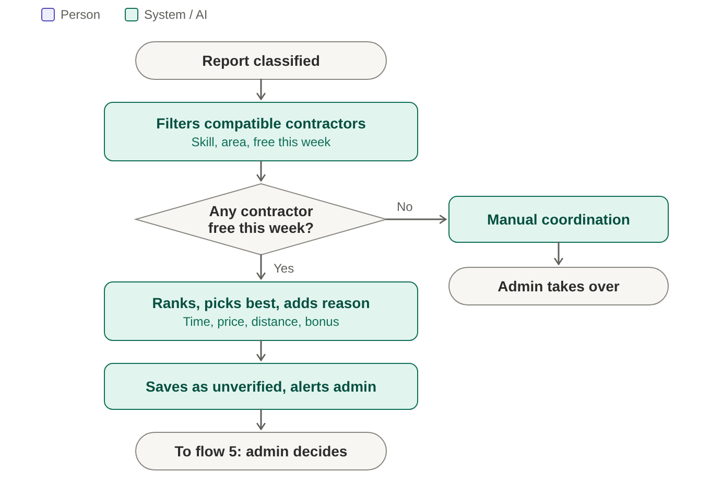

1. Receives the report (text, building and zone).
2. The AI suggests the category and the **urgency** (low, medium or high), with a plain-language reason. This is the only AI step in this workflow.
3. If the AI fails, the report goes to the administrator as "classify by hand".
4. The system filters the compatible contractors: specialty matches the category, coverage area includes the building, and at least one free slot **this week**. Availability comes from the schedule the contractor set at registration (workflow 9), minus the bookings already accepted.
5. The system ranks the remaining ones by availability, **price**, straight-line **distance** and, as a bonus, already having another booking in the same building that day. It picks the best option and builds the **proposal** with the reason, for example "free Thursday at 10:00, 4 km, €60 per visit".
6. Saves everything as an **unverified suggestion** and notifies the administrator. If nobody is free this week, the issue is marked "awaiting manual coordination".

High-urgency issues are notified first.

## 5. Administrator approval

> **Trigger:** a proposal is ready. **Actors:** administrator. **Records:** triage decision (category and urgency, with reason if corrected), approval of one version, any change with author and reason. **Outcome:** an approved version goes to the contractor, or the request is refused and goes back to a new version.

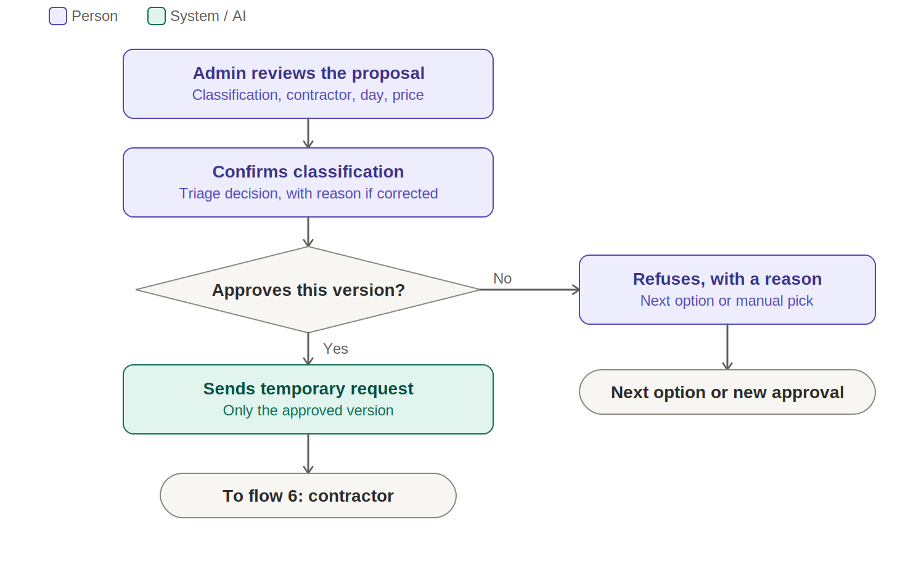

1. The administrator receives the notification with the full proposal: classification, contractor, day, time, price, distance and reason.
2. **Confirms the classification** (triage decision). The category and urgency are confirmed or corrected, with the reason recorded. This is a separate step from approval.
3. **Approves** one version (contractor, day, time, price). The request goes to the contractor as a **temporary** request. Approval covers that version only.
4. **Refuses**, with a reason: the system offers the next option (workflow 4), or the administrator picks a contractor by hand. Either one is a new version and needs approval again (step 3).

Nothing goes to the contractor without the administrator's approval.

## 6. Contractor response

> **Trigger:** the contractor receives an approved request. **Actors:** contractor, administrator, system. **Records:** acceptance, counterproposal (new version), booking state and external reference. **Outcome:** the booking is confirmed, or it stays scheduling pending with the administrator alerted.

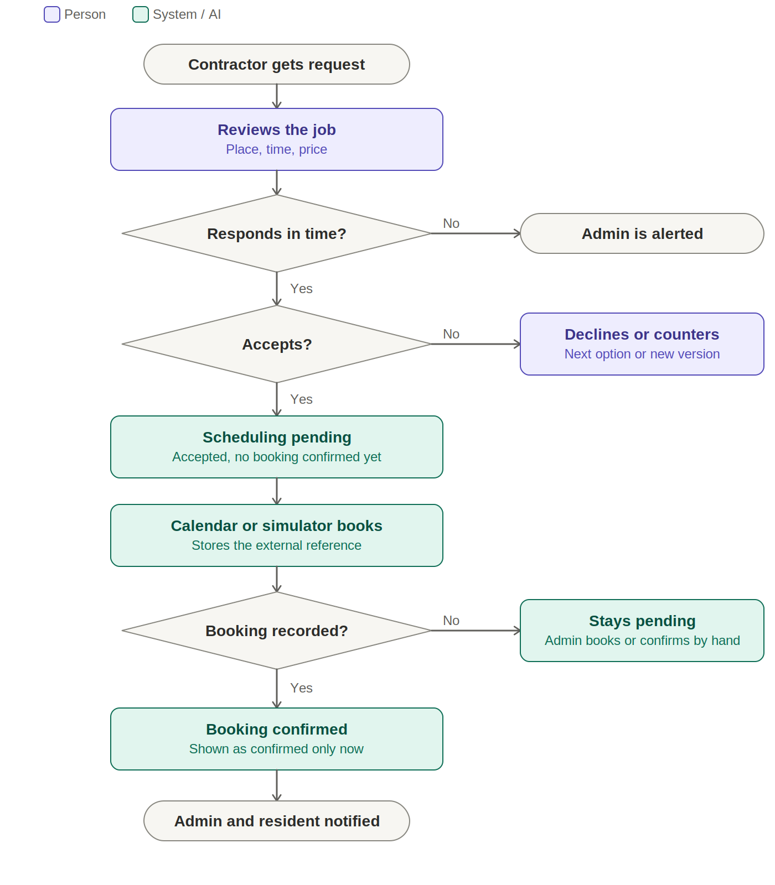

1. The contractor receives the request: problem, location, day, time and price. They never see the resident's original text.
2. **Accepts:** the booking goes to **scheduling pending**. It is not confirmed yet. The administrator is notified.
3. **Counterproposes:** a new version (other day, time or price) goes back to the administrator for approval (workflow 5, step 3).
4. **Declines:** the system offers the next option to the administrator (workflow 4).
5. If the contractor does not respond within the set deadline, the administrator is alerted.
6. **Booking confirmation:** the calendar or simulator stores the external reference, and the booking becomes **confirmed**. If the calendar does not respond, the response is invalid, or the call times out, the booking stays **scheduling pending** and the administrator is alerted. The administrator can confirm it by hand, recording the date and the source; a manual confirmation is never shown as synchronised. A retry does not create a second booking.

"Confirmed" is only shown to the resident when the booking is really confirmed.

## 7. Cancel a booking

> **Trigger:** a booking must be cancelled. **Actors:** administrator (decides and cancels), contractor and resident (can only ask). **Precondition:** the booking exists. **Records:** reason, cancellation history, exception flag when applicable. **Outcome:** the booking is removed from the calendar and the issue goes back to "to be scheduled".

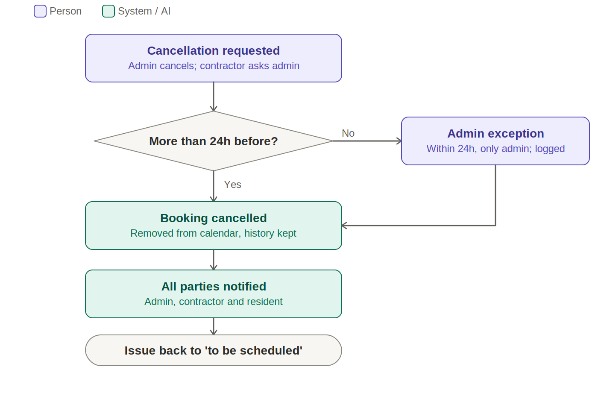

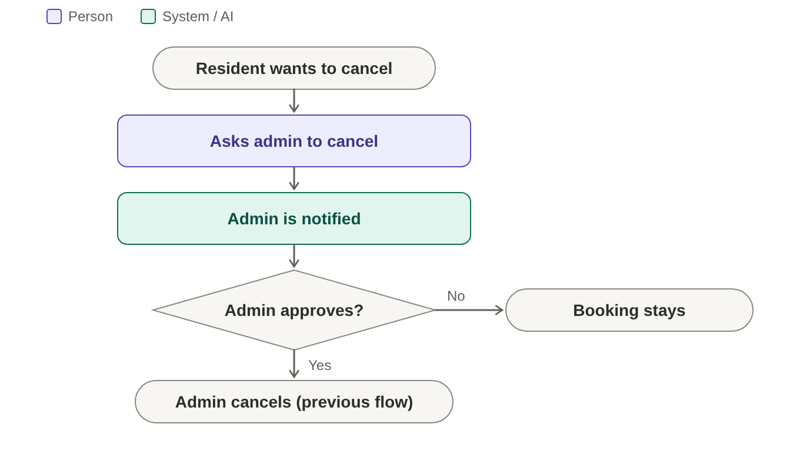

There is no "change": to move a date, cancel and create a new booking through workflows 4 and 5.

1. The administrator cancels the booking **up to 24h before**, with a mandatory reason. A contractor cannot cancel a booking; they ask the administrator, who decides.
2. The resident can **request** the cancellation, and the administrator decides.
3. The booking is removed from the calendar, but the history is kept.
4. All parties are notified and the issue goes back to "to be scheduled".
5. Within 24h, only the administrator can cancel, and it is recorded as an exception.

## 8. Execution and closure

> **Trigger:** the booked date arrives. **Actors:** contractor, administrator. **Records:** status changes, optional cost (not shown to residents), validation and closure reason. **Outcome:** the issue is closed, or it goes back to the same contractor for rework.

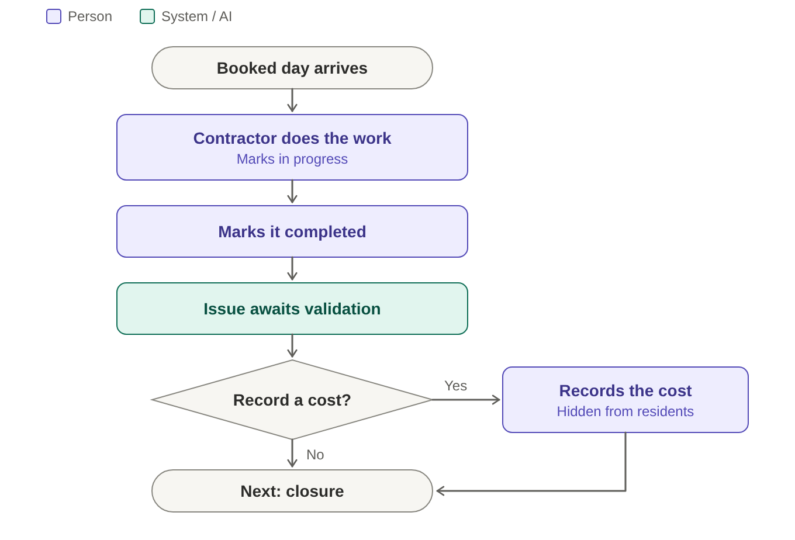

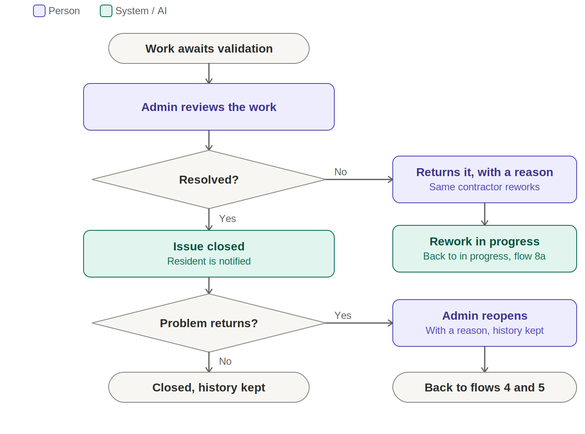

1. On the booked date, the contractor does the work and marks it "in progress", and then "completed". The issue becomes "awaiting validation".
2. Optional: the contractor or the administrator records the cost. Residents do not see it.
3. The administrator validates and **closes** the issue. The resident is notified.
4. If it is not resolved, the administrator returns it to the **same contractor** with a reason (rework). The issue goes back to "in progress".
5. A closed issue can be **reopened** by the administrator, with a reason. Everything stays in the history.

## 9. Contractor registration

> **Trigger:** a contractor signs up. **Actors:** contractor, team (validation). **Records:** company, specialties, coverage area, base address, price, weekly availability. **Outcome:** a validated contractor is in the catalogue and can receive requests.

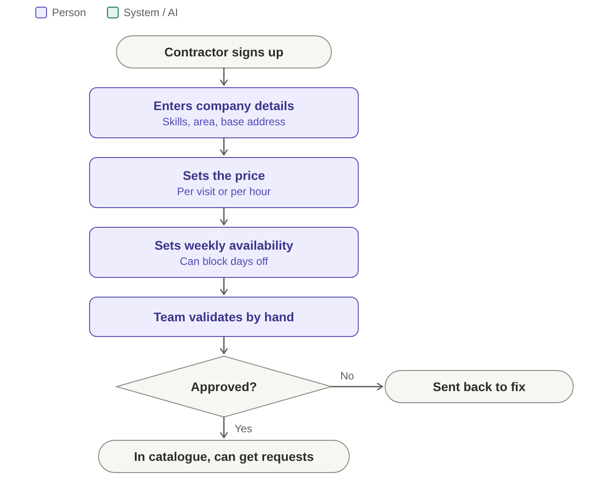

1. The contractor creates an account and enters the company, the specialties, the coverage area and the base address (used to calculate distance).
2. Sets the price: **per visit** or **per hour**, their choice.
3. Sets the **usual weekly schedule** (for example, Monday to Friday, mornings and afternoons) and can block specific days (holidays, another job). Each accepted booking takes up a slot.
4. The team validates the registration by hand.
5. Once validated, the contractor enters the catalogue and can receive requests.

In the workflow 4 ranking, the price appears as entered (€/visit or €/h), with no conversion.

## 10. "This affects me too"

> **Trigger:** several residents are affected by the same problem. **Actors:** administrator, residents. **Records:** shared summary, impact confirmations, links between reports (originals kept). **Outcome:** the administrator sees how many residents are affected when setting priority.

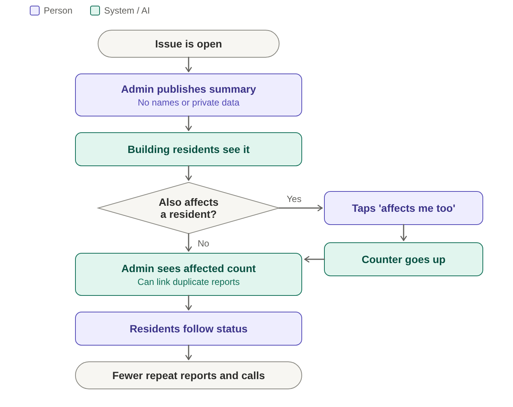

1. The administrator publishes a **shared summary** of the problem for the building, without identifying who reported it or any private data.
2. The other residents see it and tap "this affects me too" instead of reporting again.
3. The administrator sees how many residents are affected, which helps decide the priority. They can link reports of the same problem, keeping the originals.
4. Residents follow the status of the issue in the same summary, without seeing costs or the contractor's terms.

## Notification table

| Event | Who is notified |
|---|---|
| Invite sent | Resident |
| Report received | Resident (confirmation with reference number) |
| Proposal ready | Administrator |
| Request sent | Contractor |
| Contractor accepts (scheduling pending) | Administrator |
| Contractor counterproposes | Administrator |
| Booking not recorded | Administrator |
| Booking confirmed | Administrator and resident |
| Booking cancelled | Administrator, contractor and resident |
| Summary published | Residents of the building |
| Work completed | Administrator |
| Issue closed or reopened | Resident |

Notification channel: one channel in the MVP, **in-app**, as proposed in DEC-06 (not validated yet). The resident can turn notifications off. The e-invite in workflow 1 is sent by email, which is an exception to the in-app channel; see Proposed decisions. Update 2026-10-27: EN-01-01 proposes in-app plus email (captured by Mailpit in development and demo) for DEC-06 in [ADR-007](../adr/ADR-007-notification-service.md); opt-out would apply to email only, while in-app notifications stay as the status record. This is a proposal pending team review, not a validated change to this workflow.

## Proposed decisions

Nothing in this list is validated or recorded as a decision yet. Each item needs its owning DEC entry, or a new proposed DEC in [decisions-and-feedback](../planning/decisions-and-feedback.md), before it is treated as scope. Items marked "to map" have no user story yet.

| Proposal in this document | Owning decision / baseline | Affected RF / US | Status |
|---|---|---|---|
| The AI suggests; the system proposes a contractor and a date; the administrator approves | DEC-10 (approval); vision §4.1 and US-06 describe rules | US-06, US-07 | Conflicts with the baseline wording; needs DEC entry or baseline change |
| Triage confirmation as its own step | DEC-10 | US-02, US-03 | Agreed in DEC-10; wording updated |
| Counterproposal creates a new version that needs approval | DEC-10; US-07 | US-07 | Agreed in DEC-10 |
| Booking stays "scheduling pending" until confirmed; failures stay visible | DEC-10; US-08 | US-08 | Agreed in DEC-10 |
| Contractor cannot cancel; they ask the administrator | Technical design review (#44) | to map | Needs DEC entry |
| Rework goes back to the same contractor | Technical design review (#44) | US-09 (to map) | Needs DEC entry |
| E-invites (single use, valid 7 days, per fraction) | New | to map | Needs DEC entry |
| E-invite sent by email (exception to in-app notifications) | DEC-06, DEC-07 | to map | Needs DEC-06/07 review |
| 24h cancellation window; within 24h only the administrator | New | to map | Needs DEC entry |
| Scheduling covers the current week only | New | US-06 (to confirm) | Needs DEC entry |
| Contractor self-registration, validated by the team | New | to map | Needs DEC entry |
| Contractor price per visit or per hour | New | to map | Needs DEC entry |
| Resident can request a cancellation; the administrator decides | New | to map | Needs DEC entry |
| "Urgency" is the only priority term (low, medium, high) | Vision and backlog terminology | US-02 | Terminology aligned |
| Emergencies (gas, fire) stay outside the app | New | to map | Needs DEC entry |
| Resident management (revoking invites, moving out, several administrators) left after the MVP | Scope (DEC-01 style exclusion) | to map | Needs DEC entry |
</content>
